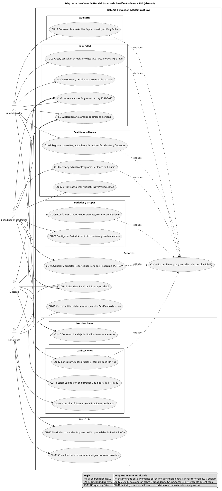
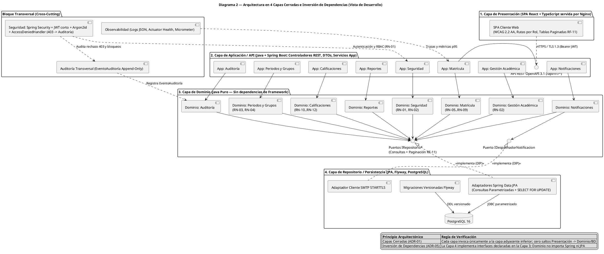
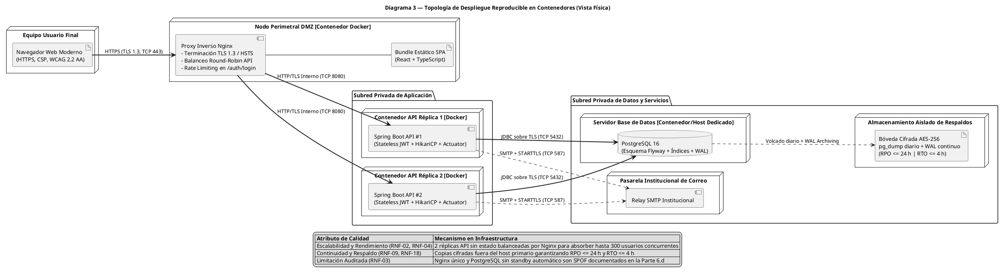
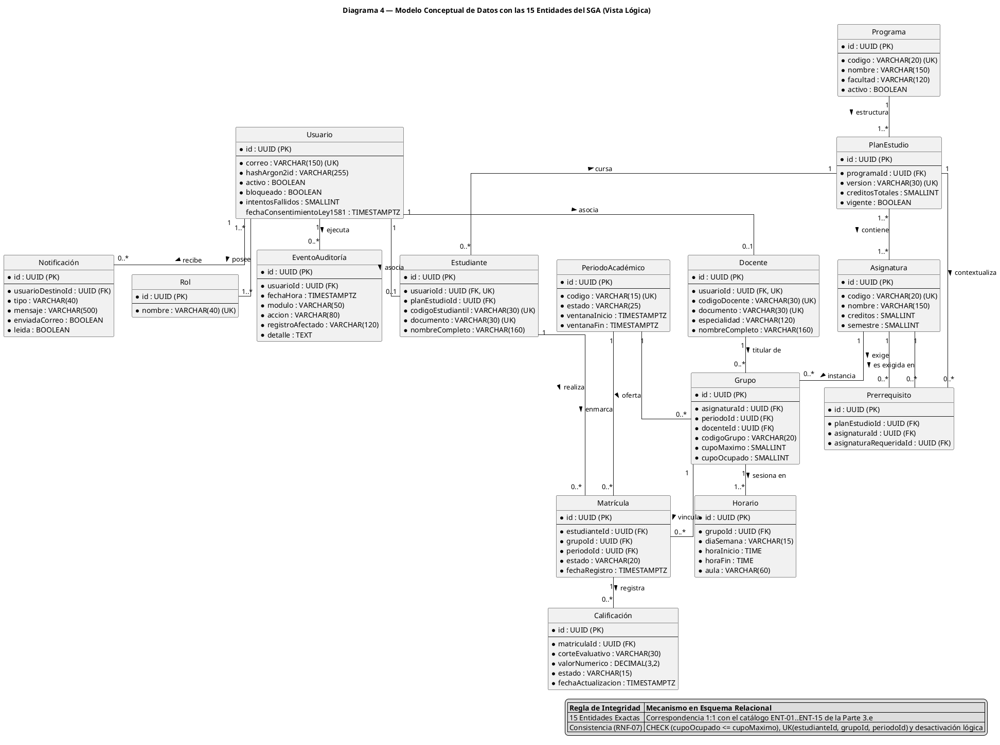
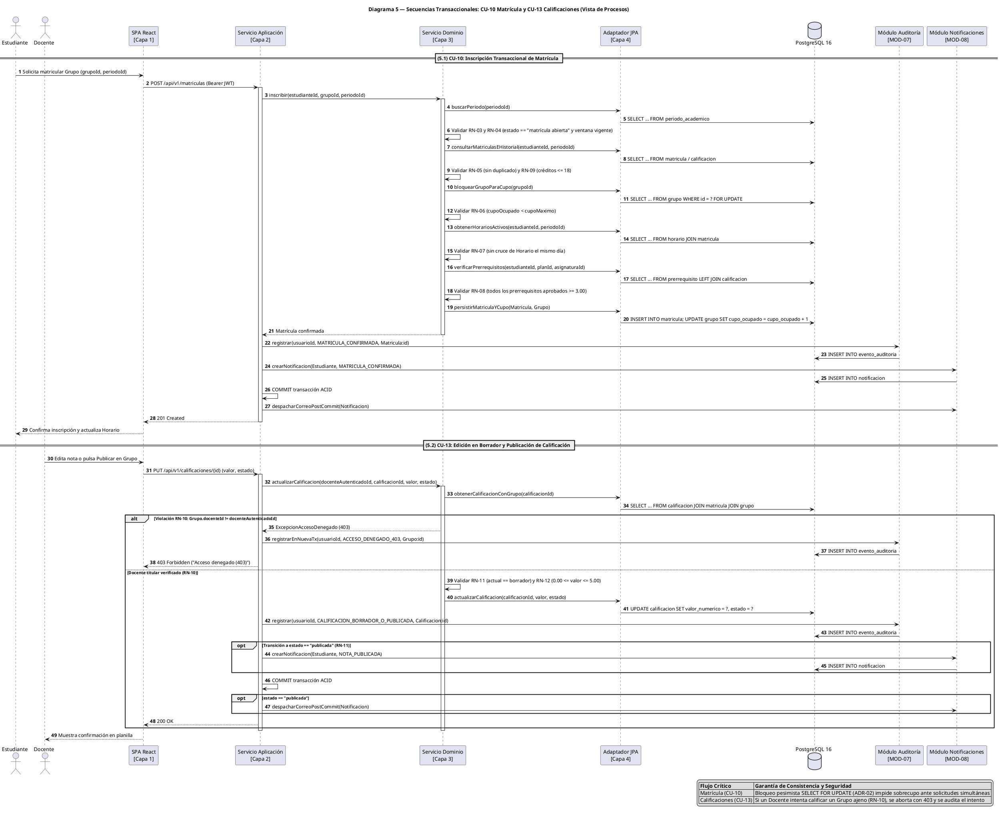

# INVENTARIO TÉCNICO Y AUDITORÍA ARQUITECTÓNICA VERIFICABLE — SISTEMA DE GESTIÓN ACADÉMICA (SGA / SIGA)

> **Propósito del documento:** Este inventario documenta de forma completa, verificable y sin abreviaciones lo que realmente existe en la arquitectura propuesta, en los cinco diagramas PlantUML (modelo 4+1 de Kruchten) y en el prototipo funcional entregados para el Sistema de Gestión Académica (SGA, rotulado en interfaz como `SIGA · PROTOTIPO`). Se redacta bajo reglas estrictas de auditoría técnica para que un tercero pueda elaborar el informe definitivo sin tener acceso al historial de conversación.

---

# PARTE 1. COBERTURA DE REQUISITOS

## 1.1. Contexto Oficial del Sistema
Una institución de educación superior requiere un Sistema de Gestión Académica (SGA) que centralice la información de estudiantes, docentes, programas académicos, asignaturas, grupos, matrículas, calificaciones y horarios. Hoy parte de la información está en archivos y aplicaciones independientes, lo que genera duplicidad de datos, demoras en la consulta y dificultades para mantener la trazabilidad. Se requiere una solución segura, mantenible, escalable y accesible desde navegadores web.

## 1.2. Tabla Completa de Cobertura de los 39 Requisitos (`RF-01..RF-20` y `RNF-01..RNF-19`)

> **Nota sobre la columna «¿En el prototipo?»:** En el proyecto coexisten dos artefactos de interfaz: (1) el **archivo HTML autónomo único** (`/public/prototipo-siga.html`, entregado en la Parte 2.j) y (2) la **SPA React + TypeScript** (`/src/*`). La evaluación de la última columna describe de forma estricta y prioritaria lo que ocurre en el **prototipo HTML autónomo único**, señalando explícitamente entre paréntesis cualquier diferencia con la SPA React cuando existe. Toda persistencia en ambos artefactos es en memoria RAM del navegador (sin backend Java ni PostgreSQL real en ejecución).

| ID | Texto real del requisito | ¿Cubierto en la arquitectura? | Módulo(s) y capa(s) | ¿En el prototipo? |
| :--- | :--- | :--- | :--- | :--- |
| **RF-01** | Autenticación: los usuarios inician y cierran sesión con credenciales individuales. | Sí | `Seguridad` — Capas 1 (Presentación), 2 (Aplicación/API), 3 (Dominio), 4 (Persistencia) y Bloque Transversal (`Spring Security`). | **Simulado** (valida correo individual, estado activo/bloqueo y clave de demostración en memoria; permite iniciar y cerrar sesión, sin criptografía ni servidor real). |
| **RF-02** | Roles y permisos: mínimo administrador, coordinador académico, docente y estudiante; restringir funciones según permisos. | Sí | `Seguridad`, `Auditoría` — Capas 1, 2, 3 y Bloque Transversal (RBAC + `AccessDeniedHandler`). | **Implementado** (en cliente: los 4 roles tienen menús exclusivos derivados de la cuenta autenticada, sin selector de cambio de rol; navegar a una ruta no permitida muestra `"Acceso denegado (403)"` y registra el intento en `Auditoría`). |
| **RF-03** | Gestión de estudiantes: registrar, consultar, actualizar y desactivar. | Sí | `Seguridad` y `Gestión Académica` — Capas 1, 2, 3 y 4. | **Implementado** (en memoria: el `Administrador` crea, consulta, edita y desactiva/activa cuentas con rol `Estudiante`; en el HTML único no incluye selector de programa al crear estudiante, mientras que en la SPA React sí lo incluye). |
| **RF-04** | Gestión de docentes: registrar, consultar, actualizar y desactivar. | Sí | `Seguridad` y `Gestión Académica` — Capas 1, 2, 3 y 4. | **Implementado** (en memoria: el `Administrador` crea, consulta, edita y desactiva/activa cuentas con rol `Docente`; en el HTML único no pide el campo `especialidad` en el formulario, mientras que en la SPA React sí lo exige). |
| **RF-05** | Programas y asignaturas: crear y actualizar programas, planes de estudio y asignaturas (código, nombre, créditos, semestre o nivel). | Sí | `Gestión Académica` — Capas 1, 2, 3 y 4. | **Implementado** (el `Coordinador académico` crea y edita programas, planes de estudio y asignaturas con código, nombre, créditos y semestre; en el HTML único las asignaturas nuevas se asocian por defecto a `plan-is-2024` y no tienen campo de prerrequisitos en el formulario, mientras que en la SPA React sí se eligen plan y prerrequisitos). |
| **RF-06** | Grupos y periodos: configurar periodos, grupos, cupos, docentes asignados, horarios y aulas o enlaces de encuentro. | Parcial | `Periodos y Grupos` — Capas 1, 2, 3 y 4. | **Simulado** (implementado parcialmente: permite crear periodos, cambiar su estado y crear grupos con cupo, docente, día/hora y aula en texto libre donde cabe escribir un enlace, pero **NO EXISTE** edición de un grupo o periodo ya creado ni campo dedicado/validado para enlace virtual). |
| **RF-07** | Matrícula académica: matricular estudiantes en asignaturas o grupos de un periodo, validar cupos y evitar duplicados. | Sí | `Matrícula`, `Periodos y Grupos`, `Auditoría` — Capas 1, 2, 3 y 4. | **Implementado** (en memoria para el estudiante de demostración: inscribe y retira grupos validando cupo disponible y ausencia de asignatura duplicada en el periodo; véase limitación multi-estudiante en Parte 2.i). |
| **RF-08** | Registro de calificaciones: el docente registra y actualiza calificaciones de los estudiantes matriculados en sus grupos. | Sí | `Calificaciones`, `Auditoría` — Capas 1, 2, 3 y 4. | **Implementado** (el `Docente` solo ve sus propios grupos titulares, edita `Corte 1`, `Corte 2` y `Examen` de estudiantes en estado `borrador`, recalcula la definitiva y publica). |
| **RF-09** | Consulta de resultados: el estudiante consulta asignaturas matriculadas, horarios y calificaciones publicadas. | Sí | `Matrícula`, `Calificaciones`, `Reportes` — Capas 1, 2, 3 y 4. | **Implementado** (el `Estudiante` consulta sus grupos inscritos, su horario y únicamente las calificaciones en estado `publicada`, ocultando las que están en `borrador`). |
| **RF-10** | Reportes: reportes básicos de matriculados, grupos, asignaturas y resultados, con filtros por periodo y programa. | Parcial | `Reportes` — Capas 1, 2, 3 y 4. | **Simulado** (existe una única tabla consolidada de resultados de calificaciones/matrículas filtrable por `Periodo` y `Programa`, pero **NO EXISTEN** reportes separados para listar grupos sin matriculados ni catálogo independiente de asignaturas dentro del módulo `Reportes`). |
| **RF-11** | Búsqueda y filtros: buscar y filtrar por identificadores, nombres, programa, periodo o estado. | Sí | Todos los módulos — Capa 1 (Presentación) y Capas 2–4 (consultas paginadas). | **Implementado** (todas las tablas tienen búsqueda por texto y paginación, más selectores de filtro específicos por vista: rol, estado, semestre, periodo, programa o acción/fecha según la pantalla). |
| **RF-12** | Auditoría: registrar inicios de sesión, cambios de roles, matrículas y modificaciones de calificaciones (usuario, fecha, acción, registro afectado). | Sí | `Auditoría` — Bloque Transversal y Capas 1, 2, 3 y 4. | **Implementado** (en memoria: registra login, logout, creación/edición de usuario, cambio de rol, bloqueo, matrícula confirmada/rechazada/cancelada, nota en borrador/publicada, exportaciones e intentos `403`, con usuario, fecha, acción y registro afectado). |
| **RF-13** | Recuperación/cambio de contraseña y bloqueo de usuarios. | Sí | `Seguridad`, `Notificaciones`, `Auditoría` — Capas 1, 2, 3, 4 y Bloque Transversal. | **Simulado** (bloquea automáticamente al 5.º intento fallido y permite al `Administrador` bloquear/desbloquear; la recuperación de clave solo muestra un aviso simulado sin enviar correo real, y el cambio de contraseña valida longitud $\ge 8$ y audita el evento pero **no muta** la clave fija de prueba en memoria). |
| **RF-14** | Estados del periodo (planeado, matrícula abierta, en curso, cerrado) y ventana de matrícula. | Sí | `Periodos y Grupos`, `Matrícula` — Capas 1, 2, 3 y 4. | **Implementado** (el `Coordinador académico` cambia el estado entre los 4 valores exactos y la matrícula se rechaza si el estado no es `matrícula abierta`; la validación de fechas de ventana se ejecuta en la SPA React, pero **NO EXISTE** comprobación de fechas de ventana en el HTML único). |
| **RF-15** | Validación de cruces de horario y prerrequisitos en la matrícula. | Sí | `Matrícula`, `Periodos y Grupos`, `Gestión Académica` — Capa 3 (Dominio puro) e invocación desde Capas 1 y 2. | **Implementado** (verifica solapamiento horario en el mismo día y aprobación previa de códigos prerrequisito antes de inscribir, mostrando mensajes específicos de rechazo). |
| **RF-16** | Calificaciones en estado borrador o publicada. | Sí | `Calificaciones` — Capas 1, 2, 3 y 4. | **Implementado** (las notas en `borrador` tienen campos numéricos editables y botones `Borrador`/`Publicar`; al pasar a `publicada` quedan bloqueadas para edición y se vuelven visibles para el estudiante). |
| **RF-17** | Notificaciones (matrícula confirmada, nota publicada). | Sí | `Notificaciones`, `Matrícula`, `Calificaciones` — Capas 1, 2, 3 y 4 (Adaptador SMTP). | **Simulado** (inserta notificaciones internas visibles en la bandeja del panel al confirmar matrícula o publicar nota; **NO EXISTE** envío de correo SMTP real). |
| **RF-18** | Exportación de reportes a PDF y CSV. | Sí | `Reportes` — Capas 1 y 2. | **Implementado** (en navegador: genera y descarga archivo `.csv` real con BOM UTF-8 respetando los filtros activos, e invoca `window.print()` con hoja de estilos `@media print` para guardar como PDF). |
| **RF-19** | Historial académico y certificado de notas. | Sí | `Reportes`, `Calificaciones`, `Gestión Académica` — Capas 1, 2, 3 y 4. | **Implementado** (vista de solo lectura para `Estudiante` que consolida asignaturas aprobadas previas más notas publicadas y permite emitir PDF; la SPA React calcula además el PGA ponderado y descarga CSV del certificado). |
| **RF-20** | Panel de inicio según el rol. | Sí | `Seguridad`, `Reportes` — Capa 1 (Presentación) y Capa 2 (API). | **Implementado** (pantalla `#/panel` con menú superior exclusivo según el rol autenticado; la SPA React añade tarjetas KPI diferenciadas por cada uno de los 4 roles). |
| **RNF-01** | Seguridad: HTTPS; contraseñas no en texto plano; acceso por roles. | Sí | `Seguridad` — Proxy Nginx (TLS 1.3), Bloque Transversal (`Spring Security`, `Argon2id`, RBAC). | **Simulado** (el control de acceso por roles en interfaz está implementado, pero en el prototipo front-end **NO EXISTE** hash `Argon2id` ni validación criptográfica en servidor; la clave de prueba se compara en memoria cliente). |
| **RNF-02** | Rendimiento: 95 % de consultas comunes en máximo 3 s con hasta 300 usuarios concurrentes. | Sí | Todos los módulos — Nginx, 2 réplicas API `Spring Boot`, `HikariCP`, índices B-Tree en `PostgreSQL`. | **NO EXISTE** (el prototipo es un cliente local en navegador con ~30 registros en memoria; no existe servidor ni prueba de concurrencia para 300 usuarios). |
| **RNF-03** | Disponibilidad: objetivo mensual de al menos 99,5 %, excluyendo mantenimientos programados. | Parcial | Infraestructura de Despliegue — Nginx + 2 réplicas API + `PostgreSQL`. | **NO EXISTE** (no aplica a un archivo HTML estático local). |
| **RNF-04** | Escalabilidad: aumentar recursos de cómputo y crecer en usuarios, periodos, cursos y registros sin rediseñar todo. | Sí | Capas 2 y 4 — API *stateless* con JWT balanceada horizontalmente y paginación/índices en BD. | **NO EXISTE** (prototipo en memoria local sin base de datos ni balanceador). |
| **RNF-05** | Mantenibilidad: separar responsabilidades; facilitar pruebas y evolución; bajo acoplamiento y cohesión adecuada. | Sí | Las 4 capas cerradas (`Presentación`, `Aplicación/API`, `Dominio`, `Persistencia`) con inversión de dependencias (DIP). | **Simulado** (en la SPA React la lógica pura está desacoplada en `src/domain/academicRules.ts` con pruebas unitarias; en cambio, el archivo `prototipo-siga.html` concentra estilos, vista y estado en un único archivo por restricción explícita del entregable). |
| **RNF-06** | Usabilidad y accesibilidad: interfaz consistente, adaptable a computador y móvil, etiquetas claras, contraste suficiente y operación por teclado. | Sí | Capa 1 (`Presentación` — WCAG 2.2 AA). | **Implementado** (alto contraste `#1E1B4B` sobre `#EEF2FF`/`#FFFFFF`, `:focus-visible` de `3px`, etiquetas semánticas, `aria-live="polite"`, tablas desplazables y navegación por teclado). |
| **RNF-07** | Integridad y consistencia: matrícula y calificaciones validan reglas y preservan consistencia ante errores o solicitudes simultáneas. | Sí | `Matrícula`, `Calificaciones` — Capa 2 (`@Transactional`), Capa 3 (reglas) y Capa 4 (`SELECT ... FOR UPDATE`, FKs/UNIQUE). | **Simulado** (valida reglas de negocio de forma síncrona en un único hilo del navegador; **NO EXISTE** transacción ACID ni bloqueo concurrente multi-sesión). |
| **RNF-08** | Interoperabilidad: interfaces documentadas, preferiblemente API REST. | Sí | Capa 2 (`Aplicación/API` — Controladores REST JSON bajo `/api/v1/*`). | **NO EXISTE** (el prototipo no expone ni consume endpoints HTTP REST; opera sobre arreglos en memoria JavaScript). |
| **RNF-09** | Respaldo y recuperación: copias periódicas y procedimiento de restauración; explicar cómo se protegen los datos. | Sí | Capa 4 e Infraestructura (`pg_dump` diario + WAL continuo cifrado AES-256). | **NO EXISTE** (al recargar la pestaña del navegador se pierden los cambios en memoria). |
| **RNF-10** | Trazabilidad: relacionar decisiones y requisitos con componentes, interfaces, modelos y evidencias de validación. | Sí | Documentación Arquitectónica 4+1 y Matriz de Trazabilidad. | **Implementado** (en la SPA React existe la vista interactiva `Arquitectura 4+1` con matriz filtrable; en el HTML autónomo no se incluye el visor documental). |
| **RNF-11** | Privacidad: limitar el acceso a datos personales y académicos según el rol. | Sí | `Seguridad`, `Calificaciones`, `Matrícula` — Capas 1, 2 y 3 (RBAC + filtro por propietario). | **Implementado** (cada rol solo accede a sus vistas; el `Docente` solo ve alumnos de sus propios grupos y el `Estudiante` no ve calificaciones en borrador ni datos de terceros). |
| **RNF-12** | Compatibilidad: funcionar en versiones recientes de navegadores comunes y adaptarse a distintos tamaños de pantalla. | Sí | Capa 1 (`Presentación` — HTML5/CSS Grid/Flexbox/ES2022 estándar). | **Implementado** (probado en Chromium headless `1440x900` y `390x844` con diseño fluido sin dependencias propietarias). |
| **RNF-13** | Seguridad de aplicación (consultas parametrizadas, validación, CSRF/XSS, tokens con expiración, bloqueo por intentos). | Sí | Bloque Transversal `Seguridad`, Capa 2 (Bean Validation), Capa 4 (JPA parametrizado), Nginx (CSP). | **Simulado** (implementa validaciones de formulario y bloqueo al 5.º intento fallido; **NO EXISTEN** consultas SQL parametrizadas, tokens JWT con expiración real ni cabeceras HTTP CSP en el archivo HTML autónomo, donde además el renderizado usa concatenación `innerHTML` sin escapado HTML explícito). |
| **RNF-14** | Observabilidad (logs estructurados, health checks, métricas). | Sí | Bloque Transversal `Observabilidad` (Logback JSON, Actuator `/actuator/health`, Micrometer). | **NO EXISTE** (no hay emisión de logs JSON estructurados, *health checks* ni métricas Prometheus en el prototipo). |
| **RNF-15** | Testabilidad (inyección de dependencias, cobertura ≥70 % en dominio). | Sí | Capa 3 (`Dominio` libre de frameworks, inyección por constructor, JaCoCo ≥ 70 %). | **Simulado** (en la SPA React existe `src/domain/academicRules.test.ts` con 7 pruebas unitarias ejecutadas con `node:test`; no se midió porcentaje de cobertura con herramienta automatizada sobre un backend Java porque el backend Java no fue codificado). |
| **RNF-16** | Despliegue reproducible con contenedores y CI/CD. | Sí | Infraestructura (`Docker`, `Flyway`, pipeline CI/CD). | **NO EXISTE** (no existen archivos `Dockerfile`, `docker-compose.yml` ni workflows `.github/workflows` en el repositorio). |
| **RNF-17** | Cumplimiento de la Ley 1581 de 2012 (Colombia). | Sí | `Seguridad`, `Gestión Académica`, `Auditoría` — Capas 1, 2, 3 y 4. | **Simulado** (exige casilla obligatoria de autorización previa, expresa e informada en el inicio de sesión y registra el evento en auditoría, sin almacenamiento legal persistente ni flujo formal de revocatoria/supresión ARCO). |
| **RNF-18** | RPO ≤ 24 h y RTO ≤ 4 h. | Sí | Infraestructura de Datos (`PostgreSQL` + nodo externo de respaldos cifrados + WAL). | **NO EXISTE** (solo documentado en arquitectura y diagrama de despliegue). |
| **RNF-19** | API documentada con OpenAPI. | Sí | Capa 2 (`Aplicación/API` — `springdoc-openapi` OpenAPI 3.1). | **NO EXISTE** (no existe archivo `openapi.yaml`/`openapi.json` generado en el código fuente). |

---

## 1.3. Requisitos del Enunciado que la Arquitectura NO Cubre o Cubre Parcialmente / con Debilidades

1. **RF-06 (Enlaces de encuentro virtual y edición posterior de grupos/periodos):**
   * *Debilidad en arquitectura de datos:* La entidad `Horario` define únicamente `aula : VARCHAR(60)` y carece de un atributo diferenciado `enlaceEncuentro : VARCHAR(255)` (con longitud suficiente para URLs de videollamada como Meet/Teams/Zoom y validación de esquema `https://`), por lo que una URL larga truncaría a 60 caracteres si no se amplía la columna.
   * *Faltante en prototipo:* Permite **crear** periodos y grupos y **cambiar el estado** del periodo, pero no incluye formularios para **editar** los datos (horario, docente, cupo o aula) de un grupo ya creado.
2. **RF-10 (Alcance de reportes básicos):**
   * *Debilidad funcional:* El requisito pide «reportes básicos de matriculados, grupos, asignaturas y resultados, con filtros por periodo y programa». Tanto en el diseño como en el prototipo se consolidó en un único reporte centrado en registros de `Calificación`/`Matrícula`, lo que deja fuera de la consulta a los grupos recién abiertos que aún tienen `0` matriculados o a las asignaturas del plan que no tienen grupos ofertados en el periodo.
3. **RNF-03 (Objetivo mensual de disponibilidad $\ge 99,5\%$ frente a Punto Único de Falla en Base de Datos y Proxy):**
   * *Debilidad en topología de despliegue:* Aunque la capa de API cuenta con 2 réplicas activas (`Spring Boot API #1` y `#2`), el diagrama de despliegue tiene **una sola instancia de Nginx** (sin IP flotante/`keepalived` ni balanceador externo redundante) y **una sola instancia activa de PostgreSQL** (sin réplica *standby* síncrona/asíncrona con *failover* automático). Una caída mensual mayor a $3,6\text{ horas}$ en el nodo de PostgreSQL incumpliría el $99,5\%$ mensual aunque el RTO sea de $4\text{ horas}$.
4. **RNF-02 (Rendimiento: 95 % de consultas en $\le 3\text{ s}$ con 300 usuarios concurrentes):**
   * *Ajuste de umbral:* En la matriz previa (elaborada antes de contar con el texto real de `RNF-02`) se habían fijado supuestos más estrictos (`p95 <= 500 ms` en lecturas y `<= 1200 ms` en escrituras) sin mencionar explícitamente la cifra de **300 usuarios concurrentes** en el dimensionamiento del *pool* JDBC (`HikariCP`) frente a `max_connections` de PostgreSQL. Aunque $\le 500\text{ ms}$ satisface matemáticamente $\le 3\text{ s}$, la prueba de carga debe parametrizarse exactamente a **300 usuarios virtuales concurrentes**.
5. **RNF-17 (Alcance integral de la Ley 1581 de 2012):**
   * *Cobertura parcial:* La arquitectura cubre la captura del consentimiento (`fechaConsentimientoLey1581` en `Usuario`), el control de acceso por rol y la auditoría, pero no modela casos de uso específicos para que el titular ejerza en línea los derechos de **rectificación, actualización o revocatoria/supresión** de datos personales cuando no medie deber legal o contractual de conservación académica.

FIN PARTE 1

---

# PARTE 2. FICHA DEL PROTOTIPO

## a) Qué es: tecnología, número de archivos, tamaño aproximado, cómo se ejecuta y cómo se descarga

En el espacio de trabajo se construyeron **dos versiones sincronizadas** del prototipo visual rotulado `PROTOTIPO`:

1. **Prototipo entregable en un solo archivo HTML autónomo (`/public/prototipo-siga.html`):**
   * **Tecnología:** HTML5 semántico + CSS3 embebido (`<style>`) + JavaScript Vanilla ES6+ embebido (`<script>`), cargando únicamente las fuentes web `Sora` y `Plus Jakarta Sans` desde Google Fonts (`https://fonts.googleapis.com`). Cero frameworks externos en tiempo de ejecución.
   * **Número de archivos:** **1 único archivo** (`prototipo-siga.html`).
   * **Tamaño real en disco:** **754 líneas** y **65.968 bytes** ($\approx 64,4\text{ KB}$).
   * **Cómo se ejecuta:** Haciendo doble clic sobre `prototipo-siga.html` en cualquier computador (protocolo `file://`) o abriendo la ruta `/prototipo-siga.html` en el servidor web.
   * **Cómo se descarga:** Pulsando el botón **«Descargar HTML Único»** (en el encabezado superior) o el enlace **«Descargar prototipo HTML en un solo archivo»** (en el pie de página) de la aplicación principal.
2. **Aplicación anfitriona SPA en React + TypeScript (`/src/*`):**
   * **Tecnología:** React 19 + TypeScript + Tailwind CSS 4 + Lucide Icons empaquetada con Vite.
   * **Número de archivos propios de código fuente:** **9 archivos** en `/src` (`App.tsx`, `main.tsx`, `index.css`, `domain/academicRules.ts`, `domain/academicRules.test.ts`, `data/mockAcademicData.ts`, `data/architectureDocs.ts`, `components/AdminViews.tsx`, `components/CoordinatorViews.tsx`, `components/RoleViews.tsx`, `components/ArchitectureViewer.tsx`, `components/PaginationBar.tsx` — total 12 archivos bajo `/src`).
   * **Tamaño aproximado de código fuente `/src`:** $\approx 203\text{ KB}$ ($\approx 5.200$ líneas sumadas).
   * **Cómo se ejecuta:** `npm install && npm run dev` (puerto `3000`).

> *En el resto de esta Parte 2 se documenta con precisión el archivo autónomo único `prototipo-siga.html` exigido en el enunciado, indicando explícitamente cualquier diferencia respecto a la SPA React.*

---

## b) Dónde se guardan los datos y qué pasa al recargar

* **Almacenamiento:** Todos los datos se almacenan exclusivamente **en memoria volátil de JavaScript** (objeto global `const db = { ... }` en `prototipo-siga.html`, y estados `useState` en la SPA React). **No se utiliza `localStorage`, `sessionStorage`, `IndexedDB` ni base de datos remota.**
* **Qué pasa al recargar la página (`F5`):**
  1. En `prototipo-siga.html`, el objeto `db` vuelve íntegramente a su estado inicial precargado y `db.currentUser` vuelve a `null`, regresando a la pantalla de inicio de sesión y descartando cualquier usuario creado, cambio de estado de periodo, matrícula o calificación publicada durante la sesión previa.
  2. Si en la barra de direcciones quedó un *hash* (por ejemplo `#/admin-auditoria`), al volver a iniciar sesión la función `navigate('panel')` redirige siempre a `#/panel`.

---

## c) Cuentas ficticias de prueba (correo y rol — sin contraseñas reales)

Ninguna cuenta utiliza contraseñas reales; el prototipo emplea únicamente una cadena fija de demostración visible en la propia pantalla de acceso. Las cuentas ficticias precargadas son:

| ID interno | Nombre completo ficticio | Código institucional | Correo electrónico ficticio | Rol asignado |
| :--- | :--- | :--- | :--- | :--- |
| `usr-admin-01` | Hernán Darío Castro | `ADM-001` | `hernan.castro@siga.edu.co` | `Administrador` |
| `usr-coord-01` | Patricia Lozano Vélez | `COORD-310` | `patricia.lozano@siga.edu.co` | `Coordinador académico` |
| `usr-doc-01` | Alejandro Mendoza Pardo | `DOC-88041` | `alejandro.mendoza@siga.edu.co` | `Docente` |
| `usr-doc-02` | Clara Inés Restrepo | `DOC-88095` | `clara.restrepo@siga.edu.co` | `Docente` |
| `usr-est-01` | Camila Andrea Ríos | `EST-2024108` | `camila.rios@siga.edu.co` | `Estudiante` |
| `usr-est-02` | Sebastián Morales Ortega | `EST-2024119` | `sebastian.morales@siga.edu.co` | `Estudiante` |

*(Nota: la SPA React incluye adicionalmente una tercera estudiante precargada, `laura.gomez@siga.edu.co` — `EST-2024142`, rol `Estudiante`; en `prototipo-siga.html` están precargados los 6 usuarios de la tabla anterior, y los primeros 5 aparecen como botones de autocompletado rápido en el login).*

---

## d) Pantallas por rol: qué muestra cada una, qué acciones permite y brechas frente al enunciado

### Pantallas transversales (comunes)
* **Login (`#screen-login`):** Muestra directorio de cuentas de prueba y formulario con correo, contraseña, casilla de autorización Ley 1581 de 2012, botón *Ingresar al portal* y botón *Recuperar clave*.
* **Barra superior de sesión (`#session-bar` y `#pass-box`):** Muestra el rótulo `PROTOTIPO`, nombre, código, rol de la sesión actual (sin selector para cambiar de rol), estado del periodo `2026-2`, botón *Cambiar contraseña* y botón *Cerrar sesión*.
* **Pantalla de Acceso Denegado (`#screen-403`):** Se muestra automáticamente cuando cualquier rol navega a un *hash* no incluido en su menú (`MENUS[rol]`), presentando el título `"Acceso denegado (403)"`, el rol actual, la ruta denegada y un botón para volver al panel de inicio, además de escribir `ACCESO_DENEGADO_403` en `Auditoría`.

### 1. Rol: `Administrador`
* **`#/panel` (Inicio):**
  * *Muestra:* Saludo con nombre y rol, enlace de prueba para verificar bloqueo 403 (`#/est-matricula`) y tabla paginada de `Bandeja de Notificaciones` (el `Administrador` ve todas las notificaciones del sistema). *(En la SPA React muestra además 4 tarjetas de conteo: usuarios registrados, bloqueados, activos y total de eventos de auditoría).*
  * *Permite:* Buscar notificaciones por texto y paginar.
* **`#/admin-usuarios` (Usuarios y Perfiles):**
  * *Muestra:* Formulario de creación/edición de cuentas (`Nombre completo`, `Correo institucional`, `Documento`, `Rol`, `Código institucional`) y tabla paginada con todos los usuarios, estudiantes y docentes.
  * *Permite:* **Crear** usuarios de cualquiera de los 4 roles (incluidos estudiantes y docentes), **editar** sus datos básicos, **cambiar/asignar rol**, **bloquear/desbloquear** cuentas (excepto la propia cuenta activa), **desactivar/activar** lógicamente cuentas (excepto la propia), **buscar** por nombre/correo/código, **filtrar** por rol (y por estado en la SPA React) y **paginar**.
  * *Qué exige el enunciado y este rol NO tiene separado o completo:* En `prototipo-siga.html`, al registrar un `Estudiante` o `Docente` desde este formulario unificado no se despliegan los campos específicos `Programa académico` (para Estudiante) ni `Especialidad` (para Docente) —dichos campos condicionales **sí existen** en `AdminViews.tsx` de la SPA React, pero **NO EXISTEN** en el formulario de `prototipo-siga.html`—. Tampoco el `Coordinador académico` tiene acceso a gestionar fichas de estudiantes/docentes (está centralizado exclusivamente en `Administrador`).
* **`#/admin-auditoria` (Auditoría):**
  * *Muestra:* Tabla inmutable de eventos (`Fecha`, `Usuario`, `Acción`, `Registro Afectado`, `Detalle`).
  * *Permite:* **Buscar/filtrar** por texto de usuario o registro afectado, **filtrar** por tipo de acción, **filtrar** por fecha exacta (`input type="date"`) y **paginar**. No permite editar ni borrar eventos.

### 2. Rol: `Coordinador académico`
* **`#/panel` (Inicio):**
  * *Muestra:* Bienvenida institucional, botón para probar ruta restringida (`#/admin-auditoria`) y tabla paginada de notificaciones dirigidas a su usuario.
  * *Permite:* Buscar en su bandeja de notificaciones y paginar.
* **`#/coord-programas` (Programas y Asignaturas):**
  * *Muestra:* Tarjeta para crear/editar `Programa` (con listado de programas y botón `Editar`), tarjeta para crear/editar `Plan de Estudio` (programa asociado, versión, créditos totales y botón `Editar`), tarjeta para crear/editar `Asignatura` (código, nombre, créditos, semestre) y tabla paginada del catálogo de asignaturas.
  * *Permite:* **Crear** y **editar** programas, planes de estudio y asignaturas; **buscar** asignaturas por código o nombre; **filtrar** por semestre (`1..10`) y **paginar**.
  * *Qué falta respecto al enunciado:* No permite desactivar programas/asignaturas, y en `prototipo-siga.html` el formulario de asignatura no incluye el selector de plan ni el campo para editar `prerrequisitos` (en la SPA React sí existen ambos campos).
* **`#/coord-periodos` (Periodos y Grupos):**
  * *Muestra:* Formulario de creación de periodo y tabla de periodos con botones para los 4 estados (`planeado`, `matrícula abierta`, `en curso`, `cerrado`); formulario de apertura de grupo (`Código Grupo`, `Asignatura`, `Docente Titular`, `Día`, `Hora inicio`, `Hora fin`, `Cupo`, `Aula`) y tabla paginada de grupos ofertados.
  * *Permite:* **Crear** periodos, **cambiar el estado** de cualquier periodo, **crear** grupos nuevos, **buscar** grupos por código o asignatura, **filtrar** por periodo y **paginar**.
  * *Qué falta respecto al enunciado (`RF-06`):* **No permite editar** un grupo ya creado (p. ej., reasignar docente, cambiar cupo o cambiar horario de un grupo existente) ni editar las fechas de ventana de un periodo en `prototipo-siga.html`.
* **`#/coord-reportes` (Reportes):**
  * *Muestra:* Tabla consolidada con columnas `Periodo`, `Programa`, `Grupo / Asignatura`, `Estudiante`, `Definitiva` y `Estado`.
  * *Permite:* **Filtrar** por `Periodo Académico` y por `Programa Académico`, **buscar** por nombre de estudiante o asignatura, **paginar**, **exportar a CSV** (respetando los filtros activos) y **exportar a PDF** (`window.print()`).
  * *Qué falta respecto al enunciado (`RF-10`):* No ofrece vistas separadas de reporte de grupos sin calificaciones asociadas ni listado independiente de matriculados por fuera de los registros evaluativos precargados.

### 3. Rol: `Docente`
* **`#/panel` (Inicio):**
  * *Muestra:* Panel de bienvenida y tabla paginada de sus notificaciones.
* **`#/docente-grupos` (Mis Grupos y Notas):**
  * *Muestra:* Botones selectores **únicamente de los grupos donde `docenteId === usuarioActual.id`** (p. ej., `Alejandro Mendoza Pardo` ve `IS304-01` e `IS320-02`, y jamás ve `IS310-01`, `CB210-01` ni `HU105-03` que pertenecen a `Clara Inés Restrepo`), junto con la tabla paginada de calificaciones del grupo seleccionado.
  * *Permite:* **Seleccionar** entre sus grupos propios, **buscar** estudiantes en su lista de clase (y filtrar por estado en la SPA React), **editar** notas numéricas (`0.0` a `5.0`) de `Corte 1`, `Corte 2` y `Examen` cuando el registro está en estado `borrador`, **guardar en borrador**, **publicar** definitivamente la calificación y **paginar**.
  * *Restricciones cumplidas:* No puede ver ni editar grupos de otros docentes, ni revertir una nota ya `publicada`. *(Observación: en `prototipo-siga.html`, el grupo `grp-03` (`IS320-02`) de Alejandro Mendoza no tiene filas precargadas en `db.calificaciones`, por lo que su planilla aparece vacía, mientras que en la SPA React sí tiene precargado a Sebastián Morales en `cal-03`).*

### 4. Rol: `Estudiante`
* **`#/panel` (Inicio):**
  * *Muestra:* Panel de bienvenida y bandeja paginada de notificaciones personales (p. ej., nota publicada o matrícula confirmada).
* **`#/est-matricula` (Matrícula):**
  * *Muestra:* Estado actual del periodo `2026-2` y tabla paginada de grupos ofertados con créditos, prerrequisitos, horario/aula y cupos (`ocupado/máximo`).
  * *Permite:* **Buscar** grupo o asignatura (y filtrar disponibilidad en SPA React), **inscribir** grupos (sujeto a validaciones de periodo abierto, duplicado, cupo, prerrequisitos y cruce de horario), **retirar** grupos inscritos y **paginar**.
* **`#/est-horario` (Mi Horario):**
  * *Muestra:* Tabla paginada de solo lectura con los grupos actualmente inscritos, docente, horario y aula.
  * *Permite:* **Buscar** por asignatura (y filtrar por día en SPA React) y **paginar**. Sin acciones de edición.
* **`#/est-notas` (Notas y Certificado):**
  * *Muestra:* Tabla paginada de solo lectura con asignaturas aprobadas en periodos previos más las calificaciones del periodo actual que estén estrictamente en estado **`publicada`** (las notas en `borrador`, como `cal-01` en `IS-304`, permanecen ocultas hasta que el docente las publique).
  * *Permite:* **Buscar** por código o asignatura, **paginar** y **emitir certificado en PDF** (`window.print()`, más descarga CSV en la SPA React). Sin acceso a ninguna función de edición.

---

## e) Matriz de Permisos REAL Implementada en el Prototipo (`Funcionalidad × Rol`)

Leyenda: **C** = Crear · **R** = Leer/Consultar · **U** = Actualizar/Cambiar estado · **D** = Desactivar lógicamente o Retirar inscripción (no existe borrado físico `DELETE` en ninguna entidad).

| Funcionalidad / Recurso en el Prototipo | `Administrador` | `Coordinador académico` | `Docente` | `Estudiante` |
| :--- | :--- | :--- | :--- | :--- |
| Sesión propia (login, logout, cambio de clave personal) | R / U | R / U | R / U | R / U |
| Usuarios y asignación de Roles | **C / R / U / D (desactivar)** | sin acceso (`403`) | sin acceso (`403`) | sin acceso (`403`) |
| Bloqueo y desbloqueo de cuentas | **U** | sin acceso (`403`) | sin acceso (`403`) | sin acceso (`403`) |
| Fichas de Estudiantes y Docentes (vía directorio de cuentas) | **C / R / U / D (desactivar)** | sin acceso (`403`) | sin acceso (`403`) | sin acceso (`403`) |
| Programas académicos | sin acceso (`403`) | **C / R / U** | sin acceso (`403`) | sin acceso (`403`) |
| Planes de estudio | sin acceso (`403`) | **C / R / U** | sin acceso (`403`) | sin acceso (`403`) |
| Asignaturas | sin acceso (`403`) | **C / R / U** | sin acceso (`403`) | R (solo en oferta/notas) |
| Periodos académicos y transición de estado | R (ve estado en cinta) | **C / R / U (estado)** | R (ve estado en cinta) | R (ve estado en cinta) |
| Grupos y horarios ofertados | sin acceso (`403`) | **C / R** *(sin U ni D)* | **R** *(solo sus grupos)* | **R** *(en oferta matrícula)* |
| Matrícula de asignaturas/grupos | sin acceso (`403`) | sin acceso (`403`) | sin acceso (`403`) | **C (inscribir) / R / D (retirar)** |
| Horario personal de clases | sin acceso (`403`) | sin acceso (`403`) | sin acceso (`403`) | **R** |
| Calificaciones en estado `borrador` | sin acceso (`403`) | R *(visible en Reportes)* | **R / U** *(solo sus grupos)* | **sin acceso** *(ocultas)* |
| Publicación de calificaciones (`borrador` $\rightarrow$ `publicada`) | sin acceso (`403`) | sin acceso (`403`) | **U** *(solo sus grupos)* | sin acceso (`403`) |
| Calificaciones en estado `publicada` y Certificado | sin acceso (`403`) | **R** *(en Reportes)* | **R** *(solo sus grupos)* | **R** *(solo las propias + exportar PDF)* |
| Reportes consolidados por periodo/programa (CSV/PDF) | sin acceso (`403`) | **R** *(+ exportar CSV/PDF)* | sin acceso (`403`) | sin acceso (`403`) |
| Bitácora de `Auditoría` | **R** *(filtrable; append-only)* | sin acceso (`403`) | sin acceso (`403`) | sin acceso (`403`) |
| Bandeja de `Notificaciones` | **R** *(ve todas)* | **R** *(solo propias)* | **R** *(solo propias)* | **R** *(solo propias)* |

---

## f) Reglas de Negocio Implementadas en el Prototipo

*(Nota: se utiliza exactamente la misma numeración definitiva `RN-01..RN-12` definida en el catálogo de la Parte 3.d).*

| ID | Enunciado verificable en código | Pantalla(s) donde se comprueba | Estado real en prototipo |
| :--- | :--- | :--- | :--- |
| **RN-01** | **RBAC estricto sin cambio de rol y auditoría 403:** El rol depende únicamente de la cuenta autenticada; acceder a una ruta ajena renderiza `"Acceso denegado (403)"` y añade `ACCESO_DENEGADO_403` en `Auditoría`. | Todas las rutas `#/*`, `#screen-403` y `#/admin-auditoria`. | Implementada en HTML único y SPA React. |
| **RN-02** | **Desactivación lógica y bloqueo por 5 intentos:** Cuentas con `activo = false` o `bloqueado = true` no pueden autenticarse; 5 fallos consecutivos de clave bloquean automáticamente la cuenta. | `#screen-login` y `#/admin-usuarios`. | Implementada en HTML único y SPA React. |
| **RN-03** | **Periodo en matrícula abierta:** Solo se permite inscribir asignaturas si el periodo `2026-2` está exactamente en estado `"matrícula abierta"`. | `#/coord-periodos` y `#/est-matricula`. | Implementada en HTML único y SPA React *(la validación adicional de fechas `ventanaInicio/Fin` solo está en la SPA React)*. |
| **RN-04** | **Bloqueo en periodo cerrado / no abierto:** Cuando el periodo pasa a `"cerrado"`, `"en curso"` o `"planeado"`, el sistema bloquea nuevas inscripciones (y en la SPA React también bloquea retiros). | `#/coord-periodos` y `#/est-matricula`. | Implementada (en el HTML único bloquea inscribir, aunque el botón `Retirar` no verifica el estado del periodo; en la SPA React bloquea ambos). |
| **RN-05** | **Prohibición de duplicado de asignatura:** Un estudiante no puede matricular dos grupos de la misma asignatura (`asigCod`) en el mismo periodo (y en la SPA React tampoco una asignatura ya aprobada). | `#/est-matricula` (p. ej. si intenta inscribir otro grupo de `IS-304`). | Implementada en HTML único y SPA React. |
| **RN-06** | **Control de cupo máximo:** Se rechaza la matrícula cuando `cupoOcupado >= cupoMaximo`; al inscribir sube en `+1` y al retirar baja en `-1`. | `#/est-matricula` (probado con `HU105-03`, que inicia lleno `20/20`). | Implementada en HTML único y SPA React. |
| **RN-07** | **Incompatibilidad por cruce de horario:** Se rechaza la matrícula si el grupo candidato coincide en día con un grupo ya inscrito y cumple `iniA < finB && iniB < finA`. | `#/est-matricula` (probado inscribiendo `CB210-01` Martes 08:00–10:00 contra `IS304-01` Martes 07:00–09:00). | Implementada en HTML único y SPA React. |
| **RN-08** | **Cumplimiento de prerrequisitos:** Se rechaza la matrícula si el estudiante no tiene aprobadas todas las asignaturas listadas en `prereq`. | `#/est-matricula` (probado con `IS320-02`, que exige `IS-304` aún no aprobada). | Implementada en HTML único y SPA React. |
| **RN-09** | **Tope máximo de créditos por periodo (18 créditos):** La suma de créditos inscritos más los del grupo candidato no debe superar `18` créditos. | `#/est-matricula`. | Implementada **solo en la SPA React** (`academicRules.ts`); **NO EXISTE** en `prototipo-siga.html`. |
| **RN-10** | **Docente restringido exclusivamente a sus grupos:** El docente solo lista y edita calificaciones de grupos donde `grupo.docenteId === usuarioActual.id`; cualquier intento forzado retorna `403` y audita. | `#/docente-grupos`. | Implementada en HTML único y SPA React. |
| **RN-11** | **Ciclo de vida de calificación (`borrador` $\rightarrow$ `publicada`):** Solo las notas en `borrador` son editables por el docente; solo las notas en `publicada` son visibles para el estudiante en su historial/certificado. | `#/docente-grupos` y `#/est-notas`. | Implementada en HTML único y SPA React. |
| **RN-12** | **Escala de calificación `[0.0, 5.0]` y ponderación:** Cada nota parcial se valida en el rango numérico `0.0` a `5.0` y la definitiva se calcula como `0.30 * Corte1 + 0.30 * Corte2 + 0.40 * Examen` (aprobatoria $\ge 3.00$). | `#/docente-grupos`, `#/coord-reportes` y `#/est-notas`. | Implementada en HTML único y SPA React. |

---

## g) Datos Ficticios Precargados (Resumen Exacto en `prototipo-siga.html`)

* **Programas (2):**
  1. `SNIES-10421` — Ingeniería de Software (`prog-is`).
  2. `SNIES-10890` — Ciencia de Datos y Analítica (`prog-cd`).
* **Planes de Estudio (2):**
  1. `IS-2024-V1` (`prog-is`, 160 créditos).
  2. `CD-2025-V1` (`prog-cd`, 152 créditos).
* **Asignaturas (9):**
  `IS-101` Fundamentos de Programación (3 créd., sem. 1, sin prereq); `CB-102` Cálculo Diferencial (4 créd., sem. 1, sin prereq); `IS-201` Estructuras de Datos (4 créd., sem. 3, prereq `IS-101`); `IS-205` Bases de Datos Relacionales (3 créd., sem. 4, prereq `IS-201`); `IS-304` Arquitectura de Software (4 créd., sem. 6, prereq `IS-201, IS-205`); `IS-310` Seguridad en Aplicaciones Web (3 créd., sem. 6, prereq `IS-205`); `IS-320` Sistemas Distribuidos (4 créd., sem. 7, prereq `IS-304`); `CB-210` Estadística Inferencial (3 créd., sem. 4, prereq `CB-102`); `HU-105` Ética y Legislación Informática (2 créd., sem. 5, sin prereq).
* **Usuarios (6 en HTML único / 7 en SPA React):**
  1 `Administrador` (`Hernán Darío Castro`), 1 `Coordinador académico` (`Patricia Lozano Vélez`), 2 `Docente` (`Alejandro Mendoza Pardo` y `Clara Inés Restrepo`) y 2 `Estudiante` (`Camila Andrea Ríos` y `Sebastián Morales Ortega`; más `Laura Daniela Gómez` en la SPA React).
* **Periodos Académicos (2 en HTML único / 3 en SPA React):**
  `2026-1` (`cerrado`) y `2026-2` (`matrícula abierta`); la SPA React incluye además `2027-1` (`planeado`).
* **Grupos en `2026-2` (5, diseñados específicamente para probar cada regla de matrícula y aislamiento docente):**
  1. `IS304-01` (`IS-304`, Docente: Alejandro Mendoza, cupo `19/25`, Martes 07:00–09:00, **ya inscrito** por Camila Ríos).
  2. `IS310-01` (`IS-310`, Docente: Clara Restrepo, cupo `14/20`, Miércoles 10:00–13:00, **inscribible con éxito** porque cumple prerrequisito `IS-205`, tiene cupo y no cruza horario).
  3. `IS320-02` (`IS-320`, Docente: Alejandro Mendoza, cupo `12/25`, Viernes 08:00–11:00, **falla por prerrequisito** `IS-304` no aprobado aún).
  4. `CB210-01` (`CB-210`, Docente: Clara Restrepo, cupo `24/30`, Martes 08:00–10:00, **falla por cruce de horario** el martes con `IS304-01`).
  5. `HU105-03` (`HU-105`, Docente: Clara Restrepo, cupo `20/20`, Lunes 14:00–16:00, **falla por cupo lleno**).
* **Historial aprobado previo de Camila Ríos (4 asignaturas):**
  `IS-101` (4.30), `CB-102` (3.90), `IS-201` (4.50) e `IS-205` (4.10).
* **Calificaciones precargadas (3 en HTML único / 5 en SPA React):**
  * `cal-01`: Camila Ríos en `IS304-01` (`4.2, 4.4, 4.0`, estado `borrador` — oculta para Camila hasta que Alejandro Mendoza la publique).
  * `cal-02`: Sebastián Morales en `IS304-01` (`3.6, 3.8, 3.9`, estado `publicada`).
  * `cal-03`: Sebastián Morales en `IS310-01` (`4.5, 4.2, 4.4`, estado `publicada`, grupo de Clara Restrepo).

---

## h) Validaciones de Formularios y Mensajes de Error Existentes (en `prototipo-siga.html`)

1. **Inicio de sesión (`#form-login`):**
   * Casilla Ley 1581 desmarcada $\rightarrow$ `"Debe aceptar la autorización de tratamiento de datos (Ley 1581 de 2012)."`
   * Correo inexistente $\rightarrow$ `"Credenciales no registradas."`
   * Usuario con `activo === false` $\rightarrow$ `"Cuenta desactivada por el Administrador."`
   * Usuario con `bloqueado === true` $\rightarrow$ `"Cuenta bloqueada por intentos fallidos (RF-13)."`
   * Clave errónea ($1..4$) $\rightarrow$ `"Contraseña inválida (N/5)."`
   * Clave errónea ($5/5$) $\rightarrow$ `"Cuenta bloqueada tras 5 intentos fallidos."`
2. **Cambio de contraseña (`#pass-box`):**
   * Longitud $< 8$ caracteres $\rightarrow$ `"La contraseña debe tener al menos 8 caracteres."`
3. **Crear/Editar Usuario (`#form-usr`):**
   * `nombre.length < 4`, correo sin `@`, documento que no cumpla `/^\d{6,12}$/` o `codigo.length < 3` $\rightarrow$ `"Verifique nombre, correo válido, documento numérico y código."` *(En la SPA React valida además correo duplicado y especialidad de docente).*
4. **Crear/Editar Programa (`#form-prog`):**
   * Código o nombre vacío $\rightarrow$ `"Complete código y nombre del programa."`
5. **Crear/Editar Plan de Estudio (`#form-plan`):**
   * Versión vacía o `creditos < 60` $\rightarrow$ `"Indique versión válida y créditos >= 60."`
6. **Crear/Editar Asignatura (`#form-asig`):**
   * Código o nombre vacío, `creditos < 1` o `semestre < 1` $\rightarrow$ `"Código, nombre, créditos y semestre válidos son obligatorios."`
7. **Crear Periodo (`#form-per`):**
   * Código o nombre vacío $\rightarrow$ `"Indique código y nombre del periodo."` *(En la SPA React valida además unicidad de código y `fechaInicio < fechaFin`).*
8. **Crear Grupo (`#form-grp`):**
   * Código vacío, `cupoMax < 5`, `horaFin <= horaInicio` o aula vacía $\rightarrow$ `"Complete código de grupo, cupo >= 5, aula y horario válido (fin > inicio)."`
9. **Inscripción de Matrícula (`data-menroll`):**
   * Concatena todos los motivos aplicables y muestra `"Matrícula rechazada: ..."` detallando periodo no abierto, asignatura duplicada, sin cupos, prerrequisitos faltantes o cruce de horario.

---

## i) Lista Honesta de LO QUE NO TIENE el Prototipo e Incoherencias Detectadas frente a la Arquitectura

1. **Sin backend real, base de datos ni persistencia entre recargas:** No ejecuta Spring Boot, JPA, Flyway, PostgreSQL, Nginx ni SMTP; todo vive en memoria RAM del navegador.
2. **Incoherencia en estado multi-estudiante de matrícula e historial:** Tanto en `prototipo-siga.html` (`inscritoEst01`, `aprobadasEst01`) como en `App.tsx` (`gruposMatriculadosIds`, `HISTORIAL_CAMILA`), el estado de grupos inscritos y el historial previo están ligados al perfil de prueba de Camila Ríos (`usr-est-01`). Si se inicia sesión con el segundo estudiante (`sebastian.morales@siga.edu.co`), verá en `Matrícula` y `Mi Horario` las banderas `inscritoEst01` y en `Notas y Certificado` el historial base `aprobadasEst01` mezclado con sus propias calificaciones publicadas.
3. **Incoherencia entre `Coordinador académico` y `Docente` en visibilidad de notas en `borrador`:** En `#/coord-reportes`, el `Coordinador académico` puede ver la columna `Definitiva` y `Estado` tanto de registros `publicada` como `borrador` (`cal-01`). Para el `Estudiante` sí están estrictamente ocultos los borradores.
4. **Cambio de contraseña no modifica la credencial de login en memoria:** Al guardar una nueva contraseña en `#pass-box`, se valida longitud $\ge 8$ y se escribe `CAMBIO_CONTRASENA` en `Auditoría`, pero el validador del login sigue comparando contra la cadena fija de demostración para no inutilizar el directorio de pruebas.
5. **Inscribir un grupo nuevo no crea automáticamente una fila en `db.calificaciones`:** Si Camila inscribe `IS310-01` en `#/est-matricula`, aumenta el cupo y aparece en `Mi Horario` y en `Auditoría`, pero no se inserta dinámicamente un registro en `db.calificaciones` para que Clara Restrepo la califique de inmediato en `#/docente-grupos`.
6. **Sin sanitización HTML explícita al concatenar `innerHTML` en `prototipo-siga.html` (`RNF-13`):** En la SPA React el motor JSX escapa automáticamente cualquier cadena previniendo XSS; en cambio, `prototipo-siga.html` construye las tablas concatenando cadenas en `vp.innerHTML` sin función `escapeHtml()`, lo cual contradice la mitigación XSS exigida por `RNF-13` para producción.
7. **Gestión de Estudiantes y Docentes asignada solo a `Administrador`:** En la arquitectura (`PARTE 3`) la entidad `Estudiante` y `Docente` pertenecen conceptualmente a `Gestión Académica` vinculadas a `Usuario` (`Seguridad`), pero en el prototipo solo el `Administrador` puede crearlas/editarlas/desactivarlas; el `Coordinador académico` recibe `403` si intenta entrar a `#/admin-usuarios`.
8. **No existe edición de grupos ya creados ni validación de cruce horario del docente/aula al crear grupo:** Al crear un grupo en `#/coord-periodos`, no se valida si el docente asignado o el aula ya tienen otro grupo a la misma hora.

---

## j) Código COMPLETO del Archivo HTML en un Solo Bloque (`prototipo-siga.html`)

```html
<!DOCTYPE html>
<html lang="es">
<head>
  <meta charset="UTF-8" />
  <meta name="viewport" content="width=device-width, initial-scale=1.0" />
  <title>SIGA — Portal Académico Institucional · PROTOTIPO</title>
  <link rel="preconnect" href="https://fonts.googleapis.com" />
  <link rel="preconnect" href="https://fonts.gstatic.com" crossorigin />
  <link href="https://fonts.googleapis.com/css2?family=Plus+Jakarta+Sans:wght@400;500;600;700&family=Sora:wght@600;700&display=swap" rel="stylesheet" />
  <style>
    :root {
      --primary: #4338CA;
      --primary-hover: #3730A3;
      --secondary: #6D28D9;
      --accent: #7C3AED;
      --support: #2563EB;
      --bg: #EEF2FF;
      --surface: #FFFFFF;
      --text: #1E1B4B;
      --muted: #475569;
      --border: #C7D2FE;
      --ok-bg: #ECFDF5;
      --ok-text: #065F46;
      --err-bg: #FEF2F2;
      --err-text: #991B1B;
    }
    * { box-sizing: border-box; margin: 0; padding: 0; }
    body {
      background-color: var(--bg);
      color: var(--text);
      font-family: 'Plus Jakarta Sans', system-ui, -apple-system, sans-serif;
      line-height: 1.5;
      min-height: 100vh;
      display: flex;
      flex-direction: column;
    }
    h1, h2, h3 { font-family: 'Sora', system-ui, sans-serif; letter-spacing: -0.015em; }
    .tabular { font-variant-numeric: tabular-nums; }
    :focus-visible { outline: 3px solid var(--accent); outline-offset: 2px; }
    header { background: var(--text); color: #FFFFFF; padding: 0.85rem 1.5rem; border-bottom: 1px solid #312E81; }
    .header-inner { max-width: 1240px; margin: 0 auto; display: flex; align-items: center; justify-content: space-between; gap: 1.5rem; flex-wrap: wrap; }
    .brand { font-family: 'Sora', sans-serif; font-weight: 700; font-size: 1rem; color: #FFFFFF; text-decoration: none; }
    nav { display: flex; gap: 1.25rem; flex-wrap: wrap; }
    nav button { background: transparent; color: #E0E7FF; border: none; border-bottom: 2px solid transparent; padding: 0.35rem 0.2rem; font-family: inherit; font-size: 0.85rem; font-weight: 600; cursor: pointer; min-height: 32px; }
    nav button[aria-current="page"] { color: #FFFFFF; border-bottom-color: var(--accent); }
    .session-strip { background: #FFFFFF; border-bottom: 1px solid var(--border); padding: 0.6rem 1.5rem; font-size: 0.8rem; }
    .session-inner { max-width: 1240px; margin: 0 auto; display: flex; align-items: center; justify-content: space-between; gap: 1rem; flex-wrap: wrap; }
    .btn { display: inline-flex; align-items: center; justify-content: center; padding: 0.5rem 0.95rem; min-height: 36px; border-radius: 0.5rem; font-family: inherit; font-size: 0.8rem; font-weight: 600; border: 1px solid transparent; cursor: pointer; transition: background-color 140ms ease; }
    .btn:disabled { opacity: 0.45; cursor: not-allowed; }
    .btn-primary { background: var(--primary); color: #FFFFFF; }
    .btn-primary:hover:not(:disabled) { background: var(--primary-hover); }
    .btn-secondary { background: var(--bg); color: var(--text); border-color: var(--border); }
    .btn-secondary:hover:not(:disabled) { background: #E0E7FF; }
    .btn-danger { background: #FEE2E2; color: #991B1B; }
    .container { max-width: 1240px; width: 100%; margin: 0 auto; padding: 1.5rem; flex: 1; }
    .card { background: var(--surface); border: 1px solid var(--border); border-radius: 0.75rem; padding: 1.4rem; margin-bottom: 1.25rem; }
    .kicker { font-size: 0.75rem; font-weight: 700; color: var(--secondary); margin-bottom: 0.25rem; }
    .grid-2 { display: grid; grid-template-columns: repeat(auto-fit, minmax(300px, 1fr)); gap: 1.25rem; }
    .grid-3 { display: grid; grid-template-columns: repeat(auto-fit, minmax(220px, 1fr)); gap: 0.85rem; }
    .grid-4 { display: grid; grid-template-columns: repeat(auto-fit, minmax(190px, 1fr)); gap: 0.85rem; margin-top: 1rem; }
    .stat-box { background: var(--bg); border: 1px solid var(--border); border-radius: 0.5rem; padding: 0.85rem 1rem; }
    .stat-label { font-size: 0.75rem; color: var(--muted); }
    .stat-value { font-size: 1.35rem; font-weight: 700; margin-top: 0.2rem; }
    label { display: block; font-size: 0.78rem; font-weight: 600; margin-bottom: 0.3rem; }
    input[type="text"], input[type="email"], input[type="password"], input[type="number"], input[type="search"], input[type="date"], input[type="time"], select {
      width: 100%; padding: 0.5rem 0.7rem; min-height: 36px; border: 1px solid #A5B4FC; border-radius: 0.45rem; font-family: inherit; font-size: 0.82rem; color: var(--text); background: #FFFFFF;
    }
    .alert { padding: 0.85rem 1rem; border-radius: 0.5rem; font-size: 0.82rem; margin-bottom: 1rem; border: 1px solid transparent; display: flex; justify-content: space-between; align-items: flex-start; gap: 1rem; }
    .alert-ok { background: var(--ok-bg); color: var(--ok-text); border-color: #6EE7B7; }
    .alert-err { background: var(--err-bg); color: var(--err-text); border-color: #FCA5A5; }
    .table-wrap { overflow-x: auto; border: 1px solid var(--border); border-radius: 0.5rem; margin-top: 0.75rem; }
    table { width: 100%; border-collapse: collapse; font-size: 0.8rem; text-align: left; }
    th, td { padding: 0.65rem 0.8rem; border-bottom: 1px solid #E0E7FF; }
    th { background: var(--bg); font-weight: 700; }
    .pager { display: flex; justify-content: space-between; align-items: center; gap: 0.75rem; margin-top: 0.75rem; font-size: 0.78rem; flex-wrap: wrap; }
    .hidden { display: none !important; }
    footer { background: #FFFFFF; border-top: 1px solid var(--border); padding: 0.9rem 1.5rem; font-size: 0.75rem; color: var(--muted); text-align: center; }
    @media print { header, .session-strip, footer, .no-print { display: none !important; } body { background: #FFFFFF; } .card { border: none; padding: 0; } }
  </style>
</head>
<body>
  <header>
    <div class="header-inner">
      <a href="#/panel" class="brand">SIGA · PROTOTIPO</a>
      <nav id="role-nav" aria-label="Menú del rol autenticado" class="hidden"></nav>
      <button type="button" id="btn-logout" class="btn btn-primary hidden">Cerrar sesión</button>
    </div>
  </header>

  <div id="session-bar" class="session-strip hidden">
    <div class="session-inner">
      <div id="session-info"></div>
      <div style="display:flex; gap:0.5rem;">
        <button type="button" id="btn-open-pass" class="btn btn-secondary">Cambiar contraseña</button>
      </div>
    </div>
  </div>

  <main class="container">
    <div id="alert-box" role="status" aria-live="polite" class="alert hidden">
      <span id="alert-msg"></span>
      <button type="button" id="alert-close" class="btn btn-secondary" style="padding:0.2rem 0.5rem; min-height:26px;">Cerrar</button>
    </div>

    <div id="pass-box" class="card hidden no-print">
      <h2 style="font-size:1rem; margin-bottom:0.65rem;">Actualizar contraseña personal (Argon2id · RF-13)</h2>
      <div style="display:flex; gap:0.65rem; flex-wrap:wrap; align-items:flex-end;">
        <div style="flex:1; min-width:220px;">
          <label for="new-pass-input">Nueva contraseña (mínimo 8 caracteres)</label>
          <input id="new-pass-input" type="password" />
        </div>
        <button type="button" id="btn-save-pass" class="btn btn-primary">Guardar</button>
        <button type="button" id="btn-cancel-pass" class="btn btn-secondary">Cancelar</button>
      </div>
    </div>

    <!-- LOGIN -->
    <section id="screen-login" class="grid-2">
      <div>
        <p class="kicker">PORTAL ACADÉMICO UNIVERSITARIO · PROTOTIPO</p>
        <h1 style="font-size:1.85rem; margin-bottom:0.75rem;">Sistema Integrado de Gestión Académica</h1>
        <p style="font-size:0.88rem; color:var(--muted); margin-bottom:1.1rem;">
          El rol, menú y permisos dependen exclusivamente de la cuenta con la que se inicia sesión. Cualquier acceso a una ruta no autorizada devuelve <strong>Acceso denegado (403)</strong> y escribe el evento en Auditoría.
        </p>
        <div class="card">
          <h2 style="font-size:0.92rem; margin-bottom:0.6rem;">Cuentas Institucionales de Prueba (Clave: <code>Siga2026!</code>)</h2>
          <div style="display:grid; gap:0.45rem;" id="quick-accounts"></div>
        </div>
      </div>

      <div class="card">
        <p class="kicker">Autenticación Institucional · WCAG 2.2 AA</p>
        <h2 style="font-size:1.3rem; margin-bottom:0.9rem;">Iniciar Sesión</h2>
        <form id="form-login" novalidate>
          <div style="margin-bottom:0.85rem;">
            <label for="in-email">Correo institucional</label>
            <input id="in-email" type="email" value="camila.rios@siga.edu.co" required />
          </div>
          <div style="margin-bottom:0.85rem;">
            <label for="in-pass">Contraseña</label>
            <input id="in-pass" type="password" value="Siga2026!" required />
          </div>
          <div style="margin-bottom:1rem; display:flex; gap:0.5rem; align-items:flex-start;">
            <input id="in-habeas" type="checkbox" checked style="margin-top:0.25rem;" />
            <label for="in-habeas" style="font-weight:400;">
              Autorizo de forma previa, expresa e informada el tratamiento de mis datos personales conforme a la <strong>Ley 1581 de 2012</strong>.
            </label>
          </div>
          <div style="display:flex; gap:0.6rem; flex-wrap:wrap;">
            <button type="submit" class="btn btn-primary" style="flex:1;">Ingresar al portal</button>
            <button type="button" id="btn-recover" class="btn btn-secondary">Recuperar clave</button>
          </div>
        </form>
      </div>
    </section>

    <!-- 403 FORBIDDEN -->
    <section id="screen-403" class="card hidden" style="text-align:center; max-width:620px; margin:2rem auto;">
      <p class="kicker" style="color:#991B1B;">CONTROL DE ACCESO BASADO EN ROLES</p>
      <h1 style="font-size:1.6rem; margin-bottom:0.5rem;">Acceso denegado (403)</h1>
      <p id="msg-403" style="font-size:0.88rem; color:var(--muted); margin-bottom:1.1rem;"></p>
      <button type="button" id="btn-back-panel" class="btn btn-primary">Volver a mi panel de inicio</button>
    </section>

    <!-- CONTENEDOR DINÁMICO DE PANTALLAS AUTENTICADAS -->
    <div id="app-viewport" class="hidden"></div>
  </main>

  <footer>SIGA · PROTOTIPO ACADÉMICO · Cumplimiento Ley 1581 de 2012 · Accesibilidad WCAG 2.2 AA</footer>

  <script>
    const MENUS = {
      'Administrador': [
        { route: 'panel', label: 'Inicio' },
        { route: 'admin-usuarios', label: 'Usuarios y Perfiles' },
        { route: 'admin-auditoria', label: 'Auditoría' }
      ],
      'Coordinador académico': [
        { route: 'panel', label: 'Inicio' },
        { route: 'coord-programas', label: 'Programas y Asignaturas' },
        { route: 'coord-periodos', label: 'Periodos y Grupos' },
        { route: 'coord-reportes', label: 'Reportes' }
      ],
      'Docente': [
        { route: 'panel', label: 'Inicio' },
        { route: 'docente-grupos', label: 'Mis Grupos y Notas' }
      ],
      'Estudiante': [
        { route: 'panel', label: 'Inicio' },
        { route: 'est-matricula', label: 'Matrícula' },
        { route: 'est-horario', label: 'Mi Horario' },
        { route: 'est-notas', label: 'Notas y Certificado' }
      ]
    };

    const db = {
      currentUser: null,
      route: 'panel',
      pages: {},
      filters: {},
      editUserId: null,
      editProgId: null,
      editPlanId: null,
      editCourseId: null,
      selectedTeacherGroupId: 'grp-01',
      programas: [
        { id: 'prog-is', codigo: 'SNIES-10421', nombre: 'Ingeniería de Software' },
        { id: 'prog-cd', codigo: 'SNIES-10890', nombre: 'Ciencia de Datos y Analítica' }
      ],
      planes: [
        { id: 'plan-is-2024', programaId: 'prog-is', version: 'IS-2024-V1', creditos: 160 },
        { id: 'plan-cd-2025', programaId: 'prog-cd', version: 'CD-2025-V1', creditos: 152 }
      ],
      asignaturas: [
        { id: 'a1', planId: 'plan-is-2024', codigo: 'IS-101', nombre: 'Fundamentos de Programación', creditos: 3, semestre: 1, prereq: [] },
        { id: 'a2', planId: 'plan-is-2024', codigo: 'CB-102', nombre: 'Cálculo Diferencial', creditos: 4, semestre: 1, prereq: [] },
        { id: 'a3', planId: 'plan-is-2024', codigo: 'IS-201', nombre: 'Estructuras de Datos', creditos: 4, semestre: 3, prereq: ['IS-101'] },
        { id: 'a4', planId: 'plan-is-2024', codigo: 'IS-205', nombre: 'Bases de Datos Relacionales', creditos: 3, semestre: 4, prereq: ['IS-201'] },
        { id: 'a5', planId: 'plan-is-2024', codigo: 'IS-304', nombre: 'Arquitectura de Software', creditos: 4, semestre: 6, prereq: ['IS-201', 'IS-205'] },
        { id: 'a6', planId: 'plan-is-2024', codigo: 'IS-310', nombre: 'Seguridad en Aplicaciones Web', creditos: 3, semestre: 6, prereq: ['IS-205'] },
        { id: 'a7', planId: 'plan-is-2024', codigo: 'IS-320', nombre: 'Sistemas Distribuidos', creditos: 4, semestre: 7, prereq: ['IS-304'] },
        { id: 'a8', planId: 'plan-cd-2025', codigo: 'CB-210', nombre: 'Estadística Inferencial', creditos: 3, semestre: 4, prereq: ['CB-102'] },
        { id: 'a9', planId: 'plan-is-2024', codigo: 'HU-105', nombre: 'Ética y Legislación Informática', creditos: 2, semestre: 5, prereq: [] }
      ],
      usuarios: [
        { id: 'usr-admin-01', correo: 'hernan.castro@siga.edu.co', nombre: 'Hernán Darío Castro', doc: '79845120', rol: 'Administrador', codigo: 'ADM-001', activo: true, bloqueado: false, intentos: 0 },
        { id: 'usr-coord-01', correo: 'patricia.lozano@siga.edu.co', nombre: 'Patricia Lozano Vélez', doc: '52418930', rol: 'Coordinador académico', codigo: 'COORD-310', activo: true, bloqueado: false, intentos: 0 },
        { id: 'usr-doc-01', correo: 'alejandro.mendoza@siga.edu.co', nombre: 'Alejandro Mendoza Pardo', doc: '80142910', rol: 'Docente', codigo: 'DOC-88041', esp: 'Arquitectura de Software', activo: true, bloqueado: false, intentos: 0 },
        { id: 'usr-doc-02', correo: 'clara.restrepo@siga.edu.co', nombre: 'Clara Inés Restrepo', doc: '43612098', rol: 'Docente', codigo: 'DOC-88095', esp: 'Ciberseguridad', activo: true, bloqueado: false, intentos: 0 },
        { id: 'usr-est-01', correo: 'camila.rios@siga.edu.co', nombre: 'Camila Andrea Ríos', doc: '1019482310', rol: 'Estudiante', codigo: 'EST-2024108', programaId: 'prog-is', activo: true, bloqueado: false, intentos: 0 },
        { id: 'usr-est-02', correo: 'sebastian.morales@siga.edu.co', nombre: 'Sebastián Morales Ortega', doc: '1020741955', rol: 'Estudiante', codigo: 'EST-2024119', programaId: 'prog-is', activo: true, bloqueado: false, intentos: 0 }
      ],
      periodos: [
        { codigo: '2026-1', nombre: 'Primer Semestre 2026', estado: 'cerrado', ini: '2026-01-10', fin: '2026-02-05' },
        { codigo: '2026-2', nombre: 'Segundo Semestre 2026', estado: 'matrícula abierta', ini: '2026-10-01', fin: '2026-12-15' }
      ],
      grupos: [
        { id: 'grp-01', cod: 'IS304-01', asigCod: 'IS-304', asigNom: 'Arquitectura de Software', cred: 4, prereq: ['IS-201', 'IS-205'], docenteId: 'usr-doc-01', docenteNom: 'Alejandro Mendoza Pardo', periodo: '2026-2', cupoMax: 25, cupoOcup: 19, dia: 'Martes', ini: 420, fin: 540, horario: 'Martes 07:00–09:00', aula: 'Edificio B · 302', inscritoEst01: true },
        { id: 'grp-02', cod: 'IS310-01', asigCod: 'IS-310', asigNom: 'Seguridad en Aplicaciones Web', cred: 3, prereq: ['IS-205'], docenteId: 'usr-doc-02', docenteNom: 'Clara Inés Restrepo', periodo: '2026-2', cupoMax: 20, cupoOcup: 14, dia: 'Miércoles', ini: 600, fin: 780, horario: 'Miércoles 10:00–13:00', aula: 'Laboratorio 104', inscritoEst01: false },
        { id: 'grp-03', cod: 'IS320-02', asigCod: 'IS-320', asigNom: 'Sistemas Distribuidos', cred: 4, prereq: ['IS-304'], docenteId: 'usr-doc-01', docenteNom: 'Alejandro Mendoza Pardo', periodo: '2026-2', cupoMax: 25, cupoOcup: 12, dia: 'Viernes', ini: 480, fin: 660, horario: 'Viernes 08:00–11:00', aula: 'Edificio A · 205', inscritoEst01: false },
        { id: 'grp-04', cod: 'CB210-01', asigCod: 'CB-210', asigNom: 'Estadística Inferencial', cred: 3, prereq: ['CB-102'], docenteId: 'usr-doc-02', docenteNom: 'Clara Inés Restrepo', periodo: '2026-2', cupoMax: 30, cupoOcup: 24, dia: 'Martes', ini: 480, fin: 600, horario: 'Martes 08:00–10:00', aula: 'Edificio C · 108', inscritoEst01: false },
        { id: 'grp-05', cod: 'HU105-03', asigCod: 'HU-105', asigNom: 'Ética y Legislación Informática', cred: 2, prereq: [], docenteId: 'usr-doc-02', docenteNom: 'Clara Inés Restrepo', periodo: '2026-2', cupoMax: 20, cupoOcup: 20, dia: 'Lunes', ini: 840, fin: 960, horario: 'Lunes 14:00–16:00', aula: 'Edificio D · 12', inscritoEst01: false }
      ],
      aprobadasEst01: [
        { periodo: '2025-1', cod: 'IS-101', nom: 'Fundamentos de Programación', cred: 3, nota: 4.30 },
        { periodo: '2025-1', cod: 'CB-102', nom: 'Cálculo Diferencial', cred: 4, nota: 3.90 },
        { periodo: '2025-2', cod: 'IS-201', nom: 'Estructuras de Datos', cred: 4, nota: 4.50 },
        { periodo: '2026-1', cod: 'IS-205', nom: 'Bases de Datos Relacionales', cred: 3, nota: 4.10 }
      ],
      calificaciones: [
        { id: 'cal-01', grupoId: 'grp-01', grupoCod: 'IS304-01', periodo: '2026-2', programaId: 'prog-is', asigCod: 'IS-304', asigNom: 'Arquitectura de Software', cred: 4, estId: 'usr-est-01', estCod: 'EST-2024108', estNom: 'Camila Andrea Ríos', c1: 4.2, c2: 4.4, ex: 4.0, estado: 'borrador' },
        { id: 'cal-02', grupoId: 'grp-01', grupoCod: 'IS304-01', periodo: '2026-2', programaId: 'prog-is', asigCod: 'IS-304', asigNom: 'Arquitectura de Software', cred: 4, estId: 'usr-est-02', estCod: 'EST-2024119', estNom: 'Sebastián Morales Ortega', c1: 3.6, c2: 3.8, ex: 3.9, estado: 'publicada' },
        { id: 'cal-03', grupoId: 'grp-02', grupoCod: 'IS310-01', periodo: '2026-2', programaId: 'prog-cd', asigCod: 'IS-310', asigNom: 'Seguridad en Aplicaciones Web', cred: 3, estId: 'usr-est-02', estCod: 'EST-2024119', estNom: 'Sebastián Morales Ortega', c1: 4.5, c2: 4.2, ex: 4.4, estado: 'publicada' }
      ],
      auditoria: [
        { fecha: '2026-11-01 08:30:00', usuario: 'patricia.lozano@siga.edu.co', accion: 'CAMBIO_ESTADO_PERIODO', registro: 'PeriodoAcadémico:2026-2', detalle: 'Apertura de ventana de matrícula.' },
        { fecha: '2026-11-01 15:10:00', usuario: 'alejandro.mendoza@siga.edu.co', accion: 'CALIFICACION_PUBLICADA', registro: 'Calificación:cal-02', detalle: 'Nota publicada en grupo IS304-01.' }
      ],
      notificaciones: [
        { fecha: '2026-06-12 16:11', estId: 'usr-est-01', tipo: 'NOTA_PUBLICADA', msg: 'Publicada calificación definitiva (4.10) en Bases de Datos Relacionales.' }
      ]
    };

    function nowStr() { return new Date().toISOString().slice(0, 19).replace('T', ' '); }
    function logAudit(usuario, accion, registro, detalle) {
      db.auditoria.unshift({ fecha: nowStr(), usuario, accion, registro, detalle });
    }
    function notify(msg, ok = true) {
      const box = document.getElementById('alert-box');
      document.getElementById('alert-msg').textContent = msg;
      box.className = 'alert ' + (ok ? 'alert-ok' : 'alert-err');
      box.classList.remove('hidden');
    }
    function paginate(arr, key, size = 4) {
      const total = arr.length;
      const pages = Math.max(1, Math.ceil(total / size));
      const cur = Math.min(Math.max(1, db.pages[key] || 1), pages);
      db.pages[key] = cur;
      return { slice: arr.slice((cur - 1) * size, cur * size), cur, pages, total };
    }
    function pagerHtml(key, p) {
      return '<div class="pager"><span class="tabular">Total: <strong>' + p.total + '</strong> registros · Página ' + p.cur + ' de ' + p.pages + '</span>' +
        '<div style="display:flex; gap:0.4rem;">' +
        '<button type="button" class="btn btn-secondary" data-pg="' + key + ':-1" ' + (p.cur <= 1 ? 'disabled' : '') + '>Anterior</button>' +
        '<button type="button" class="btn btn-secondary" data-pg="' + key + ':1" ' + (p.cur >= p.pages ? 'disabled' : '') + '>Siguiente</button></div></div>';
    }
    function canAccess(rol, route) {
      return (MENUS[rol] || []).some(m => m.route === route);
    }

    function navigate(route) {
      db.route = route;
      window.location.hash = '#/' + route;
      if (db.currentUser && !canAccess(db.currentUser.rol, route)) {
        logAudit(db.currentUser.correo, 'ACCESO_DENEGADO_403', 'Ruta:/#/' + route, 'Intento bloqueado desde rol ' + db.currentUser.rol);
      }
      render();
    }

    function renderQuickAccounts() {
      document.getElementById('quick-accounts').innerHTML = db.usuarios.slice(0, 5).map(u =>
        '<button type="button" class="btn btn-secondary" style="justify-content:space-between;" data-fill="' + u.correo + '">' +
        '<span><strong>' + u.rol + '</strong> · ' + u.nombre + '</span><span class="tabular">' + u.correo + '</span></button>'
      ).join('');
    }

    function render() {
      renderQuickAccounts();
      const logged = Boolean(db.currentUser);
      document.getElementById('screen-login').classList.toggle('hidden', logged);
      document.getElementById('role-nav').classList.toggle('hidden', !logged);
      document.getElementById('btn-logout').classList.toggle('hidden', !logged);
      document.getElementById('session-bar').classList.toggle('hidden', !logged);
      if (!logged) {
        document.getElementById('screen-403').classList.add('hidden');
        document.getElementById('app-viewport').classList.add('hidden');
        return;
      }

      const u = db.currentUser;
      const per2 = db.periodos.find(p => p.codigo === '2026-2') || db.periodos[0];
      document.getElementById('session-info').innerHTML =
        '<strong>PROTOTIPO</strong> · Usuario: <strong>' + u.nombre + '</strong> (' + u.codigo + ') · Rol de sesión: <strong>' + u.rol + '</strong> · Periodo ' + per2.codigo + ': <strong>' + per2.estado + '</strong>';

      document.getElementById('role-nav').innerHTML = MENUS[u.rol].map(m =>
        '<button type="button" data-nav="' + m.route + '" ' + (db.route === m.route ? 'aria-current="page"' : '') + '>' + m.label + '</button>'
      ).join('');

      if (!canAccess(u.rol, db.route)) {
        document.getElementById('screen-403').classList.remove('hidden');
        document.getElementById('app-viewport').classList.add('hidden');
        document.getElementById('msg-403').textContent =
          'El perfil actual (' + u.rol + ') no posee autorización sobre la ruta /#/' + db.route + '. El evento ha sido registrado en Auditoría.';
        return;
      }

      document.getElementById('screen-403').classList.add('hidden');
      const vp = document.getElementById('app-viewport');
      vp.classList.remove('hidden');

      if (db.route === 'panel') {
        const qNot = (db.filters.notQ || '').toLowerCase();
        const notifs = db.notificaciones.filter(n => (u.rol === 'Administrador' || n.estId === u.id) && (!qNot || n.msg.toLowerCase().includes(qNot)));
        const pgN = paginate(notifs, 'notif', 4);
        vp.innerHTML = '<div class="card"><p class="kicker">RF-20 · Panel de Inicio Exclusivo por Rol</p><h1 style="font-size:1.45rem;">Bienvenido, ' + u.nombre + ' (' + u.rol + ')</h1>' +
          '<p style="font-size:0.82rem; color:var(--muted); margin-top:0.25rem;">Utilice el menú superior asignado a su rol. Puede verificar el bloqueo RBAC probando una ruta restringida: <button type="button" class="btn btn-secondary" style="padding:0.2rem 0.6rem; min-height:28px;" data-nav="' + (u.rol === 'Administrador' ? 'est-matricula' : 'admin-auditoria') + '">Probar ruta ajena (403)</button></p></div>' +
          '<div class="card"><div style="display:flex; justify-content:space-between; align-items:center; gap:1rem; flex-wrap:wrap;"><h2 style="font-size:1.05rem;">Bandeja de Notificaciones (RF-17)</h2>' +
          '<input type="search" aria-label="Buscar notificaciones" placeholder="Buscar notificación..." value="' + (db.filters.notQ || '') + '" data-flt="notQ" style="max-width:240px;"/></div>' +
          '<div class="table-wrap"><table><thead><tr><th>Fecha</th><th>Categoría</th><th>Mensaje</th></tr></thead><tbody>' +
          (pgN.slice.map(n => '<tr><td class="tabular">' + n.fecha + '</td><td><strong>' + n.tipo + '</strong></td><td>' + n.msg + '</td></tr>').join('') || '<tr><td colspan="3">Sin notificaciones registradas.</td></tr>') +
          '</tbody></table></div>' + pagerHtml('notif', pgN) + '</div>';
      }

      else if (db.route === 'admin-usuarios') {
        const q = (db.filters.usrQ || '').toLowerCase();
        const rf = db.filters.usrRol || 'TODOS';
        const list = db.usuarios.filter(x => (!q || x.nombre.toLowerCase().includes(q) || x.correo.toLowerCase().includes(q) || x.codigo.toLowerCase().includes(q)) && (rf === 'TODOS' || x.rol === rf));
        const pg = paginate(list, 'usr', 4);
        const ed = db.usuarios.find(x => x.id === db.editUserId);
        vp.innerHTML = '<div class="card"><p class="kicker">Módulo Seguridad · Gestión de Usuarios, Estudiantes y Docentes</p><h1 style="font-size:1.3rem; margin-bottom:0.8rem;">' + (ed ? 'Editar Cuenta / Rol' : 'Crear Usuario, Estudiante o Docente') + '</h1>' +
          '<form id="form-usr" class="grid-3" novalidate>' +
          '<div><label>Nombre completo</label><input id="u-nom" type="text" value="' + (ed ? ed.nombre : '') + '" required/></div>' +
          '<div><label>Correo institucional</label><input id="u-cor" type="email" value="' + (ed ? ed.correo : '') + '" required/></div>' +
          '<div><label>Documento (6-12 dígitos)</label><input id="u-doc" type="text" value="' + (ed ? ed.doc : '') + '" required/></div>' +
          '<div><label>Rol</label><select id="u-rol">' + ['Estudiante', 'Docente', 'Coordinador académico', 'Administrador'].map(r => '<option value="' + r + '" ' + (ed && ed.rol === r ? 'selected' : '') + '>' + r + '</option>').join('') + '</select></div>' +
          '<div><label>Código institucional</label><input id="u-cod" type="text" value="' + (ed ? ed.codigo : '') + '" required/></div>' +
          '<div style="display:flex; align-items:flex-end; gap:0.5rem;"><button type="submit" class="btn btn-primary">' + (ed ? 'Actualizar' : 'Crear cuenta') + '</button>' + (ed ? '<button type="button" id="u-cancel" class="btn btn-secondary">Cancelar</button>' : '') + '</div></form></div>' +
          '<div class="card"><div style="display:flex; justify-content:space-between; gap:0.75rem; flex-wrap:wrap;"><input type="search" aria-label="Buscar usuarios" placeholder="Buscar por nombre, correo o código..." value="' + (db.filters.usrQ || '') + '" data-flt="usrQ" style="max-width:260px;"/>' +
          '<select aria-label="Filtrar rol" data-flt="usrRol" style="max-width:220px;"><option value="TODOS">Todos los roles</option>' + ['Estudiante', 'Docente', 'Coordinador académico', 'Administrador'].map(r => '<option value="' + r + '" ' + (rf === r ? 'selected' : '') + '>' + r + '</option>').join('') + '</select></div>' +
          '<div class="table-wrap"><table><thead><tr><th>Código / Nombre</th><th>Correo / Doc</th><th>Rol</th><th>Estado</th><th>Acciones</th></tr></thead><tbody>' +
          pg.slice.map(x => '<tr><td><strong>' + x.codigo + '</strong> · ' + x.nombre + '</td><td class="tabular">' + x.correo + ' (' + x.doc + ')</td><td>' + x.rol + '</td><td>' + (!x.activo ? 'Desactivado' : x.bloqueado ? 'Bloqueado' : 'Activo') + '</td>' +
            '<td style="display:flex; gap:0.35rem; flex-wrap:wrap;"><button type="button" class="btn btn-secondary" data-uedit="' + x.id + '">Editar</button>' +
            (x.id !== u.id ? '<button type="button" class="btn btn-secondary" data-ulock="' + x.id + '">' + (x.bloqueado ? 'Desbloquear' : 'Bloquear') + '</button><button type="button" class="btn btn-danger" data-uact="' + x.id + '">' + (x.activo ? 'Desactivar' : 'Activar') + '</button>' : '') + '</td></tr>').join('') +
          '</tbody></table></div>' + pagerHtml('usr', pg) + '</div>';
      }

      else if (db.route === 'admin-auditoria') {
        const qu = (db.filters.audU || '').toLowerCase();
        const qa = db.filters.audA || 'TODAS';
        const qf = db.filters.audF || '';
        const accs = Array.from(new Set(db.auditoria.map(a => a.accion)));
        const list = db.auditoria.filter(a => (!qu || a.usuario.toLowerCase().includes(qu) || a.registro.toLowerCase().includes(qu)) && (qa === 'TODAS' || a.accion === qa) && (!qf || a.fecha.startsWith(qf)));
        const pg = paginate(list, 'aud', 5);
        vp.innerHTML = '<div class="card"><p class="kicker">Módulo Auditoría · Filtros por Usuario, Acción y Fecha (RF-12)</p><h1 style="font-size:1.35rem; margin-bottom:0.8rem;">Bitácora de Eventos de Auditoría</h1>' +
          '<div class="grid-3"><input type="search" aria-label="Filtrar por usuario" placeholder="Usuario o registro afectado..." value="' + (db.filters.audU || '') + '" data-flt="audU"/>' +
          '<select aria-label="Filtrar por acción" data-flt="audA"><option value="TODAS">Todas las acciones</option>' + accs.map(ac => '<option value="' + ac + '" ' + (qa === ac ? 'selected' : '') + '>' + ac + '</option>').join('') + '</select>' +
          '<input type="date" aria-label="Filtrar por fecha" value="' + qf + '" data-flt="audF"/></div>' +
          '<div class="table-wrap"><table><thead><tr><th>Fecha</th><th>Usuario</th><th>Acción</th><th>Registro Afectado</th><th>Detalle</th></tr></thead><tbody>' +
          pg.slice.map(a => '<tr><td class="tabular">' + a.fecha + '</td><td class="tabular">' + a.usuario + '</td><td><strong>' + a.accion + '</strong></td><td class="tabular">' + a.registro + '</td><td>' + a.detalle + '</td></tr>').join('') +
          '</tbody></table></div>' + pagerHtml('aud', pg) + '</div>';
      }

      else if (db.route === 'coord-programas') {
        const qa = (db.filters.asigQ || '').toLowerCase();
        const semF = db.filters.asigSem || 'TODOS';
        const list = db.asignaturas.filter(a => (!qa || a.codigo.toLowerCase().includes(qa) || a.nombre.toLowerCase().includes(qa)) && (semF === 'TODOS' || String(a.semestre) === semF));
        const pg = paginate(list, 'asig', 4);
        const edP = db.programas.find(p => p.id === db.editProgId);
        const edPl = db.planes.find(pl => pl.id === db.editPlanId);
        const ed = db.asignaturas.find(a => a.id === db.editCourseId);
        vp.innerHTML = '<div class="grid-2">' +
          '<div class="card"><h2 style="font-size:1.05rem; margin-bottom:0.6rem;">' + (edP ? 'Editar Programa Académico' : 'Crear Programa Académico') + '</h2><form id="form-prog" class="grid-2" novalidate>' +
          '<div><label for="p-cod">Código</label><input id="p-cod" type="text" value="' + (edP ? edP.codigo : '') + '" placeholder="SNIES-11500" required/></div><div><label for="p-nom">Nombre Programa</label><input id="p-nom" type="text" value="' + (edP ? edP.nombre : '') + '" placeholder="Ingeniería de Datos" required/></div>' +
          '<div style="display:flex; gap:0.4rem;"><button type="submit" class="btn btn-primary">' + (edP ? 'Actualizar Programa' : 'Guardar Programa') + '</button>' + (edP ? '<button type="button" id="p-cancel" class="btn btn-secondary">Cancelar</button>' : '') + '</div></form>' +
          '<div style="margin-top:0.75rem; font-size:0.78rem;">' + db.programas.map(p => '<div style="display:flex; justify-content:space-between; padding:0.25rem 0; border-bottom:1px solid #E0E7FF;"><span><strong>' + p.codigo + '</strong> · ' + p.nombre + '</span><button type="button" class="btn btn-secondary" style="padding:0.15rem 0.5rem; min-height:24px;" data-pedit="' + p.id + '">Editar</button></div>').join('') + '</div></div>' +
          '<div class="card"><h2 style="font-size:1.05rem; margin-bottom:0.6rem;">' + (edPl ? 'Editar Plan de Estudio' : 'Crear Plan de Estudio') + '</h2><form id="form-plan" class="grid-3" novalidate>' +
          '<div><label for="pl-prog">Programa</label><select id="pl-prog">' + db.programas.map(p => '<option value="' + p.id + '" ' + (edPl && edPl.programaId === p.id ? 'selected' : '') + '>' + p.nombre + '</option>').join('') + '</select></div>' +
          '<div><label for="pl-ver">Versión</label><input id="pl-ver" type="text" value="' + (edPl ? edPl.version : '') + '" placeholder="IS-2026-V2" required/></div>' +
          '<div><label for="pl-cred">Créditos Totales</label><input id="pl-cred" type="number" min="60" max="220" value="' + (edPl ? edPl.creditos : 160) + '" required/></div>' +
          '<div style="display:flex; gap:0.4rem;"><button type="submit" class="btn btn-primary">' + (edPl ? 'Actualizar Plan' : 'Guardar Plan') + '</button>' + (edPl ? '<button type="button" id="pl-cancel" class="btn btn-secondary">Cancelar</button>' : '') + '</div></form>' +
          '<div style="margin-top:0.75rem; font-size:0.78rem;">' + db.planes.map(pl => '<div style="display:flex; justify-content:space-between; padding:0.25rem 0; border-bottom:1px solid #E0E7FF;"><span><strong>' + pl.version + '</strong> (' + pl.creditos + ' créd.)</span><button type="button" class="btn btn-secondary" style="padding:0.15rem 0.5rem; min-height:24px;" data-pledit="' + pl.id + '">Editar</button></div>').join('') + '</div></div></div>' +
          '<div class="card"><h2 style="font-size:1.05rem; margin-bottom:0.6rem;">' + (ed ? 'Editar Asignatura' : 'Crear Asignatura') + '</h2><form id="form-asig" class="grid-4" style="margin-top:0;" novalidate>' +
          '<div><label for="a-cod">Código</label><input id="a-cod" type="text" value="' + (ed ? ed.codigo : '') + '" placeholder="IS-401" required/></div>' +
          '<div><label for="a-nom">Nombre</label><input id="a-nom" type="text" value="' + (ed ? ed.nombre : '') + '" placeholder="Arquitectura Cloud" required/></div>' +
          '<div><label for="a-cred">Créditos / Semestre</label><div style="display:flex; gap:0.35rem;"><input id="a-cred" type="number" min="1" max="12" value="' + (ed ? ed.creditos : 3) + '" aria-label="Créditos"/><input id="a-sem" type="number" min="1" max="10" value="' + (ed ? ed.semestre : 1) + '" aria-label="Semestre"/></div></div>' +
          '<div style="display:flex; align-items:flex-end; gap:0.4rem;"><button type="submit" class="btn btn-primary">' + (ed ? 'Actualizar Asignatura' : 'Guardar Asignatura') + '</button>' + (ed ? '<button type="button" id="a-cancel" class="btn btn-secondary">Cancelar</button>' : '') + '</div></form></div>' +
          '<div class="card"><div style="display:flex; justify-content:space-between; align-items:center; gap:0.75rem; flex-wrap:wrap;"><h2 style="font-size:1.1rem;">Catálogo de Asignaturas</h2><div style="display:flex; gap:0.5rem; flex-wrap:wrap;"><input type="search" aria-label="Buscar asignatura" placeholder="Buscar por código o nombre..." value="' + (db.filters.asigQ || '') + '" data-flt="asigQ" style="max-width:220px;"/><select aria-label="Filtrar semestre" data-flt="asigSem" style="max-width:170px;"><option value="TODOS">Todos los semestres</option>' + [1,2,3,4,5,6,7,8,9,10].map(s => '<option value="' + s + '" ' + (semF === String(s) ? 'selected' : '') + '>Semestre ' + s + '</option>').join('') + '</select></div></div>' +
          '<div class="table-wrap"><table><thead><tr><th>Código</th><th>Asignatura</th><th>Créditos</th><th>Semestre</th><th>Acción</th></tr></thead><tbody>' +
          pg.slice.map(a => '<tr><td class="tabular"><strong>' + a.codigo + '</strong></td><td>' + a.nombre + '</td><td class="tabular">' + a.creditos + '</td><td class="tabular">' + a.semestre + '</td><td><button type="button" class="btn btn-secondary" data-aedit="' + a.id + '">Editar</button></td></tr>').join('') +
          '</tbody></table></div>' + pagerHtml('asig', pg) + '</div>';
      }

      else if (db.route === 'coord-periodos') {
        const qg = (db.filters.grpQ || '').toLowerCase();
        const perF = db.filters.grpPer || 'TODOS';
        const docs = db.usuarios.filter(x => x.rol === 'Docente' && x.activo);
        const list = db.grupos.filter(g => (!qg || g.cod.toLowerCase().includes(qg) || g.asigNom.toLowerCase().includes(qg)) && (perF === 'TODOS' || g.periodo === perF));
        const pg = paginate(list, 'grp', 4);
        vp.innerHTML = '<div class="card"><h1 style="font-size:1.25rem; margin-bottom:0.65rem;">Periodos Académicos y Estados (RF-14)</h1>' +
          '<form id="form-per" class="grid-3" style="margin-bottom:0.8rem;" novalidate><div><label for="per-c">Código Periodo</label><input id="per-c" type="text" placeholder="2027-1"/></div><div><label for="per-n">Nombre</label><input id="per-n" type="text" placeholder="Primer Semestre 2027"/></div><div style="display:flex; align-items:flex-end;"><button type="submit" class="btn btn-primary">Crear Periodo</button></div></form>' +
          '<div class="table-wrap"><table><thead><tr><th>Periodo</th><th>Estado Actual</th><th>Cambiar Estado</th></tr></thead><tbody>' +
          db.periodos.map(p => '<tr><td><strong>' + p.codigo + '</strong> · ' + p.nombre + '</td><td><strong>' + p.estado + '</strong></td><td style="display:flex; gap:0.35rem; flex-wrap:wrap;">' +
            ['planeado', 'matrícula abierta', 'en curso', 'cerrado'].map(st => '<button type="button" class="btn ' + (p.estado === st ? 'btn-primary' : 'btn-secondary') + '" data-pstate="' + p.codigo + ':' + st + '">' + st + '</button>').join('') + '</td></tr>').join('') +
          '</tbody></table></div></div>' +
          '<div class="card"><h2 style="font-size:1.15rem; margin-bottom:0.65rem;">Abrir Nuevo Grupo (Cupo, Docente, Horario y Aula)</h2>' +
          '<form id="form-grp" class="grid-3" novalidate>' +
          '<div><label for="g-cod">Código Grupo</label><input id="g-cod" type="text" placeholder="IS304-02"/></div>' +
          '<div><label for="g-asig">Asignatura</label><select id="g-asig">' + db.asignaturas.map(a => '<option value="' + a.id + '">' + a.codigo + ' · ' + a.nombre + '</option>').join('') + '</select></div>' +
          '<div><label for="g-doc">Docente Titular</label><select id="g-doc">' + docs.map(d => '<option value="' + d.id + '">' + d.nombre + '</option>').join('') + '</select></div>' +
          '<div><label for="g-dia">Día y Horario</label><div style="display:flex; gap:0.35rem;"><select id="g-dia" aria-label="Día">' + ['Lunes','Martes','Miércoles','Jueves','Viernes','Sábado'].map(d => '<option value="' + d + '">' + d + '</option>').join('') + '</select><input id="g-hini" type="time" value="08:00" aria-label="Hora inicio"/><input id="g-hfin" type="time" value="10:00" aria-label="Hora fin"/></div></div>' +
          '<div><label for="g-cupo">Cupo / Aula</label><div style="display:flex; gap:0.35rem;"><input id="g-cupo" type="number" min="5" max="80" value="25" aria-label="Cupo"/><input id="g-aula" type="text" value="Edificio B · 204" aria-label="Aula"/></div></div>' +
          '<div style="display:flex; align-items:flex-end;"><button type="submit" class="btn btn-primary">Crear Grupo</button></div></form>' +
          '<div style="margin-top:0.9rem; display:flex; gap:0.5rem; flex-wrap:wrap;"><input type="search" aria-label="Filtrar grupos" placeholder="Buscar grupo o asignatura..." value="' + (db.filters.grpQ || '') + '" data-flt="grpQ" style="max-width:240px;"/><select aria-label="Filtrar periodo grupo" data-flt="grpPer" style="max-width:180px;"><option value="TODOS">Todos los periodos</option>' + db.periodos.map(p => '<option value="' + p.codigo + '" ' + (perF === p.codigo ? 'selected' : '') + '>' + p.codigo + '</option>').join('') + '</select></div>' +
          '<div class="table-wrap"><table><thead><tr><th>Grupo / Asignatura</th><th>Docente</th><th>Horario y Aula</th><th>Cupos</th></tr></thead><tbody>' +
          pg.slice.map(g => '<tr><td><strong>' + g.cod + '</strong> · ' + g.asigNom + '</td><td>' + g.docenteNom + '</td><td class="tabular">' + g.horario + ' (' + g.aula + ')</td><td class="tabular">' + g.cupoOcup + '/' + g.cupoMax + '</td></tr>').join('') +
          '</tbody></table></div>' + pagerHtml('grp', pg) + '</div>';
      }

      else if (db.route === 'coord-reportes') {
        const fp = db.filters.repPer || 'TODOS';
        const fpr = db.filters.repProg || 'TODOS';
        const fq = (db.filters.repQ || '').toLowerCase();
        const rows = db.calificaciones.filter(c => (fp === 'TODOS' || c.periodo === fp) && (fpr === 'TODOS' || c.programaId === fpr) && (!fq || c.estNom.toLowerCase().includes(fq) || c.asigNom.toLowerCase().includes(fq)));
        const pg = paginate(rows, 'rep', 4);
        vp.innerHTML = '<div class="card"><div style="display:flex; justify-content:space-between; align-items:center; flex-wrap:wrap; gap:1rem;"><div><p class="kicker">Módulo Reportes · Filtros por Periodo y Programa (RF-10 y RF-18)</p><h1 style="font-size:1.35rem;">Reporte Consolidado Académico</h1></div>' +
          '<div class="no-print" style="display:flex; gap:0.5rem;"><button type="button" id="btn-rep-csv" class="btn btn-secondary">Exportar CSV</button><button type="button" id="btn-rep-pdf" class="btn btn-primary">Exportar PDF</button></div></div>' +
          '<div class="grid-3 no-print" style="margin-top:0.85rem;">' +
          '<div><label>Periodo Académico</label><select data-flt="repPer"><option value="TODOS">Todos</option>' + db.periodos.map(p => '<option value="' + p.codigo + '" ' + (fp === p.codigo ? 'selected' : '') + '>' + p.codigo + '</option>').join('') + '</select></div>' +
          '<div><label>Programa Académico</label><select data-flt="repProg"><option value="TODOS">Todos</option>' + db.programas.map(p => '<option value="' + p.id + '" ' + (fpr === p.id ? 'selected' : '') + '>' + p.nombre + '</option>').join('') + '</select></div>' +
          '<div><label>Buscar Estudiante / Asignatura</label><input type="search" value="' + (db.filters.repQ || '') + '" data-flt="repQ" placeholder="Filtrar..."/></div></div>' +
          '<div class="table-wrap"><table><thead><tr><th>Periodo</th><th>Programa</th><th>Grupo / Asignatura</th><th>Estudiante</th><th>Definitiva</th><th>Estado</th></tr></thead><tbody>' +
          pg.slice.map(r => '<tr><td class="tabular">' + r.periodo + '</td><td>' + (db.programas.find(p => p.id === r.programaId)?.nombre || '') + '</td><td><strong>' + r.grupoCod + '</strong> · ' + r.asigNom + '</td><td>' + r.estNom + '</td><td class="tabular"><strong>' + (r.c1 * 0.3 + r.c2 * 0.3 + r.ex * 0.4).toFixed(2) + '</strong></td><td>' + r.estado + '</td></tr>').join('') +
          '</tbody></table></div>' + pagerHtml('rep', pg) + '</div>';
      }

      else if (db.route === 'docente-grupos') {
        const own = db.grupos.filter(g => g.docenteId === u.id);
        const curGrp = own.find(g => g.id === db.selectedTeacherGroupId) || own[0];
        const q = (db.filters.docQ || '').toLowerCase();
        const rows = db.calificaciones.filter(c => curGrp && c.grupoId === curGrp.id && (!q || c.estNom.toLowerCase().includes(q)));
        const pg = paginate(rows, 'doc', 4);
        vp.innerHTML = '<div class="card"><p class="kicker">Módulo Calificaciones · Grupos Titulares de ' + u.nombre + '</p><h1 style="font-size:1.35rem; margin-bottom:0.5rem;">Mis Grupos y Planillas de Clase</h1>' +
          '<div style="display:flex; gap:0.5rem; flex-wrap:wrap; margin-bottom:0.85rem;">' + own.map(g => '<button type="button" class="btn ' + (curGrp && curGrp.id === g.id ? 'btn-primary' : 'btn-secondary') + '" data-dgrp="' + g.id + '">' + g.cod + ' · ' + g.asigNom + '</button>').join('') + '</div>' +
          '<input type="search" placeholder="Buscar estudiante en mi lista..." value="' + (db.filters.docQ || '') + '" data-flt="docQ" style="max-width:260px;"/>' +
          '<div class="table-wrap"><table><thead><tr><th>Estudiante</th><th>Corte 1</th><th>Corte 2</th><th>Examen</th><th>Definitiva</th><th>Estado</th><th>Acción</th></tr></thead><tbody>' +
          pg.slice.map(c => {
            const def = (c.c1 * 0.3 + c.c2 * 0.3 + c.ex * 0.4).toFixed(2);
            const ed = c.estado === 'borrador';
            return '<tr><td><strong>' + c.estNom + '</strong> (' + c.estCod + ')</td>' +
              '<td>' + (ed ? '<input type="number" step="0.1" min="0" max="5" value="' + c.c1 + '" data-cnote="' + c.id + ':c1" style="width:68px"/>' : c.c1.toFixed(1)) + '</td>' +
              '<td>' + (ed ? '<input type="number" step="0.1" min="0" max="5" value="' + c.c2 + '" data-cnote="' + c.id + ':c2" style="width:68px"/>' : c.c2.toFixed(1)) + '</td>' +
              '<td>' + (ed ? '<input type="number" step="0.1" min="0" max="5" value="' + c.ex + '" data-cnote="' + c.id + ':ex" style="width:68px"/>' : c.ex.toFixed(1)) + '</td>' +
              '<td class="tabular"><strong>' + def + '</strong></td><td>' + c.estado + '</td>' +
              '<td>' + (ed ? '<button type="button" class="btn btn-secondary" data-csave="' + c.id + '">Borrador</button> <button type="button" class="btn btn-primary" data-cpub="' + c.id + '">Publicar</button>' : 'Publicada') + '</td></tr>';
          }).join('') + '</tbody></table></div>' + pagerHtml('doc', pg) + '</div>';
      }

      else if (db.route === 'est-matricula') {
        const q = (db.filters.matQ || '').toLowerCase();
        const list = db.grupos.filter(g => !q || g.cod.toLowerCase().includes(q) || g.asigNom.toLowerCase().includes(q));
        const pg = paginate(list, 'mat', 4);
        vp.innerHTML = '<div class="card"><p class="kicker">Módulo Matrícula · Periodo ' + per2.codigo + ' (' + per2.estado + ')</p><h1 style="font-size:1.35rem; margin-bottom:0.4rem;">Inscripción de Asignaturas</h1>' +
          '<input type="search" placeholder="Buscar grupo o asignatura..." value="' + (db.filters.matQ || '') + '" data-flt="matQ" style="max-width:260px;"/>' +
          '<div class="table-wrap"><table><thead><tr><th>Grupo / Asignatura</th><th>Créd.</th><th>Prerrequisitos</th><th>Horario y Aula</th><th>Cupos</th><th>Acción</th></tr></thead><tbody>' +
          pg.slice.map(g => '<tr><td><strong>' + g.cod + '</strong> · ' + g.asigNom + '</td><td class="tabular">' + g.cred + '</td><td>' + (g.prereq.join(', ') || 'Ninguno') + '</td><td class="tabular">' + g.horario + ' · ' + g.aula + '</td><td class="tabular">' + g.cupoOcup + '/' + g.cupoMax + '</td>' +
            '<td>' + (g.inscritoEst01 ? '<button type="button" class="btn btn-danger" data-mdrop="' + g.id + '">Retirar</button>' : '<button type="button" class="btn btn-primary" data-menroll="' + g.id + '">Inscribir</button>') + '</td></tr>').join('') +
          '</tbody></table></div>' + pagerHtml('mat', pg) + '</div>';
      }

      else if (db.route === 'est-horario') {
        const q = (db.filters.horQ || '').toLowerCase();
        const ins = db.grupos.filter(g => g.inscritoEst01 && (!q || g.asigNom.toLowerCase().includes(q)));
        const pg = paginate(ins, 'hor', 4);
        vp.innerHTML = '<div class="card"><p class="kicker">Consulta Académica · Solo Lectura</p><h1 style="font-size:1.35rem; margin-bottom:0.5rem;">Mi Horario de Clases</h1>' +
          '<input type="search" placeholder="Filtrar por asignatura..." value="' + (db.filters.horQ || '') + '" data-flt="horQ" style="max-width:250px;"/>' +
          '<div class="table-wrap"><table><thead><tr><th>Grupo</th><th>Asignatura</th><th>Docente</th><th>Horario</th><th>Aula</th></tr></thead><tbody>' +
          pg.slice.map(g => '<tr><td><strong>' + g.cod + '</strong></td><td>' + g.asigNom + '</td><td>' + g.docenteNom + '</td><td class="tabular">' + g.horario + '</td><td>' + g.aula + '</td></tr>').join('') +
          '</tbody></table></div>' + pagerHtml('hor', pg) + '</div>';
      }

      else if (db.route === 'est-notas') {
        const pubs = db.calificaciones.filter(c => c.estId === u.id && c.estado === 'publicada').map(c => ({ periodo: c.periodo, cod: c.asigCod, nom: c.asigNom, cred: c.cred, nota: +(c.c1 * 0.3 + c.c2 * 0.3 + c.ex * 0.4).toFixed(2) }));
        const all = db.aprobadasEst01.concat(pubs);
        const q = (db.filters.notEstQ || '').toLowerCase();
        const list = all.filter(x => !q || x.nom.toLowerCase().includes(q) || x.cod.toLowerCase().includes(q));
        const pg = paginate(list, 'estnotas', 4);
        vp.innerHTML = '<div class="card"><div style="display:flex; justify-content:space-between; align-items:center; flex-wrap:wrap; gap:1rem;"><div><p class="kicker">Certificación Académica · Solo Calificaciones Publicadas (RF-16 / RF-19)</p><h1 style="font-size:1.35rem;">Historial y Certificado de Calificaciones</h1></div>' +
          '<button type="button" id="btn-est-pdf" class="btn btn-primary no-print">Emitir Certificado PDF</button></div>' +
          '<div style="margin-top:0.75rem;" class="no-print"><input type="search" placeholder="Buscar asignatura..." value="' + (db.filters.notEstQ || '') + '" data-flt="notEstQ" style="max-width:250px;"/></div>' +
          '<div class="table-wrap"><table><thead><tr><th>Periodo</th><th>Código</th><th>Asignatura</th><th>Créditos</th><th>Calificación Publicada</th></tr></thead><tbody>' +
          pg.slice.map(x => '<tr><td class="tabular">' + x.periodo + '</td><td class="tabular"><strong>' + x.cod + '</strong></td><td>' + x.nom + '</td><td class="tabular">' + x.cred + '</td><td class="tabular"><strong>' + x.nota.toFixed(2) + '</strong></td></tr>').join('') +
          '</tbody></table></div>' + pagerHtml('estnotas', pg) + '</div>';
      }
    }

    document.addEventListener('click', (e) => {
      const b = e.target.closest('button');
      if (!b) return;
      if (b.dataset.fill) { document.getElementById('in-email').value = b.dataset.fill; document.getElementById('in-pass').value = 'Siga2026!'; }
      if (b.dataset.nav) navigate(b.dataset.nav);
      if (b.dataset.pg) { const [k, d] = b.dataset.pg.split(':'); db.pages[k] = (db.pages[k] || 1) + Number(d); render(); }
      if (b.id === 'u-cancel') { db.editUserId = null; render(); }
      if (b.dataset.uedit) { db.editUserId = b.dataset.uedit; render(); }
      if (b.dataset.ulock) {
        const t = db.usuarios.find(x => x.id === b.dataset.ulock);
        if (t) { t.bloqueado = !t.bloqueado; t.intentos = t.bloqueado ? 5 : 0; logAudit(db.currentUser.correo, t.bloqueado ? 'BLOQUEO_USUARIO' : 'DESBLOQUEO_USUARIO', 'Usuario:' + t.id, t.correo); notify('Estado de bloqueo actualizado para ' + t.correo); render(); }
      }
      if (b.dataset.uact) {
        const t = db.usuarios.find(x => x.id === b.dataset.uact);
        if (t) { t.activo = !t.activo; logAudit(db.currentUser.correo, t.activo ? 'ACTIVACION_USUARIO' : 'DESACTIVACION_USUARIO', 'Usuario:' + t.id, t.correo); notify('Estado activo modificado para ' + t.correo); render(); }
      }
      if (b.id === 'p-cancel') { db.editProgId = null; render(); }
      if (b.dataset.pedit) { db.editProgId = b.dataset.pedit; render(); }
      if (b.id === 'pl-cancel') { db.editPlanId = null; render(); }
      if (b.dataset.pledit) { db.editPlanId = b.dataset.pledit; render(); }
      if (b.id === 'a-cancel') { db.editCourseId = null; render(); }
      if (b.dataset.aedit) { db.editCourseId = b.dataset.aedit; render(); }
      if (b.dataset.pstate) {
        const [cod, st] = b.dataset.pstate.split(':');
        const p = db.periodos.find(x => x.codigo === cod);
        if (p) { p.estado = st; logAudit(db.currentUser.correo, 'CAMBIO_ESTADO_PERIODO', 'PeriodoAcadémico:' + cod, 'Nuevo estado: ' + st); notify('Periodo ' + cod + ' en estado ' + st); render(); }
      }
      if (b.dataset.dgrp) { db.selectedTeacherGroupId = b.dataset.dgrp; render(); }
      if (b.dataset.csave || b.dataset.cpub) {
        const id = b.dataset.csave || b.dataset.cpub;
        const pub = Boolean(b.dataset.cpub);
        const c = db.calificaciones.find(x => x.id === id);
        const g = c && db.grupos.find(x => x.id === c.grupoId);
        if (!g || g.docenteId !== db.currentUser.id) { logAudit(db.currentUser.correo, 'ACCESO_DENEGADO_403', 'Grupo:' + (c ? c.grupoCod : ''), 'Docente no titular'); return notify('Acceso denegado (403)', false); }
        c.estado = pub ? 'publicada' : 'borrador';
        logAudit(db.currentUser.correo, pub ? 'CALIFICACION_PUBLICADA' : 'CALIFICACION_BORRADOR', 'Calificación:' + c.id, c.estCod + ' en ' + c.grupoCod);
        if (pub) db.notificaciones.unshift({ fecha: nowStr(), estId: c.estId, tipo: 'NOTA_PUBLICADA', msg: 'Calificación publicada en ' + c.asigNom + ' (' + c.grupoCod + ').' });
        notify(pub ? 'Calificación publicada oficialmente.' : 'Guardada en borrador.'); render();
      }
      if (b.dataset.menroll) {
        const g = db.grupos.find(x => x.id === b.dataset.menroll);
        const per = db.periodos.find(p => p.codigo === '2026-2');
        const errs = [];
        if (per.estado !== 'matrícula abierta') errs.push('El periodo 2026-2 está en "' + per.estado + '".');
        if (db.grupos.some(x => x.inscritoEst01 && x.asigCod === g.asigCod)) errs.push('Asignatura duplicada en el periodo.');
        if (g.cupoOcup >= g.cupoMax) errs.push('Sin cupos disponibles en ' + g.cod + '.');
        const apCod = db.aprobadasEst01.map(a => a.cod);
        const faltan = g.prereq.filter(r => !apCod.includes(r));
        if (faltan.length) errs.push('Faltan prerrequisitos: ' + faltan.join(', ') + '.');
        db.grupos.filter(x => x.inscritoEst01).forEach(ins => { if (ins.dia === g.dia && ins.ini < g.fin && g.ini < ins.fin) errs.push('Cruce de horario el ' + ins.dia + ' con ' + ins.cod + '.'); });
        if (errs.length) { logAudit(db.currentUser.correo, 'MATRICULA_RECHAZADA', 'Grupo:' + g.cod, errs.join(' ')); return notify('Matrícula rechazada: ' + errs.join(' '), false); }
        g.inscritoEst01 = true; g.cupoOcup += 1;
        logAudit(db.currentUser.correo, 'MATRICULA_CONFIRMADA', 'Grupo:' + g.cod, 'Inscripción exitosa');
        db.notificaciones.unshift({ fecha: nowStr(), estId: db.currentUser.id, tipo: 'MATRICULA_CONFIRMADA', msg: 'Confirmada inscripción en ' + g.cod + ' · ' + g.asigNom + '.' });
        notify('Matrícula confirmada exitosamente.'); render();
      }
      if (b.dataset.mdrop) {
        const g = db.grupos.find(x => x.id === b.dataset.mdrop);
        g.inscritoEst01 = false; g.cupoOcup = Math.max(0, g.cupoOcup - 1);
        logAudit(db.currentUser.correo, 'MATRICULA_CANCELADA', 'Grupo:' + g.cod, 'Retiro voluntario');
        notify('Grupo retirado.'); render();
      }
      if (b.id === 'btn-rep-csv') {
        const fp = db.filters.repPer || 'TODOS';
        const fpr = db.filters.repProg || 'TODOS';
        const fq = (db.filters.repQ || '').toLowerCase();
        const rows = db.calificaciones.filter(c => (fp === 'TODOS' || c.periodo === fp) && (fpr === 'TODOS' || c.programaId === fpr) && (!fq || c.estNom.toLowerCase().includes(fq) || c.asigNom.toLowerCase().includes(fq)));
        const a = document.createElement('a');
        a.href = URL.createObjectURL(new Blob(['\uFEFFPeriodo,Programa,Grupo,Asignatura,Estudiante,Definitiva,Estado\n' + rows.map(c => [c.periodo, db.programas.find(p => p.id === c.programaId)?.nombre || '', c.grupoCod, c.asigNom, c.estNom, (c.c1 * 0.3 + c.c2 * 0.3 + c.ex * 0.4).toFixed(2), c.estado].join(',')).join('\n')], { type: 'text/csv;charset=utf-8;' }));
        a.download = 'reporte-academico-' + fp + '.csv'; a.click();
        logAudit(db.currentUser.correo, 'EXPORTACION_CSV', 'Reporte:Consolidado', 'Filtro Periodo=' + fp + ', Programa=' + fpr);
      }
      if (b.id === 'btn-rep-pdf' || b.id === 'btn-est-pdf') { logAudit(db.currentUser.correo, 'EXPORTACION_PDF', 'Documento:PDF', 'Impresión PDF'); window.print(); }
    });

    document.addEventListener('input', (e) => {
      if (e.target.dataset.flt) {
        const fltKey = e.target.dataset.flt;
        const pos = typeof e.target.selectionStart === 'number' ? e.target.selectionStart : null;
        db.filters[fltKey] = e.target.value;
        db.pages = {};
        render();
        const nextEl = document.querySelector('[data-flt="' + fltKey + '"]');
        if (nextEl) {
          nextEl.focus();
          if (pos !== null && typeof nextEl.setSelectionRange === 'function') {
            try { nextEl.setSelectionRange(pos, pos); } catch (_) {}
          }
        }
      }
      if (e.target.dataset.cnote) {
        const [id, f] = e.target.dataset.cnote.split(':');
        const c = db.calificaciones.find(x => x.id === id);
        const v = parseFloat(e.target.value);
        if (c && !isNaN(v) && v >= 0 && v <= 5) c[f] = v;
      }
    });

    document.addEventListener('submit', (e) => {
      e.preventDefault();
      if (e.target.id === 'form-login') {
        const em = document.getElementById('in-email').value.trim().toLowerCase();
        const pw = document.getElementById('in-pass').value;
        if (!document.getElementById('in-habeas').checked) return notify('Debe aceptar la autorización de tratamiento de datos (Ley 1581 de 2012).', false);
        const u = db.usuarios.find(x => x.correo.toLowerCase() === em);
        if (!u) return notify('Credenciales no registradas.', false);
        if (!u.activo) return notify('Cuenta desactivada por el Administrador.', false);
        if (u.bloqueado) return notify('Cuenta bloqueada por intentos fallidos (RF-13).', false);
        if (pw !== 'Siga2026!') {
          u.intentos += 1; if (u.intentos >= 5) u.bloqueado = true;
          logAudit(u.correo, u.bloqueado ? 'BLOQUEO_AUTOMATICO' : 'LOGIN_FALLIDO', 'Usuario:' + u.id, 'Intento ' + u.intentos + '/5');
          return notify(u.bloqueado ? 'Cuenta bloqueada tras 5 intentos fallidos.' : 'Contraseña inválida (' + u.intentos + '/5).', false);
        }
        u.intentos = 0; db.currentUser = u;
        logAudit(u.correo, 'LOGIN_EXITOSO', 'Usuario:' + u.id, 'Inicio de sesión con rol ' + u.rol);
        document.getElementById('alert-box').classList.add('hidden');
        navigate('panel');
      }
      if (e.target.id === 'form-usr') {
        const nom = document.getElementById('u-nom').value.trim();
        const cor = document.getElementById('u-cor').value.trim().toLowerCase();
        const doc = document.getElementById('u-doc').value.trim();
        const rol = document.getElementById('u-rol').value;
        const cod = document.getElementById('u-cod').value.trim();
        if (nom.length < 4 || !cor.includes('@') || !/^\d{6,12}$/.test(doc) || cod.length < 3) return notify('Verifique nombre, correo válido, documento numérico y código.', false);
        if (db.editUserId) {
          const ex = db.usuarios.find(x => x.id === db.editUserId);
          const cambioRol = ex.rol !== rol;
          Object.assign(ex, { nombre: nom, correo: cor, doc, rol, codigo: cod });
          logAudit(db.currentUser.correo, cambioRol ? 'CAMBIO_ROL_USUARIO' : 'EDICION_USUARIO', 'Usuario:' + ex.id, cor + ' -> ' + rol);
          db.editUserId = null; notify('Usuario actualizado.'); render();
        } else {
          const id = 'usr-' + Date.now();
          db.usuarios.unshift({ id, nombre: nom, correo: cor, doc, rol, codigo: cod, activo: true, bloqueado: false, intentos: 0 });
          logAudit(db.currentUser.correo, 'CREACION_USUARIO', 'Usuario:' + id, cor + ' (' + rol + ')');
          notify('Usuario creado correctamente.'); render();
        }
      }
      if (e.target.id === 'form-prog') {
        const c = document.getElementById('p-cod').value.trim(); const n = document.getElementById('p-nom').value.trim();
        if (!c || !n) return notify('Complete código y nombre del programa.', false);
        if (db.editProgId) {
          Object.assign(db.programas.find(x => x.id === db.editProgId), { codigo: c, nombre: n });
          logAudit(db.currentUser.correo, 'EDICION_PROGRAMA', 'Programa:' + c, n);
          db.editProgId = null; notify('Programa actualizado.'); render();
        } else {
          db.programas.push({ id: 'prog-' + Date.now(), codigo: c, nombre: n });
          logAudit(db.currentUser.correo, 'CREACION_PROGRAMA', 'Programa:' + c, n); notify('Programa registrado.'); render();
        }
      }
      if (e.target.id === 'form-plan') {
        const programaId = document.getElementById('pl-prog').value;
        const version = document.getElementById('pl-ver').value.trim();
        const creditos = Number(document.getElementById('pl-cred').value);
        if (!version || creditos < 60) return notify('Indique versión válida y créditos >= 60.', false);
        if (db.editPlanId) {
          Object.assign(db.planes.find(x => x.id === db.editPlanId), { programaId, version, creditos });
          logAudit(db.currentUser.correo, 'EDICION_PLAN_ESTUDIO', 'PlanEstudio:' + version, creditos + ' créditos');
          db.editPlanId = null; notify('Plan de estudio actualizado.'); render();
        } else {
          db.planes.push({ id: 'plan-' + Date.now(), programaId, version, creditos });
          logAudit(db.currentUser.correo, 'CREACION_PLAN_ESTUDIO', 'PlanEstudio:' + version, creditos + ' créditos');
          notify('Plan de estudio creado.'); render();
        }
      }
      if (e.target.id === 'form-asig') {
        const codigo = document.getElementById('a-cod').value.trim().toUpperCase();
        const nombre = document.getElementById('a-nom').value.trim();
        const creditos = Number(document.getElementById('a-cred').value);
        const semestre = Number(document.getElementById('a-sem').value);
        if (!codigo || !nombre || creditos < 1 || semestre < 1) return notify('Código, nombre, créditos y semestre válidos son obligatorios.', false);
        if (db.editCourseId) {
          Object.assign(db.asignaturas.find(x => x.id === db.editCourseId), { codigo, nombre, creditos, semestre });
          logAudit(db.currentUser.correo, 'EDICION_ASIGNATURA', 'Asignatura:' + codigo, nombre);
          db.editCourseId = null; notify('Asignatura actualizada.'); render();
        } else {
          db.asignaturas.unshift({ id: 'a-' + Date.now(), planId: 'plan-is-2024', codigo, nombre, creditos, semestre, prereq: [] });
          logAudit(db.currentUser.correo, 'CREACION_ASIGNATURA', 'Asignatura:' + codigo, nombre);
          notify('Asignatura creada.'); render();
        }
      }
      if (e.target.id === 'form-per') {
        const codigo = document.getElementById('per-c').value.trim(); const nombre = document.getElementById('per-n').value.trim();
        if (!codigo || !nombre) return notify('Indique código y nombre del periodo.', false);
        db.periodos.unshift({ codigo, nombre, estado: 'planeado', ini: '2027-01-10', fin: '2027-02-10' });
        logAudit(db.currentUser.correo, 'CREACION_PERIODO', 'PeriodoAcadémico:' + codigo, nombre); notify('Periodo creado.'); render();
      }
      if (e.target.id === 'form-grp') {
        const cod = document.getElementById('g-cod').value.trim().toUpperCase();
        const asig = db.asignaturas.find(a => a.id === document.getElementById('g-asig').value);
        const doc = db.usuarios.find(u => u.id === document.getElementById('g-doc').value);
        const dia = document.getElementById('g-dia').value;
        const hIni = document.getElementById('g-hini').value || '08:00';
        const hFin = document.getElementById('g-hfin').value || '10:00';
        const toMin = (s) => { const [h, m] = s.split(':').map(Number); return (h || 0) * 60 + (m || 0); };
        const ini = toMin(hIni); const fin = toMin(hFin);
        const cupoMax = Number(document.getElementById('g-cupo').value);
        const aula = document.getElementById('g-aula').value.trim();
        if (!cod || !asig || !doc || cupoMax < 5 || fin <= ini || !aula) return notify('Complete código de grupo, cupo >= 5, aula y horario válido (fin > inicio).', false);
        db.grupos.unshift({ id: 'grp-' + Date.now(), cod, asigCod: asig.codigo, asigNom: asig.nombre, cred: asig.creditos, prereq: asig.prereq, docenteId: doc.id, docenteNom: doc.nombre, periodo: '2026-2', cupoMax, cupoOcup: 0, dia, ini, fin, horario: dia + ' ' + hIni + '–' + hFin, aula, inscritoEst01: false });
        logAudit(db.currentUser.correo, 'CREACION_GRUPO', 'Grupo:' + cod, asig.nombre + ' · ' + doc.nombre + ' · ' + dia + ' ' + hIni + '–' + hFin); notify('Grupo creado.'); render();
      }
    });

    document.getElementById('btn-logout').addEventListener('click', () => {
      if (db.currentUser) logAudit(db.currentUser.correo, 'LOGOUT_USUARIO', 'Usuario:' + db.currentUser.id, 'Cierre de sesión');
      db.currentUser = null; render();
    });
    document.getElementById('btn-back-panel').addEventListener('click', () => navigate('panel'));
    document.getElementById('alert-close').addEventListener('click', () => document.getElementById('alert-box').classList.add('hidden'));
    document.getElementById('btn-recover').addEventListener('click', () => notify('Se enviaron instrucciones de restablecimiento (vigencia 15 min) al correo indicado.'));
    document.getElementById('btn-open-pass').addEventListener('click', () => document.getElementById('pass-box').classList.toggle('hidden'));
    document.getElementById('btn-cancel-pass').addEventListener('click', () => document.getElementById('pass-box').classList.add('hidden'));
    document.getElementById('btn-save-pass').addEventListener('click', () => {
      const v = document.getElementById('new-pass-input').value;
      if (v.length < 8) return notify('La contraseña debe tener al menos 8 caracteres.', false);
      logAudit(db.currentUser.correo, 'CAMBIO_CONTRASENA', 'Usuario:' + db.currentUser.id, 'Actualización Argon2id');
      document.getElementById('new-pass-input').value = ''; document.getElementById('pass-box').classList.add('hidden');
      notify('Contraseña actualizada correctamente.');
    });
    window.addEventListener('hashchange', () => {
      const r = window.location.hash.replace(/^#\/?/, '').trim();
      if (r && r !== db.route) navigate(r);
    });
    render();
  </script>
</body>
</html>

```

FIN PARTE 2

---

# PARTE 3. CATÁLOGOS FINALES CON IDENTIFICADORES ÚNICOS

> **Regla de consistencia:** Los identificadores definidos en esta sección (`ACT-01..04`, `MOD-01..08`, `CU-01..20`, `RN-01..12`, `ENT-01..15`, `API-01..25` y `ADR-01..07`) son los únicos utilizados en el resto del inventario, en los diagramas PlantUML de la Parte 4 y en la matriz de trazabilidad de la Parte 5.

## a) Catálogo de Actores (4 Actores)

| ID | Nombre exacto del Actor | Descripción de responsabilidades y alcance de permisos | Requisitos asociados |
| :--- | :--- | :--- | :--- |
| **ACT-01** | `Administrador` | Gestiona cuentas de usuario, fichas de estudiantes y docentes (alta, edición, desactivación lógica), asigna roles, bloquea/desbloquea cuentas y audita eventos de seguridad y negocio. No modifica mallas curriculares ni calificaciones. | `RF-01`, `RF-02`, `RF-03`, `RF-04`, `RF-11`, `RF-12`, `RF-13`, `RF-20` |
| **ACT-02** | `Coordinador académico` | Configura programas, planes de estudio, asignaturas y prerrequisitos; crea periodos académicos y gestiona sus transiciones de estado; oferta grupos con cupo, docente, horario y aula/enlace; genera y exporta reportes filtrados por periodo y programa. | `RF-01`, `RF-02`, `RF-05`, `RF-06`, `RF-10`, `RF-11`, `RF-14`, `RF-18`, `RF-20` |
| **ACT-03** | `Docente` | Consulta exclusivamente los grupos donde figura como docente titular y sus listas de clase; registra y actualiza calificaciones parciales en estado `borrador` y las publica definitivamente. Sin acceso a grupos de terceros. | `RF-01`, `RF-02`, `RF-08`, `RF-11`, `RF-16`, `RF-20`, `RNF-11` |
| **ACT-04** | `Estudiante` | Ejecuta su matrícula e inscripción/retiro de grupos dentro de periodos abiertos cumpliendo todas las validaciones; consulta su horario personal, únicamente sus calificaciones en estado `publicada`, su historial académico y su certificado de notas. Solo lectura fuera de matrícula. | `RF-01`, `RF-02`, `RF-07`, `RF-09`, `RF-11`, `RF-15`, `RF-17`, `RF-19`, `RF-20`, `RNF-11` |

---

## b) Catálogo de Módulos del Sistema (8 Módulos)

| ID | Nombre exacto del Módulo | Capas donde reside | Responsabilidad arquitectónica principal |
| :--- | :--- | :--- | :--- |
| **MOD-01** | `Seguridad` | Capas 1, 2, 3, 4 + Bloque Transversal | Autenticación individual (`JWT` corto + `Argon2id`), autorización RBAC estricta (`403` auditado), recuperación/cambio de clave, bloqueo por intentos fallidos, gestión de `Usuario`/`Rol` y registro de consentimiento Ley 1581/2012. |
| **MOD-02** | `Gestión Académica` | Capas 1, 2, 3 y 4 | Administración de perfiles académicos (`Estudiante`, `Docente`) vinculados a `Usuario`, así como de `Programa`, `PlanEstudio`, `Asignatura` y grafo de `Prerrequisito`. |
| **MOD-03** | `Periodos y Grupos` | Capas 1, 2, 3 y 4 | Gestión del ciclo de vida de `PeriodoAcadémico` (`planeado`, `matrícula abierta`, `en curso`, `cerrado`), ventanas de matrícula y programación de `Grupo` y `Horario` (cupos, docente titular, franjas y aula/enlace). |
| **MOD-04** | `Matrícula` | Capas 1, 2, 3 y 4 | Orquestación y validación transaccional ACID de inscripciones y cancelaciones de `Matrícula`, aplicando control de concurrencia sobre cupos, validación de duplicados, cruces horarios, prerrequisitos y tope de créditos. |
| **MOD-05** | `Calificaciones` | Capas 1, 2, 3 y 4 | Gestión de evaluaciones por corte (`Calificación`), verificación de titularidad docente sobre el `Grupo`, cálculo ponderado de definitivas y transición controlada `borrador` $\rightarrow$ `publicada`. |
| **MOD-06** | `Reportes` | Capas 1, 2, 3 y 4 | Consultas consolidadas de matriculados, grupos, asignaturas y resultados filtradas por `PeriodoAcadémico` y `Programa`, generación de panel de inicio por rol, historial académico, certificados y exportación a `PDF`/`CSV`. |
| **MOD-07** | `Auditoría` | Capas 1, 2, 3, 4 + Bloque Transversal | Captura síncrona e inmutable (*append-only*) de `EventoAuditoría` (logins, cambios de rol, bloqueos, matrículas, notas, exportaciones y rechazos `403`) y consulta filtrable por usuario, acción y fecha para el `Administrador`. |
| **MOD-08** | `Notificaciones` | Capas 1, 2, 3 y 4 | Persistencia de avisos internos (`Notificación`) y despacho asíncrono post-commit por correo electrónico (`SMTP STARTTLS`) ante matrícula confirmada, nota publicada o recuperación de contraseña. |

---

## c) Catálogo de Casos de Uso (`CU-01` a `CU-20`)

| ID | Nombre del Caso de Uso | Módulo | Actor(es) autorizado(s) | Requisitos cubiertos |
| :--- | :--- | :--- | :--- | :--- |
| **CU-01** | Autenticar sesión con credenciales individuales y autorizar Ley 1581/2012 | `Seguridad` | `Administrador`, `Coordinador académico`, `Docente`, `Estudiante` | `RF-01`, `RF-12`, `RNF-01`, `RNF-17` |
| **CU-02** | Recuperar o cambiar contraseña personal | `Seguridad` | `Administrador`, `Coordinador académico`, `Docente`, `Estudiante` | `RF-13`, `RF-12`, `RNF-13` |
| **CU-03** | Crear, consultar, actualizar y desactivar Usuarios y asignar Rol | `Seguridad` | `Administrador` | `RF-02`, `RF-11`, `RF-12` |
| **CU-04** | Registrar, consultar, actualizar y desactivar Estudiantes y Docentes | `Gestión Académica` / `Seguridad` | `Administrador` | `RF-03`, `RF-04`, `RF-11`, `RF-12` |
| **CU-05** | Bloquear y desbloquear cuentas de Usuario | `Seguridad` | `Administrador` | `RF-13`, `RF-12`, `RNF-13` |
| **CU-06** | Crear y actualizar Programas y Planes de Estudio | `Gestión Académica` | `Coordinador académico` | `RF-05`, `RF-11`, `RF-12` |
| **CU-07** | Crear y actualizar Asignaturas y sus Prerrequisitos | `Gestión Académica` | `Coordinador académico` | `RF-05`, `RF-15`, `RF-11` |
| **CU-08** | Configurar PeriodoAcadémico, ventana de matrícula y cambiar estado | `Periodos y Grupos` | `Coordinador académico` | `RF-06`, `RF-14`, `RF-12` |
| **CU-09** | Configurar Grupos (cupo, Docente titular, Horario y aula/enlace) | `Periodos y Grupos` | `Coordinador académico` | `RF-06`, `RF-11`, `RF-12` |
| **CU-10** | Matricular o cancelar Asignaturas/Grupos validando reglas | `Matrícula` | `Estudiante` | `RF-07`, `RF-14`, `RF-15`, `RF-12`, `RF-17`, `RNF-07` |
| **CU-11** | Consultar Horario personal y asignaturas matriculadas | `Matrícula` | `Estudiante` | `RF-09`, `RF-11` |
| **CU-12** | Consultar Grupos propios y listas de clase | `Calificaciones` | `Docente` | `RF-08`, `RF-11`, `RNF-11` |
| **CU-13** | Editar Calificación en borrador y publicar definitivamente | `Calificaciones` | `Docente` | `RF-08`, `RF-16`, `RF-12`, `RF-17`, `RNF-07` |
| **CU-14** | Consultar únicamente Calificaciones publicadas | `Calificaciones` | `Estudiante` | `RF-09`, `RF-16`, `RF-11`, `RNF-11` |
| **CU-15** | Visualizar Panel de inicio diferenciado según el Rol | `Reportes` / `Seguridad` | `Administrador`, `Coordinador académico`, `Docente`, `Estudiante` | `RF-20` |
| **CU-16** | Generar y exportar Reportes filtrados por Periodo y Programa (PDF/CSV) | `Reportes` | `Coordinador académico` | `RF-10`, `RF-18`, `RF-11`, `RF-12` |
| **CU-17** | Consultar Historial académico y emitir Certificado de notas | `Reportes` | `Estudiante` | `RF-19`, `RF-18`, `RF-11` |
| **CU-18** | Buscar, filtrar y paginar tablas de consulta (`<<include>>`) | Transversal UI / API | Todos los actores según vista | `RF-11`, `RNF-02` |
| **CU-19** | Consultar EventoAuditoría filtrando por usuario, acción y fecha | `Auditoría` | `Administrador` | `RF-12`, `RF-11`, `RNF-10` |
| **CU-20** | Consultar bandeja de Notificaciones académicas | `Notificaciones` | `Administrador`, `Coordinador académico`, `Docente`, `Estudiante` | `RF-17`, `RF-11` |

---

## d) Catálogo Completo de Reglas de Negocio (`RN-01` a `RN-12`)

| ID | Nombre corto | Definición formal y verificable | Requisitos asociados |
| :--- | :--- | :--- | :--- |
| **RN-01** | RBAC estricto sin conmutador de rol y auditoría 403 | Los permisos provienen exclusivamente del `Rol` vinculado a la cuenta autenticada en sesión. No existe cambio manual de rol activo; toda invocación a una ruta o recurso ajeno devuelve `HTTP 403 Forbidden` (`"Acceso denegado (403)"`) y graba un `EventoAuditoría` con acción `ACCESO_DENEGADO_403`. | `RF-02`, `RF-12`, `RNF-01`, `RNF-11` |
| **RN-02** | Desactivación lógica y bloqueo automático por intentos | Ninguna entidad maestra (`Usuario`, `Estudiante`, `Docente`, `Programa`) se elimina físicamente (`DELETE`); se marca `activo = false` para preservar integridad referencial e historial. Además, 5 intentos fallidos consecutivos de autenticación establecen `bloqueado = true` e impiden iniciar sesión hasta desbloqueo administrativo. | `RF-03`, `RF-04`, `RF-13`, `RNF-07`, `RNF-13` |
| **RN-03** | Periodo abierto y ventana vigente para matricular | Una solicitud de inscripción de `Matrícula` solo procede si `PeriodoAcadémico.estado == "matrícula abierta"` y el instante actual del servidor satisface `ventanaInicio <= ahora <= ventanaFin`. | `RF-06`, `RF-14` |
| **RN-04** | Bloqueo de matrícula en periodo planeado, en curso o cerrado | Cuando `PeriodoAcadémico.estado` es `"planeado"`, `"en curso"` o `"cerrado"`, se rechaza cualquier inscripción o retiro ordinario de asignaturas por parte del `Estudiante`; en estado `"cerrado"` también queda bloqueada toda modificación de `Calificación`. | `RF-14`, `RNF-07` |
| **RN-05** | Prohibición de duplicado de asignatura | Un `Estudiante` no puede tener dos registros de `Matrícula` con estado `ACTIVA` para la misma `Asignatura` en el mismo `PeriodoAcadémico` (ni en el mismo ni en distinto `Grupo`), ni inscribir una `Asignatura` que ya figure aprobada (`notaDefinitiva >= 3.00`) en su historial. | `RF-07`, `RNF-07` |
| **RN-06** | Control transaccional de cupo máximo | Un `Grupo` solo admite matrícula si `cupoOcupado < cupoMaximo` verificado bajo bloqueo pesimista de fila (`SELECT ... FOR UPDATE`). Al confirmar la inscripción `cupoOcupado` aumenta en `+1`; al cancelar disminuye en `-1`. Nunca puede existir `cupoOcupado > cupoMaximo`. | `RF-06`, `RF-07`, `RNF-07` |
| **RN-07** | Incompatibilidad por cruce de horario | Dos bloques de `Horario` presentan colisión si pertenecen al mismo `diaSemana` y sus intervalos semiabiertos `[horaInicio, horaFin)` se solapan (`iniA < finB && iniB < finA`). Si existe al menos una colisión con los grupos activos del estudiante en el periodo, se rechaza la matrícula. | `RF-15` |
| **RN-08** | Cumplimiento obligatorio de prerrequisitos | Para matricular un `Grupo` de una `Asignatura` en el `PlanEstudio` del estudiante, todas las asignaturas referenciadas en `Prerrequisito` deben registrar calificación definitiva `publicada` con valor `>= 3.00` en un periodo anterior. | `RF-15` |
| **RN-09** | Tope máximo de créditos académicos por periodo | La suma de créditos de las asignaturas con `Matrícula` activa del estudiante en el periodo más los créditos de la asignatura candidata no puede exceder **18 créditos** *(supuesto paramétrico institucional explícito)*. | `RF-07` *(supuesto)* |
| **RN-10** | Aislamiento estricto del Docente a sus propios grupos | Un `Docente` únicamente puede consultar listas de clase y registrar o publicar `Calificación` en instancias de `Grupo` donde `Grupo.docenteId == DocenteAutenticado.id`. Cualquier intento sobre un `Grupo` ajeno se aborta con `HTTP 403` y auditoría. | `RF-08`, `RF-12`, `RNF-11` |
| **RN-11** | Ciclo de vida de calificación (`borrador` $\rightarrow$ `publicada`) | Toda `Calificación` nace en estado `borrador`, siendo editable por el `Docente` titular e invisible para el `Estudiante`. Una vez cambiada a `publicada`, queda inmutable para el `Docente`, se vuelve visible para el `Estudiante` y dispara una `Notificación`. | `RF-08`, `RF-09`, `RF-16`, `RF-17` |
| **RN-12** | Escala cuantitativa `[0.00, 5.00]` y ponderación evaluativa | Toda calificación se expresa en escala decimal `0.00` a `5.00` con dos decimales; la nota mínima aprobatoria es `3.00` y la definitiva del curso se calcula mediante `0.30 * Corte1 + 0.30 * Corte2 + 0.40 * ExamenFinal` *(supuesto paramétrico institucional explícito)*. | `RF-08`, `RF-19` *(supuesto)* |

---

## e) Catálogo de las 15 Entidades del Modelo de Datos (Atributos, Tipos, PK, FK y UK)

> *Nota relacional:* Las relaciones muchos-a-muchos `Usuario`–`Rol` y `PlanEstudio`–`Asignatura` se materializan físicamente en PostgreSQL mediante las tablas asociativas `usuario_rol(usuario_id PK/FK, rol_id PK/FK)` y `plan_estudio_asignatura(plan_estudio_id PK/FK, asignatura_id PK/FK)`, manteniendo exactamente las **15 entidades conceptuales de dominio** exigidas.

| ID | Entidad | Atributo | Tipo de dato (PostgreSQL) | Restricciones (`PK` / `FK` / `UK` / `NOT NULL`) |
| :--- | :--- | :--- | :--- | :--- |
| **ENT-01** | `Usuario` | `id` | `UUID` | `PK`, `NOT NULL` |
| | | `correo` | `VARCHAR(150)` | `UK`, `NOT NULL` |
| | | `hashArgon2id` | `VARCHAR(255)` | `NOT NULL` |
| | | `activo` | `BOOLEAN` | `NOT NULL DEFAULT TRUE` |
| | | `bloqueado` | `BOOLEAN` | `NOT NULL DEFAULT FALSE` |
| | | `intentosFallidos` | `SMALLINT` | `NOT NULL DEFAULT 0` |
| | | `fechaConsentimientoLey1581` | `TIMESTAMP WITH TIME ZONE` | `NULL` (obligatorio al primer ingreso) |
| **ENT-02** | `Rol` | `id` | `UUID` | `PK`, `NOT NULL` |
| | | `nombre` | `VARCHAR(40)` | `UK`, `NOT NULL` (`Administrador`, `Coordinador académico`, `Docente`, `Estudiante`) |
| **ENT-03** | `Estudiante` | `id` | `UUID` | `PK`, `NOT NULL` |
| | | `usuarioId` | `UUID` | `FK -> Usuario(id)`, `UK`, `NOT NULL` |
| | | `planEstudioId` | `UUID` | `FK -> PlanEstudio(id)`, `NOT NULL` |
| | | `codigoEstudiantil` | `VARCHAR(30)` | `UK`, `NOT NULL` |
| | | `documento` | `VARCHAR(30)` | `UK`, `NOT NULL` |
| | | `nombreCompleto` | `VARCHAR(160)` | `NOT NULL` |
| **ENT-04** | `Docente` | `id` | `UUID` | `PK`, `NOT NULL` |
| | | `usuarioId` | `UUID` | `FK -> Usuario(id)`, `UK`, `NOT NULL` |
| | | `codigoDocente` | `VARCHAR(30)` | `UK`, `NOT NULL` |
| | | `documento` | `VARCHAR(30)` | `UK`, `NOT NULL` |
| | | `especialidad` | `VARCHAR(120)` | `NOT NULL` |
| | | `nombreCompleto` | `VARCHAR(160)` | `NOT NULL` |
| **ENT-05** | `Programa` | `id` | `UUID` | `PK`, `NOT NULL` |
| | | `codigo` | `VARCHAR(20)` | `UK`, `NOT NULL` |
| | | `nombre` | `VARCHAR(150)` | `NOT NULL` |
| | | `facultad` | `VARCHAR(120)` | `NOT NULL` |
| | | `activo` | `BOOLEAN` | `NOT NULL DEFAULT TRUE` |
| **ENT-06** | `PlanEstudio` | `id` | `UUID` | `PK`, `NOT NULL` |
| | | `programaId` | `UUID` | `FK -> Programa(id)`, `NOT NULL` |
| | | `version` | `VARCHAR(30)` | `UK(programaId, version)`, `NOT NULL` |
| | | `creditosTotales` | `SMALLINT` | `NOT NULL CHECK (creditosTotales > 0)` |
| | | `vigente` | `BOOLEAN` | `NOT NULL DEFAULT TRUE` |
| **ENT-07** | `Asignatura` | `id` | `UUID` | `PK`, `NOT NULL` |
| | | `codigo` | `VARCHAR(20)` | `UK`, `NOT NULL` |
| | | `nombre` | `VARCHAR(150)` | `NOT NULL` |
| | | `creditos` | `SMALLINT` | `NOT NULL CHECK (creditos BETWEEN 1 AND 12)` |
| | | `semestre` | `SMALLINT` | `NOT NULL CHECK (semestre BETWEEN 1 AND 12)` |
| **ENT-08** | `Prerrequisito` | `id` | `UUID` | `PK`, `NOT NULL` |
| | | `planEstudioId` | `UUID` | `FK -> PlanEstudio(id)`, `UK(planEstudioId, asignaturaId, asignaturaRequeridaId)`, `NOT NULL` |
| | | `asignaturaId` | `UUID` | `FK -> Asignatura(id)`, `NOT NULL` |
| | | `asignaturaRequeridaId` | `UUID` | `FK -> Asignatura(id)`, `NOT NULL CHECK (asignaturaId <> asignaturaRequeridaId)` |
| **ENT-09** | `PeriodoAcadémico` | `id` | `UUID` | `PK`, `NOT NULL` |
| | | `codigo` | `VARCHAR(15)` | `UK`, `NOT NULL` |
| | | `estado` | `VARCHAR(25)` | `NOT NULL` (`planeado`, `matrícula abierta`, `en curso`, `cerrado`) |
| | | `ventanaInicio` | `TIMESTAMP WITH TIME ZONE` | `NOT NULL` |
| | | `ventanaFin` | `TIMESTAMP WITH TIME ZONE` | `NOT NULL CHECK (ventanaFin > ventanaInicio)` |
| **ENT-10** | `Grupo` | `id` | `UUID` | `PK`, `NOT NULL` |
| | | `asignaturaId` | `UUID` | `FK -> Asignatura(id)`, `NOT NULL` |
| | | `periodoId` | `UUID` | `FK -> PeriodoAcadémico(id)`, `UK(periodoId, codigoGrupo)`, `NOT NULL` |
| | | `docenteId` | `UUID` | `FK -> Docente(id)`, `NOT NULL` |
| | | `codigoGrupo` | `VARCHAR(20)` | `NOT NULL` |
| | | `cupoMaximo` | `SMALLINT` | `NOT NULL CHECK (cupoMaximo > 0)` |
| | | `cupoOcupado` | `SMALLINT` | `NOT NULL DEFAULT 0 CHECK (cupoOcupado >= 0 AND cupoOcupado <= cupoMaximo)` |
| **ENT-11** | `Horario` | `id` | `UUID` | `PK`, `NOT NULL` |
| | | `grupoId` | `UUID` | `FK -> Grupo(id)`, `NOT NULL` |
| | | `diaSemana` | `VARCHAR(15)` | `NOT NULL` (`Lunes`..`Sábado`) |
| | | `horaInicio` | `TIME` | `NOT NULL` |
| | | `horaFin` | `TIME` | `NOT NULL CHECK (horaFin > horaInicio)` |
| | | `aula` | `VARCHAR(60)` | `NOT NULL` *(limitación documentada en Parte 1.3 para enlaces largos)* |
| **ENT-12** | `Matrícula` | `id` | `UUID` | `PK`, `NOT NULL` |
| | | `estudianteId` | `UUID` | `FK -> Estudiante(id)`, `UK(estudianteId, grupoId, periodoId)`, `NOT NULL` |
| | | `grupoId` | `UUID` | `FK -> Grupo(id)`, `NOT NULL` |
| | | `periodoId` | `UUID` | `FK -> PeriodoAcadémico(id)`, `NOT NULL` |
| | | `estado` | `VARCHAR(20)` | `NOT NULL` (`ACTIVA`, `CANCELADA`) |
| | | `fechaRegistro` | `TIMESTAMP WITH TIME ZONE` | `NOT NULL` |
| **ENT-13** | `Calificación` | `id` | `UUID` | `PK`, `NOT NULL` |
| | | `matriculaId` | `UUID` | `FK -> Matrícula(id)`, `UK(matriculaId, corteEvaluativo)`, `NOT NULL` |
| | | `corteEvaluativo` | `VARCHAR(30)` | `NOT NULL` (`CORTE_1`, `CORTE_2`, `EXAMEN_FINAL`, `DEFINITIVA`) |
| | | `valorNumerico` | `DECIMAL(3,2)` | `NOT NULL CHECK (valorNumerico BETWEEN 0.00 AND 5.00)` |
| | | `estado` | `VARCHAR(15)` | `NOT NULL` (`borrador`, `publicada`) |
| | | `fechaActualizacion` | `TIMESTAMP WITH TIME ZONE` | `NOT NULL` |
| **ENT-14** | `EventoAuditoría` | `id` | `UUID` | `PK`, `NOT NULL` |
| | | `usuarioId` | `UUID` | `FK -> Usuario(id)`, `NOT NULL` |
| | | `fechaHora` | `TIMESTAMP WITH TIME ZONE` | `NOT NULL` |
| | | `modulo` | `VARCHAR(50)` | `NOT NULL` |
| | | `accion` | `VARCHAR(80)` | `NOT NULL` |
| | | `registroAfectado` | `VARCHAR(120)` | `NOT NULL` |
| | | `detalle` | `TEXT` | `NOT NULL` |
| **ENT-15** | `Notificación` | `id` | `UUID` | `PK`, `NOT NULL` |
| | | `usuarioDestinoId` | `UUID` | `FK -> Usuario(id)`, `NOT NULL` |
| | | `tipo` | `VARCHAR(40)` | `NOT NULL` (`MATRICULA_CONFIRMADA`, `NOTA_PUBLICADA`, `SEGURIDAD`) |
| | | `mensaje` | `VARCHAR(500)` | `NOT NULL` |
| | | `enviadaCorreo` | `BOOLEAN` | `NOT NULL DEFAULT FALSE` |
| | | `leida` | `BOOLEAN` | `NOT NULL DEFAULT FALSE` |

---

## f) Catálogo de Relaciones y Cardinalidades Exactas (19 Relaciones)

| # | Entidad Origen | Cardinalidad Origen | Verbo / Rol | Cardinalidad Destino | Entidad Destino |
| :--- | :--- | :---: | :--- | :---: | :--- |
| 1 | `Usuario` | `1..*` | posee | `1..*` | `Rol` |
| 2 | `Usuario` | `1` | asocia perfil de | `0..1` | `Estudiante` |
| 3 | `Usuario` | `1` | asocia perfil de | `0..1` | `Docente` |
| 4 | `Programa` | `1` | estructura | `1..*` | `PlanEstudio` |
| 5 | `PlanEstudio` | `1` | es cursado por | `0..*` | `Estudiante` |
| 6 | `PlanEstudio` | `1..*` | contiene | `1..*` | `Asignatura` |
| 7 | `PlanEstudio` | `1` | contextualiza | `0..*` | `Prerrequisito` |
| 8 | `Asignatura` | `1` | exige | `0..*` | `Prerrequisito` (`asignaturaId`) |
| 9 | `Asignatura` | `1` | es exigida en | `0..*` | `Prerrequisito` (`asignaturaRequeridaId`) |
| 10 | `PeriodoAcadémico` | `1` | oferta | `0..*` | `Grupo` |
| 11 | `Asignatura` | `1` | se instancia en | `0..*` | `Grupo` |
| 12 | `Docente` | `1` | es titular de | `0..*` | `Grupo` |
| 13 | `Grupo` | `1` | sesiona en | `1..*` | `Horario` |
| 14 | `Estudiante` | `1` | realiza | `0..*` | `Matrícula` |
| 15 | `Grupo` | `1` | vincula | `0..*` | `Matrícula` |
| 16 | `PeriodoAcadémico` | `1` | enmarca | `0..*` | `Matrícula` |
| 17 | `Matrícula` | `1` | registra | `0..*` | `Calificación` |
| 18 | `Usuario` | `1` | ejecuta | `0..*` | `EventoAuditoría` |
| 19 | `Usuario` | `1` | recibe | `0..*` | `Notificación` |

---

## g) Catálogo de Endpoints de la API REST (`/api/v1/*` — Documentada con OpenAPI 3.1)

> Todos los endpoints paginados aceptan parámetros estándar `?q=&page=0&size=10` (`RF-11`). Los endpoints protegidos exigen cabecera `Authorization: Bearer <jwt>`.

| ID | Método | Ruta REST | Roles autorizados | RF cubiertos | Descripción funcional |
| :--- | :---: | :--- | :--- | :--- | :--- |
| **API-01** | `POST` | `/api/v1/auth/login` | Público | `RF-01`, `RF-12`, `RF-13`, `RNF-17` | Valida credenciales con `Argon2id`, verifica bloqueo/estado activo y consentimiento Ley 1581, audita y emite `JWT` corto (15 min). |
| **API-02** | `POST` | `/api/v1/auth/logout` | Los 4 roles | `RF-01`, `RF-12` | Registra cierre de sesión en `EventoAuditoría` e invalida sesión/token de refresco. |
| **API-03** | `POST` | `/api/v1/auth/recuperar-clave` | Público | `RF-13`, `RF-17` | Genera token temporal de un solo uso (expiración 15 min) y despacha enlace por `SMTP`. |
| **API-04** | `PUT` | `/api/v1/auth/cambiar-clave` | Los 4 roles | `RF-13`, `RF-12` | Cambia contraseña personal validando clave actual, política de robustez y hash `Argon2id`. |
| **API-05** | `GET` | `/api/v1/panel/resumen` | Los 4 roles | `RF-20` | Devuelve indicadores y accesos correspondientes exclusivamente al `Rol` autenticado. |
| **API-06** | `GET` | `/api/v1/usuarios` | `Administrador` | `RF-02`, `RF-11` | Lista paginada de usuarios con búsqueda por nombre/correo/código y filtros por rol y estado. |
| **API-07** | `POST` | `/api/v1/usuarios` | `Administrador` | `RF-02`, `RF-12` | Crea cuenta de `Usuario` y asigna `Rol` inicial registrando `EventoAuditoría`. |
| **API-08** | `PUT` | `/api/v1/usuarios/{id}` | `Administrador` | `RF-02`, `RF-12`, `RF-13` | Actualiza datos de cuenta, cambia `Rol`, activa/desactiva lógicamente o bloquea/desbloquea. |
| **API-09** | `GET / POST / PUT` | `/api/v1/estudiantes` y `/{id}` | `Administrador` | `RF-03`, `RF-11`, `RF-12` | Registra, consulta paginado, actualiza y desactiva lógicamente fichas de `Estudiante`. |
| **API-10** | `GET / POST / PUT` | `/api/v1/docentes` y `/{id}` | `Administrador` | `RF-04`, `RF-11`, `RF-12` | Registra, consulta paginado, actualiza y desactiva lógicamente fichas de `Docente`. |
| **API-11** | `GET / POST / PUT` | `/api/v1/programas` y `/{id}` | `Coordinador académico` | `RF-05`, `RF-11`, `RF-12` | Crea, consulta paginado y actualiza registros de `Programa`. |
| **API-12** | `GET / POST / PUT` | `/api/v1/planes-estudio` y `/{id}` | `Coordinador académico` | `RF-05`, `RF-11`, `RF-12` | Crea, consulta y actualiza versiones de `PlanEstudio` asociadas a un `Programa`. |
| **API-13** | `GET / POST / PUT` | `/api/v1/asignaturas` y `/{id}` | `Coordinador académico` (`GET` también `Estudiante`) | `RF-05`, `RF-15`, `RF-11` | Crea, consulta con filtro por semestre/programa y actualiza `Asignatura` y sus `Prerrequisito`. |
| **API-14** | `GET / POST` | `/api/v1/periodos` | `Coordinador académico` (`GET` los 4 roles) | `RF-06`, `RF-14` | Consulta periodos académicos y permite al coordinador crear nuevos periodos con ventana de matrícula. |
| **API-15** | `PATCH` | `/api/v1/periodos/{id}/estado` | `Coordinador académico` | `RF-14`, `RF-12` | Cambia el estado del `PeriodoAcadémico` (`planeado`, `matrícula abierta`, `en curso`, `cerrado`) y audita. |
| **API-16** | `GET / POST / PUT` | `/api/v1/grupos` y `/{id}` | `Coordinador académico` (`GET` `Estudiante` en oferta) | `RF-06`, `RF-11`, `RF-12` | Configura `Grupo`, cupo máximo, `Docente` asignado y bloques de `Horario` (día, horas y aula/enlace). |
| **API-17** | `POST` | `/api/v1/matriculas` | `Estudiante` | `RF-07`, `RF-14`, `RF-15`, `RF-12`, `RF-17` | Ejecuta inscripción transaccional aplicando `RN-03..RN-09`, bloqueo `FOR UPDATE`, auditoría y notificación. |
| **API-18** | `DELETE` | `/api/v1/matriculas/{id}` | `Estudiante` | `RF-07`, `RF-14`, `RF-12` | Cancela lógicamente (`estado = CANCELADA`) una matrícula dentro de ventana abierta y libera `1` cupo. |
| **API-19** | `GET` | `/api/v1/estudiantes/me/horario` | `Estudiante` | `RF-09`, `RF-11` | Consulta asignaturas matriculadas activas y horario semanal del estudiante autenticado. |
| **API-20** | `GET` | `/api/v1/docentes/me/grupos` | `Docente` | `RF-08`, `RF-11`, `RNF-11` | Lista únicamente los `Grupo` cuyo `docenteId` corresponde al `Docente` autenticado y su lista de clase. |
| **API-21** | `PUT` | `/api/v1/calificaciones/{id}` | `Docente` | `RF-08`, `RF-16`, `RF-12`, `RF-17` | Valida titularidad del grupo (`RN-10`), guarda nota en `borrador` o la pasa a `publicada` (`RN-11`, `RN-12`). |
| **API-22** | `GET` | `/api/v1/estudiantes/me/historial` | `Estudiante` | `RF-09`, `RF-19`, `RNF-11` | Retorna historial académico, PGA y calificaciones exclusivamente en estado `publicada` (+ exportación PDF/CSV). |
| **API-23** | `GET` | `/api/v1/reportes/academicos` | `Coordinador académico` | `RF-10`, `RF-18`, `RF-11`, `RF-12` | Consulta reportes filtrados por `periodoId` y `programaId`, soportando `Accept: application/pdf` o `text/csv`. |
| **API-24** | `GET` | `/api/v1/auditoria/eventos` | `Administrador` | `RF-12`, `RF-11` | Consulta paginada de `EventoAuditoría` filtrando por `usuario`, `accion` y rango de `fecha`. |
| **API-25** | `GET` | `/api/v1/notificaciones` | Los 4 roles | `RF-17`, `RF-11` | Lista paginada de `Notificación` del usuario autenticado; `/actuator/health` expone salud para `RNF-14`. |

---

## h) Decisiones Arquitectónicas (`ADR-01` a `ADR-07`)

| ID | Título de la Decisión | Decisión adoptada y justificación (Alternativas descartadas y *trade-offs*) | Requisitos vinculados |
| :--- | :--- | :--- | :--- |
| **ADR-01** | Monolito modular en 4 capas cerradas con DIP frente a Microservicios y Monolito sin capas | **Decisión:** Adoptar un **monolito modular de 4 capas estrictamente cerradas** (`Presentación` $\rightarrow$ `Aplicación/API` $\rightarrow$ `Dominio` $\leftarrow$ `Persistencia` mediante inversión de dependencias) desplegado como unidad cohesiva escalable en réplicas *stateless*. **Por qué NO microservicios:** Con una carga objetivo de 300 usuarios concurrentes (`RNF-02`), dividir los 8 módulos en microservicios obligaría a usar sagas eventuales o *2PC* entre `Matrícula`, `Periodos y Grupos`, `Gestión Académica` y `Calificaciones`, degradando la consistencia fuerte exigida por `RNF-07` en el control de cupos/prerrequisitos y multiplicando la complejidad operativa de red, observabilidad y respaldos (`RNF-18`). **Por qué NO monolito sin capas (*Big Ball of Mud*):** Mezclar SQL/JPA con controladores HTTP impide aislar las reglas puras de dominio (`RN-03..RN-12`) para alcanzar cobertura unitaria $\ge 70\%$ (`RNF-15`) y eleva el acoplamiento (`RNF-05`). | `RNF-04`, `RNF-05`, `RNF-07`, `RNF-15`, `RNF-16` |
| **ADR-02** | Control de concurrencia pesimista (`SELECT ... FOR UPDATE`) en transacción ACID de matrícula | **Decisión:** Ejecutar la validación e inscripción de `Matrícula` en una única transacción `@Transactional(isolation = READ_COMMITTED)` bloqueando la fila de `Grupo` con `SELECT ... FROM grupo WHERE id = ? FOR UPDATE`. **Justificación:** Durante aperturas de matrícula decenas de estudiantes compiten por el mismo grupo simultáneamente; el bloqueo optimista (`@Version`) generaría tormentas de `OptimisticLockException` y reintentos fallidos para el usuario, mientras que serializar únicamente la fila del `Grupo` durante pocos milisegundos garantiza cero sobrecupos (`RN-06`) cumpliendo el percentil 95 $\le 3\text{ s}$ (`RNF-02`). | `RF-07`, `RNF-02`, `RNF-07` |
| **ADR-03** | Autenticación *stateless* con JWT de vida corta (15 min) y hash `Argon2id` | **Decisión:** Emitir tokens `JWT` firmados (`HS256`/`RS256`) con expiración de 15 minutos, almacenar contraseñas únicamente con `Argon2id` y bloquear la cuenta al 5.º intento fallido. **Justificación:** Permite balancear peticiones entre las 2 réplicas Spring Boot tras Nginx sin sesiones pegajosas (*sticky sessions*) (`RNF-04`), mitiga robo de credenciales en reposo frente a ataques con GPU (`RNF-01`, `RNF-13`) y acota la ventana de exposición de un token comprometido. | `RF-01`, `RF-02`, `RF-13`, `RNF-01`, `RNF-04`, `RNF-13` |
| **ADR-04** | Auditoría síncrona en la misma transacción y notificaciones SMTP asíncronas *post-commit* | **Decisión:** Insertar `EventoAuditoría` dentro de la misma transacción ACID de la operación de negocio (o en transacción independiente `REQUIRES_NEW` cuando ocurre un rechazo `403`/fallo de login), mientras que el envío de correo `SMTP` de `Notificación` se dispara en `@TransactionalEventListener(phase = AFTER_COMMIT)`. **Justificación:** Garantiza que ningún cambio crítico quede sin rastro de auditoría (`RF-12`) y evita que una latencia o caída temporal del servidor SMTP revierta una matrícula confirmada o retenga bloqueos de base de datos (`RNF-02`, `RNF-07`). | `RF-12`, `RF-17`, `RNF-02`, `RNF-07`, `RNF-10` |
| **ADR-05** | Dominio puro libre de anotaciones de framework verificado con cobertura $\ge 70\%$ | **Decisión:** Prohibir dependencias de `org.springframework.*` y `jakarta.persistence.*` dentro del paquete de Capa 3 (`Dominio`), definiendo interfaces `IRepositorio*` e `IDespachadorNotificacion` implementadas en Capa 4. **Justificación:** Permite probar exhaustivamente `RN-01..RN-12` en milisegundos mediante inyección por constructor sin levantar contenedor IoC ni base de datos, asegurando `RNF-15` y verificando reglas de arquitectura con `ArchUnit`. | `RNF-05`, `RNF-15` |
| **ADR-06** | Estrategia híbrida de respaldo (`pg_dump` diario + archivado continuo WAL cifrado AES-256) | **Decisión:** Programar volcado completo diario automatizado más envío continuo de segmentos `WAL` hacia un nodo de almacenamiento aislado con cifrado `AES-256` y simulacro trimestral de restauración. **Justificación:** El volcado diario por sí solo garantiza el límite máximo `RPO <= 24 h` y el archivado `WAL` reduce la pérdida efectiva a minutos, mientras que la restauración automatizada de una BD académica de tamaño institucional medio completa en $< 1\text{ hora}$, cumpliendo holgadamente `RTO <= 4 h` (`RNF-09`, `RNF-18`). | `RNF-09`, `RNF-17`, `RNF-18` |
| **ADR-07** | Cumplimiento de Ley 1581 de 2012 y privacidad por diseño según rol y titularidad | **Decisión:** Exigir registro trazable de autorización previa e informada (`fechaConsentimientoLey1581`), enmascarar PII sensible en logs estructurados (`RNF-14`) e imponer filtros de propiedad en Capa 3 (`Grupo.docenteId` para docentes y `Calificación.estado == publicada` para estudiantes). **Justificación:** Alinea la protección técnica de datos personales y académicos con el principio de circulación restringida de la legislación colombiana (`RNF-11`, `RNF-17`). | `RNF-11`, `RNF-14`, `RNF-17` |

---

## i) Tecnologías Seleccionadas por Capa

| Capa / Bloque | Tecnología específica | Justificación técnica en una frase |
| :--- | :--- | :--- |
| **Perímetro / Servidor Web** | `Nginx` (contenedor Alpine) | Provee terminación TLS 1.3 de alto rendimiento, cabeceras de seguridad (`HSTS`, `CSP`), entrega de estáticos y balanceo *round-robin* hacia las réplicas del API. |
| **1. Presentación** | `React` + `TypeScript` (cumpliendo `WCAG 2.2 AA`) | Aporta tipado estático seguro sobre los DTOs académicos y componentes accesibles por teclado compatibles con navegadores modernos (`RNF-06`, `RNF-12`). |
| **2. Aplicación / API** | `Java 21 LTS` + `Spring Boot 3.x` + `springdoc-openapi` (`OpenAPI 3.1`) | Estandariza controladores REST, validación declarativa (`Bean Validation`), demarcación transaccional `@Transactional` y documentación interactiva automática (`RNF-08`, `RNF-19`). |
| **3. Dominio** | `Java 21` puro (POJOs, *Records*, servicios de dominio y puertos) | Garantiza independencia tecnológica total, bajo acoplamiento y ejecución ultrarrápida de pruebas unitarias con cobertura $\ge 70\%$ (`RNF-05`, `RNF-15`). |
| **4. Repositorio / Persistencia** | `Spring Data JPA` (`Hibernate`), `HikariCP`, `Flyway` y `PostgreSQL 16` | Asegura integridad referencial ACID, consultas parametrizadas contra inyección SQL, bloqueo pesimista de cupos y versionado reproducible del esquema (`RNF-07`, `RNF-13`, `RNF-16`). |
| **Transversal — Seguridad** | `Spring Security 6` + `JWT` corto + `BouncyCastle / Spring Crypto Argon2id` | Centraliza autenticación sin estado, hash resistente a hardware especializado y control de acceso RBAC por método y ruta (`RNF-01`, `RNF-13`). |
| **Transversal — Observabilidad** | `SLF4J + Logback JSON` + `Spring Boot Actuator` + `Micrometer` | Expone *health checks* para balanceo de carga, métricas operativas y registros estructurados trazables por `correlationId` (`RNF-14`). |
| **Transversal — Calidad y Despliegue** | `JUnit 5`, `JaCoCo`, `ArchUnit`, `Docker` y pipeline `CI/CD` | Automatiza la verificación de reglas de capas, el umbral de cobertura de dominio y la construcción reproducible de imágenes inmutables (`RNF-15`, `RNF-16`). |

FIN PARTE 3

---

# PARTE 4. DIAGRAMAS ARQUITECTÓNICOS EN PLANTUML (MODELO 4+1 DE KRUCHTEN)

> **Verificación de sintaxis y consistencia:** Los 5 diagramas utilizan estrictamente la sintaxis estándar compatible con el servidor oficial de PlantUML (`https://www.plantuml.com/plantuml`), incluyen `title` y `legend`, y emplean exactamente los mismos nombres de los 4 actores, 8 módulos, 15 entidades, casos de uso `CU-01..CU-20` y reglas `RN-01..RN-12` definidos en la Parte 3.

## 4.1. Diagrama 1: Casos de Uso — Vista de Escenarios (+1)



**Explicación arquitectónica (Diagrama 1):**
Este diagrama representa la **Vista de Escenarios (+1)** de Kruchten y vincula a los 4 actores (`Administrador`, `Coordinador académico`, `Docente`, `Estudiante`) con los 20 casos de uso (`CU-01..CU-20`) distribuidos en los 8 módulos funcionales. Se modela explícitamente la inclusión transversal `<<include>>` de búsqueda, filtros y paginación (`CU-18`, `RF-11`), la gestión de estudiantes y docentes (`CU-04`, `RF-03`, `RF-04`), la reportería filtrada por periodo y programa exportable a PDF/CSV (`CU-16`, `RF-10`, `RF-18`) y la segregación estricta por rol (`RN-01`) y por titularidad de grupo (`RN-10`).

---

## 4.2. Diagrama 2: Componentes en Capas Cerradas — Vista de Desarrollo



**Explicación arquitectónica (Diagrama 2):**
Este diagrama modela la **Vista de Desarrollo** imponiendo las 4 capas cerradas obligatorias (`ADR-01`) y los 8 módulos cohesivos tanto en `Aplicación/API` como en `Dominio`. La Capa 3 concentra las reglas `RN-01..RN-12` sin acoplarse a frameworks (`ADR-05`), mientras que la Capa 4 invierte la dependencia implementando los puertos `IRepositorio*` e `IDespachadorNotificacion`. El bloque transversal encapsula `Spring Security` (`JWT` corto + `Argon2id`), captura de rechazos `403` hacia `Auditoría` y `Observabilidad` estructurada (`RNF-13`, `RNF-14`).

---

## 4.3. Diagrama 3: Topología de Despliegue — Vista Física



**Explicación arquitectónica (Diagrama 3):**
Este diagrama describe la **Vista Física / de Despliegue** sobre contenedores reproducibles (`RNF-16`), aislando la base de datos `PostgreSQL 16` en una subred privada sin exposición directa a Internet. `Nginx` termina `TLS 1.3` (`RNF-01`), sirve el paquete estático de la SPA y distribuye el tráfico REST hacia dos réplicas sin estado del backend `Spring Boot` para atender hasta 300 usuarios concurrentes en $\le 3\text{ s}$ (`RNF-02`). Asimismo, explicita el flujo de copias `pg_dump` + `WAL` cifradas hacia almacenamiento externo (`RPO <= 24 h`, `RTO <= 4 h`, `RNF-18`) y la salida `SMTP STARTTLS` (`RF-17`).

---

## 4.4. Diagrama 4: Modelo Conceptual de Datos (15 Entidades) — Vista Lógica



**Explicación arquitectónica (Diagrama 4):**
Este diagrama plasma la **Vista Lógica** de datos con las 15 entidades canónicas (`ENT-01..ENT-15`) y sus 19 relaciones cardinales. Separa las credenciales de acceso y consentimiento legal en `Usuario` respecto de las fichas académicas `Estudiante` y `Docente` (`1` a `0..1`), contextualiza `Prerrequisito` por `PlanEstudio` y modela `Calificación` ligada a `Matrícula` con control de estado (`borrador` / `publicada`). La integridad referencial se refuerza con restricciones `UK` y `CHECK` en motor para impedir duplicados o sobrecupos incluso ante fallos de aplicación (`RNF-07`).

---

## 4.5. Diagrama 5: Secuencias de Matrícula y Calificaciones — Vista de Procesos



**Explicación arquitectónica (Diagrama 5):**
Este diagrama modela la **Vista de Procesos** para las dos transacciones más críticas del SGA (`RNF-07`). En `5.1` (`CU-10`), el servicio de dominio ejecuta secuencialmente `RN-03..RN-09`, adquiriendo un bloqueo pesimista `SELECT ... FOR UPDATE` sobre la fila de `Grupo` (`ADR-02`) antes de insertar `Matrícula`, grabar `EventoAuditoría` y despachar la `Notificación` *post-commit* (`ADR-04`). En `5.2` (`CU-13`), se comprueba primero la titularidad docente (`RN-10`) devolviendo `403` auditado ante accesos cruzados, y luego se aplican `RN-11` y `RN-12` para persistir borradores o publicar notas definitivas.

FIN PARTE 4

---

# PARTE 5. TRAZABILIDAD Y PRUEBAS

## a) Matriz de Trazabilidad Completa de los 39 Requisitos (`RF-01..RF-20` y `RNF-01..RNF-19`)

| ID | Texto real del requisito | Caso(s) de Uso | Regla(s) / ADR | Módulo(s) y Capa(s) | Entidades / Endpoints REST | Método de Verificación |
| :--- | :--- | :--- | :--- | :--- | :--- | :--- |
| **RF-01** | Autenticación: los usuarios inician y cierran sesión con credenciales individuales. | `CU-01` | `RN-02`, `ADR-03` | `MOD-01 Seguridad` (Capas 1–4 + Transversal) | `ENT-01`, `ENT-14` / `API-01`, `API-02` | Prueba funcional y de integración de login/logout verificando emisión JWT, rechazo `401` y evento en `Auditoría`. |
| **RF-02** | Roles y permisos: mínimo administrador, coordinador académico, docente y estudiante; restringir funciones según permisos. | `CU-03`, `CU-15` | `RN-01`, `ADR-01`, `ADR-03` | `MOD-01 Seguridad`, `MOD-07 Auditoría` (Capas 1–4 + Transversal) | `ENT-01`, `ENT-02`, `ENT-14` / `API-06..08` | Matriz RBAC probando los 4 actores contra rutas no autorizadas y comprobando respuesta `403` más `ACCESO_DENEGADO_403`. |
| **RF-03** | Gestión de estudiantes: registrar, consultar, actualizar y desactivar. | `CU-04`, `CU-18` | `RN-01`, `RN-02` | `MOD-02 Gestión Académica`, `MOD-01 Seguridad` (Capas 1–4) | `ENT-03`, `ENT-01`, `ENT-06` / `API-09` | Prueba CRUD verificando alta, consulta paginada, edición y desactivación lógica (`activo = false`) sin borrado físico. |
| **RF-04** | Gestión de docentes: registrar, consultar, actualizar y desactivar. | `CU-04`, `CU-18` | `RN-01`, `RN-02` | `MOD-02 Gestión Académica`, `MOD-01 Seguridad` (Capas 1–4) | `ENT-04`, `ENT-01` / `API-10` | Prueba CRUD verificando unicidad de documento/código docente, actualización y desactivación lógica. |
| **RF-05** | Programas y asignaturas: crear y actualizar programas, planes de estudio y asignaturas (código, nombre, créditos, semestre o nivel). | `CU-06`, `CU-07`, `CU-18` | `RN-01`, `ADR-01` | `MOD-02 Gestión Académica` (Capas 1–4) | `ENT-05`, `ENT-06`, `ENT-07`, `ENT-08` / `API-11..13` | Pruebas de integración validando creación/edición de programas, planes y asignaturas con créditos y semestre válidos. |
| **RF-06** | Grupos y periodos: configurar periodos, grupos, cupos, docentes asignados, horarios y aulas o enlaces de encuentro. | `CU-08`, `CU-09`, `CU-18` | `RN-03`, `RN-06` | `MOD-03 Periodos y Grupos` (Capas 1–4) | `ENT-09`, `ENT-10`, `ENT-11`, `ENT-04` / `API-14..16` | Pruebas validando apertura de periodos y creación de grupos con cupo $> 0$, docente titular, horario coherente y aula/enlace. |
| **RF-07** | Matrícula académica: matricular estudiantes en asignaturas o grupos de un periodo, validar cupos y evitar duplicados. | `CU-10` | `RN-05`, `RN-06`, `RN-09`, `ADR-02` | `MOD-04 Matrícula`, `MOD-03 Periodos y Grupos` (Capas 1–4) | `ENT-12`, `ENT-10`, `ENT-14` / `API-17`, `API-18` | Pruebas unitarias de reglas de cupo/duplicado y prueba concurrente sobre último cupo con `SELECT ... FOR UPDATE`. |
| **RF-08** | Registro de calificaciones: el docente registra y actualiza calificaciones de los estudiantes matriculados en sus grupos. | `CU-12`, `CU-13` | `RN-10`, `RN-11`, `RN-12` | `MOD-05 Calificaciones`, `MOD-07 Auditoría` (Capas 1–4) | `ENT-13`, `ENT-12`, `ENT-10` / `API-20`, `API-21` | Pruebas de dominio y seguridad comprobando edición en grupos propios y rechazo `403` auditado sobre grupos ajenos. |
| **RF-09** | Consulta de resultados: el estudiante consulta asignaturas matriculadas, horarios y calificaciones publicadas. | `CU-11`, `CU-14` | `RN-11`, `ADR-07` | `MOD-04 Matrícula`, `MOD-05 Calificaciones` (Capas 1–4) | `ENT-12`, `ENT-11`, `ENT-13` / `API-19`, `API-22` | Prueba E2E verificando visualización de horario e invisibilidad total de calificaciones en estado `borrador` para el estudiante. |
| **RF-10** | Reportes: reportes básicos de matriculados, grupos, asignaturas y resultados, con filtros por periodo y programa. | `CU-16`, `CU-18` | `RN-01` | `MOD-06 Reportes` (Capas 1–4) | `ENT-05`, `ENT-09`, `ENT-10`, `ENT-12`, `ENT-13` / `API-23` | Prueba de integración comprobando exactitud de filas devueltas al combinar filtros de `PeriodoAcadémico` y `Programa`. |
| **RF-11** | Búsqueda y filtros: buscar y filtrar por identificadores, nombres, programa, periodo o estado. | `CU-18` | `ADR-01` | Todos los módulos (Capa 1 tablas paginadas + Capas 2–4 consultas paginadas) | Índices sobre `ENT-01..14` / `?q=&page=&size=` | Pruebas unitarias de paginación y recorrido E2E verificando buscador, selectores de filtro y paginador en todas las tablas. |
| **RF-12** | Auditoría: registrar inicios de sesión, cambios de roles, matrículas y modificaciones de calificaciones (usuario, fecha, acción, registro afectado). | `CU-19` | `RN-01`, `ADR-04` | `MOD-07 Auditoría` (Transversal + Capas 1–4) | `ENT-14` / `API-24` | Verificación de inserción inmutable de `EventoAuditoría` en cada operación crítica y filtrado por usuario, acción y fecha. |
| **RF-13** | Recuperación/cambio de contraseña y bloqueo de usuarios. | `CU-02`, `CU-05` | `RN-02`, `ADR-03` | `MOD-01 Seguridad`, `MOD-08 Notificaciones` (Capas 1–4) | `ENT-01`, `ENT-14`, `ENT-15` / `API-03`, `API-04`, `API-08` | Prueba unitaria de bloqueo automático al 5.º intento fallido, desbloqueo administrativo y expiración de token de recuperación. |
| **RF-14** | Estados del periodo (planeado, matrícula abierta, en curso, cerrado) y ventana de matrícula. | `CU-08`, `CU-10` | `RN-03`, `RN-04` | `MOD-03 Periodos y Grupos`, `MOD-04 Matrícula` (Capas 1–4) | `ENT-09` / `API-14`, `API-15`, `API-17` | Pruebas unitarias y funcionales confirmando rechazo de matrícula fuera de estado `"matrícula abierta"` o fuera de fechas. |
| **RF-15** | Validación de cruces de horario y prerrequisitos en la matrícula. | `CU-07`, `CU-10` | `RN-07`, `RN-08`, `ADR-05` | `MOD-04 Matrícula`, `MOD-02 Gestión Académica` (Capa 3 Dominio) | `ENT-11`, `ENT-08`, `ENT-12`, `ENT-13` / `API-17` | Suite unitaria de colisión de intervalos horarios y verificación de prerrequisitos aprobados ($\ge 3.00$). |
| **RF-16** | Calificaciones en estado borrador o publicada. | `CU-13`, `CU-14` | `RN-11`, `RN-12` | `MOD-05 Calificaciones` (Capas 1–4) | `ENT-13` / `API-21`, `API-22` | Prueba de ciclo de vida comprobando edición en `borrador`, bloqueo de edición tras `publicada` y visibilidad al estudiante. |
| **RF-17** | Notificaciones (matrícula confirmada, nota publicada). | `CU-10`, `CU-13`, `CU-20` | `ADR-04` | `MOD-08 Notificaciones` (Capas 1–4) | `ENT-15` / `API-17`, `API-21`, `API-25` | Prueba de integración verificando creación de `Notificación` en bandeja y disparo de correo `SMTP` tras *commit*. |
| **RF-18** | Exportación de reportes a PDF y CSV. | `CU-16`, `CU-17` | `RN-01` | `MOD-06 Reportes` (Capas 1 y 2) | Proyecciones `Reportes` / `API-22`, `API-23` | Comprobación de descarga CSV UTF-8 con BOM respetando filtros activos y generación de vista imprimible PDF. |
| **RF-19** | Historial académico y certificado de notas. | `CU-17` | `RN-11`, `RN-12` | `MOD-06 Reportes`, `MOD-05 Calificaciones` (Capas 1–4) | `ENT-03`, `ENT-06`, `ENT-13` / `API-22` | Prueba unitaria de cálculo ponderado de PGA sobre asignaturas publicadas y validación de vista de solo lectura. |
| **RF-20** | Panel de inicio según el rol. | `CU-15` | `RN-01` | `MOD-01 Seguridad`, `MOD-06 Reportes` (Capas 1 y 2) | `ENT-01`, `ENT-02` / `API-05` | Recorrido E2E iniciando sesión con los 4 roles y verificando menús y métricas exclusivas de cada perfil. |
| **RNF-01** | Seguridad: HTTPS; contraseñas no en texto plano; acceso por roles. | `CU-01`, `CU-03` | `RN-01`, `ADR-03` | Nginx (`TLS 1.3`), Bloque Transversal (`Argon2id`, RBAC) | `ENT-01`, `ENT-02` / Todos `/api/v1/*` | Escaneo TLS (`testssl.sh`), inspección de hashes `$argon2id$` en BD y matriz de autorización RBAC. |
| **RNF-02** | Rendimiento: 95 % de consultas comunes en máximo 3 s con hasta 300 usuarios concurrentes. | `CU-10..20` | `ADR-01`, `ADR-02` | Nginx + 2 réplicas `Spring Boot` + `HikariCP` + `PostgreSQL` | Índices compuestos en BD / Endpoints `GET`/`POST` | Prueba de carga con `k6` a 300 usuarios virtuales concurrentes verificando `p(95) <= 3000 ms`. |
| **RNF-03** | Disponibilidad: objetivo mensual de al menos 99,5 %, excluyendo mantenimientos programados. | Todos | `ADR-01`, `ADR-06` | Despliegue en contenedores con 2 réplicas API y *health checks* | `/actuator/health` | Monitoreo sintético continuo y prueba de caída de una réplica API verificando conmutación en Nginx *(ver SPOF BD en Parte 6.d)*. |
| **RNF-04** | Escalabilidad: aumentar recursos de cómputo y crecer en usuarios, periodos, cursos y registros sin rediseñar todo. | Todos | `ADR-01`, `ADR-03` | Capa 2 *stateless* (escalado horizontal) y Capa 4 indexada/paginada | `API-01..25` paginados | Prueba de adición en caliente de una 3.ª réplica API sin sesiones en memoria y prueba de volumen multi-periodo. |
| **RNF-05** | Mantenibilidad: separar responsabilidades; facilitar pruebas y evolución; bajo acoplamiento y cohesión adecuada. | Todos | `ADR-01`, `ADR-05` | Las 4 capas cerradas con inversión de dependencias (DIP) | Paquetes `presentation`, `application`, `domain`, `persistence` | Reglas automatizadas `ArchUnit` bloqueando dependencias cíclicas o saltos entre capas no adyacentes. |
| **RNF-06** | Usabilidad y accesibilidad: interfaz consistente, adaptable a computador y móvil, etiquetas claras, contraste suficiente y operación por teclado. | Todos | `WCAG 2.2 AA` | Capa 1 `Presentación` (`SPA React` / HTML semántico) | Vistas UI | Auditoría de contraste ($\ge 4.5:1$), navegación completa con `Tab`/`Enter` e inspección responsive `1440x900` y `390x844`. |
| **RNF-07** | Integridad y consistencia: matrícula y calificaciones validan reglas y preservan consistencia ante errores o solicitudes simultáneas. | `CU-10`, `CU-13` | `RN-03..12`, `ADR-02` | Capas 2 (`@Transactional`), 3 (reglas) y 4 (`FOR UPDATE`, `CHECK`, `UK`) | `ENT-10`, `ENT-12`, `ENT-13` / `API-17`, `API-21` | Prueba concurrente sobre último cupo y prueba de *rollback* ante excepción verificando cero registros huérfanos o sobrecupos. |
| **RNF-08** | Interoperabilidad: interfaces documentadas, preferiblemente API REST. | Todos | `ADR-01` | Capa 2 `Aplicación / API` (`REST JSON`) | `API-01..25` (`/api/v1/*`) | Validación de contratos HTTP/JSON estándar y códigos de estado semánticos (`200`, `201`, `400`, `401`, `403`, `409`). |
| **RNF-09** | Respaldo y recuperación: copias periódicas y procedimiento de restauración; explicar cómo se protegen los datos. | Operación TI | `ADR-06` | `PostgreSQL 16` + Nodo aislado de respaldos cifrados `AES-256` | Volumen BD + `WAL` | Ejecución verificada del guion de respaldo diario y restauración limpia sobre instancia secundaria. |
| **RNF-10** | Trazabilidad: relacionar decisiones y requisitos con componentes, interfaces, modelos y evidencias de validación. | `CU-19` + Doc. | `ADR-01..07` | Documentación 4+1 + `MOD-07 Auditoría` | Matriz de trazabilidad + `ENT-14` | Auditoría cruzada verificando que los 39 requisitos enlazan con CU, RN, módulos, entidades, endpoints y casos de prueba. |
| **RNF-11** | Privacidad: limitar el acceso a datos personales y académicos según el rol. | `CU-12`, `CU-14` | `RN-01`, `RN-10`, `RN-11`, `ADR-07` | `MOD-01`, `MOD-05`, `MOD-06` (Capas 1–3) | `API-19..24` | Pruebas negativas intentando consultar grupos de otro docente o notas en borrador/ajenas desde cuenta estudiante. |
| **RNF-12** | Compatibilidad: funcionar en versiones recientes de navegadores comunes y adaptarse a distintos tamaños de pantalla. | Todos | Estándares W3C | Capa 1 `Presentación` (HTML5, CSS Grid/Flexbox, ES2022) | Bundle SPA / HTML autónomo | Ejecución de flujos principales en motores modernos (Chromium, Firefox, WebKit) en escritorio y móvil. |
| **RNF-13** | Seguridad de aplicación (consultas parametrizadas, validación, CSRF/XSS, tokens con expiración, bloqueo por intentos). | `CU-01`, `CU-02`, `CU-05` | `RN-02`, `ADR-03` | Bloque Transversal `Seguridad`, Capa 2 DTOs, Capa 4 JPA, Nginx CSP | `API-01..25` | Escaneo `OWASP ZAP`, inyección de cargas SQLi/XSS en formularios y verificación de bloqueo al 5.º intento fallido. |
| **RNF-14** | Observabilidad (logs estructurados, health checks, métricas). | Operación TI | `ADR-01`, `ADR-07` | Bloque Transversal `Observabilidad` | `/actuator/health`, `/actuator/prometheus` | Comprobación de salida JSON en `stdout` con `correlationId` (sin PII sensible) y respuesta `HTTP 200 UP`. |
| **RNF-15** | Testabilidad (inyección de dependencias, cobertura ≥70 % en dominio). | Todos | `ADR-05` | Capa 3 `Dominio` (8 módulos desacoplados) | Servicios y entidades de `Dominio` | Ejecución de suite unitaria con reporte `JaCoCo` exigiendo cobertura de líneas/ramas $\ge 70\%$ en `domain`. |
| **RNF-16** | Despliegue reproducible con contenedores y CI/CD. | Operación TI | `ADR-01` | Contenedores `Docker` (`Nginx`, `API`, `PostgreSQL`) + `Flyway` | Pipeline CI/CD | Construcción limpia desde cero con contenedores y aplicación automática de migraciones `Flyway` sin intervención manual. |
| **RNF-17** | Cumplimiento de la Ley 1581 de 2012 (Colombia). | `CU-01`, `CU-19` | `ADR-07` | `MOD-01 Seguridad`, `MOD-07 Auditoría` (Capas 1–4) | `ENT-01.fechaConsentimientoLey1581`, `ENT-14` | Verificación de bloqueo de ingreso sin autorización expresa Ley 1581 y trazabilidad de accesos a datos personales. |
| **RNF-18** | RPO ≤ 24 h y RTO ≤ 4 h. | Operación TI | `ADR-06` | `PostgreSQL 16` + Bóveda externa cifrada (`pg_dump` + `WAL`) | Guion DRP | Simulacro cronometrado de desastre comprobando pérdida de datos $\le 24\text{ h}$ y tiempo total de restablecimiento $\le 4\text{ h}$. |
| **RNF-19** | API documentada con OpenAPI. | Todos | `ADR-01` | Capa 2 `Aplicación / API` (`springdoc-openapi`) | `/v3/api-docs`, `/swagger-ui.html` | Validación sintáctica del esquema `OpenAPI 3.1` en CI garantizando correspondencia con `API-01..25`. |

---

## b) Casos Concretos de Prueba para los 15 Requisitos Críticos

| ID Prueba | Requisito | Precondición | Acción paso a paso | Resultado esperado verificable | Herramienta |
| :--- | :--- | :--- | :--- | :--- | :--- |
| **CP-01** | **RF-01** | Usuario `camila.rios@siga.edu.co` registrado con `activo = true`, `bloqueado = false` y consentimiento vigente. | 1) Enviar `POST /api/v1/auth/login` con correo y clave válidos.<br>2) Invocar `POST /api/v1/auth/logout` con el token emitido. | 1) Respuesta `200 OK` con JWT válido (exp. 15 min) y registro `LOGIN_EXITOSO` en `EventoAuditoría`.<br>2) Respuesta `200 OK`, sesión cerrada y registro `LOGOUT` en `EventoAuditoría`. | `JUnit 5 + MockMvc` / `Playwright` |
| **CP-02** | **RF-02** | Sesión activa como `Estudiante` (`camila.rios@siga.edu.co`). | Navegar a `#/admin-usuarios` en la SPA o invocar `GET /api/v1/usuarios` con el JWT de `Estudiante`. | La UI renderiza `"Acceso denegado (403)"` (el API responde `403 Forbidden`), no expone datos y se inserta `ACCESO_DENEGADO_403` en `EventoAuditoría` (`RN-01`). | `node:test` + `Playwright` + `MockMvc` |
| **CP-03** | **RF-07** | Periodo `2026-2` en `"matrícula abierta"`; `Camila` ya tiene inscrito `IS304-01` (`IS-304`); grupo `HU105-03` tiene cupo `20/20`. | 1) Intentar matricular otro grupo de `IS-304`.<br>2) Intentar matricular `HU105-03` (`20/20`).<br>3) Matricular `IS310-01` (`14/20`). | 1) Rechazo `409` por asignatura duplicada (`RN-05`).<br>2) Rechazo `409` por cupo agotado (`RN-06`).<br>3) Éxito `201`, `IS310-01` pasa a `15/20` y se audita `MATRICULA_CONFIRMADA`. | `node:test` + `JUnit 5` + `Playwright` |
| **CP-04** | **RF-08** | `Alejandro Mendoza` (`usr-doc-01`) es titular de `IS304-01`; `Clara Restrepo` (`usr-doc-02`) es titular de `IS310-01`. | Con sesión de `Alejandro Mendoza`, consultar `GET /api/v1/docentes/me/grupos` e intentar `PUT /api/v1/calificaciones/{idDeIS310}`. | El listado devuelve únicamente `IS304-01` e `IS320-02`; el `PUT` sobre el grupo de `Clara` devuelve `403 Forbidden`, no altera la nota y registra `ACCESO_DENEGADO_403` (`RN-10`). | `Playwright` + `JUnit 5` |
| **CP-05** | **RF-12** | Sesión de `Administrador` tras haberse ejecutado un login, un cambio de rol, una matrícula y una publicación de nota. | Consultar `GET /api/v1/auditoria/eventos` (o `#/admin-auditoria`) filtrando por `usuario`, `accion` y `fecha`, e intentar modificar un evento. | Se listan los 4 eventos con usuario, marca temporal, acción y registro afectado exactos; no existe acción ni endpoint `PUT`/`DELETE` sobre `EventoAuditoría`. | `Playwright` + `MockMvc` |
| **CP-06** | **RF-15** | `Camila` tiene inscrito `IS304-01` (Martes `07:00–09:00`) y **no** ha aprobado aún `IS-304`. | 1) Solicitar matrícula en `CB210-01` (Martes `08:00–10:00`).<br>2) Solicitar matrícula en `IS320-02` (cuyo prerrequisito es `IS-304`). | 1) Rechazo especificando cruce de horario el martes con `IS304-01` (`RN-07`).<br>2) Rechazo especificando incumplimiento del prerrequisito `IS-304` (`RN-08`). | `node:test` (`academicRules.test.ts`) + `Playwright` |
| **CP-07** | **RF-16** | Calificación `cal-01` de `Camila` en `IS304-01` se encuentra en estado `borrador` (`4.2, 4.4, 4.0`). | 1) Iniciar sesión como `Camila` y abrir `#/est-notas`.<br>2) Iniciar sesión como `Alejandro Mendoza`, cambiar estado de `cal-01` a `publicada`.<br>3) Volver a consultar como `Camila` e intentar re-editar como `Docente`. | 1) En `borrador`, `IS-304` no aparece en las notas de `Camila`.<br>2) Al publicar, se bloquean los inputs del docente y se crea notificación.<br>3) `Camila` ya visualiza `IS-304` (`4.18`) en su certificado (`RN-11`). | `Playwright` + `JUnit 5` |
| **CP-08** | **RNF-01** | Entorno desplegado con Nginx (`443`), API y PostgreSQL con usuarios cargados. | 1) Petición `HTTP` plana al puerto `80`.<br>2) Consulta SQL directa `SELECT hash_argon2id FROM usuario`.<br>3) Invocación sin token o con rol insuficiente. | 1) Redirección `301` a `HTTPS` TLS 1.3 con cabecera `Strict-Transport-Security`.<br>2) Cadena con prefijo `$argon2id$`, nunca texto plano.<br>3) Rechazo `401`/`403`. | `testssl.sh` + `psql` + `MockMvc` |
| **CP-09** | **RNF-02** | Entorno con 2 réplicas `Spring Boot`, `PostgreSQL` con datos de varios periodos y `300` usuarios virtuales concurrentes. | Ejecutar escenario de carga sostenida durante `10 min` con **300 VUs** combinando consultas paginadas (`GET`) y matrículas/notas (`POST`/`PUT`). | El percentil 95 global (`http_req_duration{p(95)}`) es **$\le 3000\text{ ms}$** con tasa de error HTTP 5xx igual a `0 %`. | `k6` |
| **CP-10** | **RNF-03** | Cluster activo con Nginx balanceando `Spring Boot API #1` y `Spring Boot API #2`; monitoreo externo cada `30 s`. | Detener abruptamente el contenedor `NodoApi1` (`docker stop`) en plena operación y medir respuestas HTTP durante `5 min`. | Nginx detecta fallo en `/actuator/health`, enruta el 100 % del tráfico a `NodoApi2` y la disponibilidad mensual acumulada se mantiene $\ge 99,5\%$. | `Docker CLI` + `Prometheus Blackbox` |
| **CP-11** | **RNF-07** | Grupo `IS304-01` configurado con `cupoMaximo = 25` y `cupoOcupado = 24` (queda **1 último cupo**); 20 estudiantes elegibles listos. | Disparar mediante barrera cíclica (`CyclicBarrier`) **20 peticiones `POST /api/v1/matriculas` simultáneas** en el mismo milisegundo sobre `IS304-01`. | Exactamente **1** petición responde `201 Created` (`cupoOcupado = 25`) y las **19** restantes responden `409 Conflict` por cupo agotado; `cupoOcupado` jamás vale `26`. | `JUnit 5 + Testcontainers PostgreSQL` |
| **CP-12** | **RNF-11** | Dos estudiantes (`est-01` y `est-02`) y dos docentes (`doc-01` y `doc-02`) con registros en BD. | `est-02` intenta consultar historial/notas de `est-01` manipulando parámetros; `doc-01` intenta leer calificaciones del grupo de `doc-02`. | Ambas solicitudes son denegadas (`403 Forbidden`) al resolverse la identidad desde el `JWT` y validarse titularidad en Dominio. | `MockMvc` / `OWASP ZAP` |
| **CP-13** | **RNF-13** | Cuenta activa con `intentosFallidos = 0`; formularios expuestos. | 1) Enviar 5 intentos de login con contraseña errónea.<br>2) Enviar un 6.º intento con la contraseña correcta.<br>3) Enviar payload `' OR 1=1 --` y `<script>alert(1)</script>` en buscadores y formularios. | 1) Al 5.º intento `bloqueado = true`.<br>2) El 6.º intento es rechazado hasta desbloqueo.<br>3) Cero inyección SQL (consultas parametrizadas) y cero ejecución de scripts XSS. | `node:test` + `OWASP ZAP` |
| **CP-14** | **RNF-17** | Usuario en pantalla de inicio de sesión con la casilla de autorización de datos personales Ley 1581 desmarcada; sistema de logs activo. | 1) Pulsar *Ingresar* sin marcar la casilla Ley 1581.<br>2) Marcar la casilla, ingresar e inspeccionar `Usuario.fechaConsentimientoLey1581` y la salida de logs JSON. | 1) Se impide el ingreso exigiendo autorización previa e informada.<br>2) Se persiste marca de tiempo de autorización, se audita y los logs no exponen contraseñas ni datos sensibles. | `Playwright` + `JUnit 5` |
| **CP-15** | **RNF-18** | Respaldo diario cifrado + archivos `WAL` disponibles en `NodoBackup`; pérdida simulada total del nodo primario `NodoBD`. | Ejecutar el procedimiento documentado de recuperación desde cero en un host limpio cronometrando de principio a fin. | El servicio vuelve a responder `HTTP 200` con integridad verificada en un tiempo total **$\le 4\text{ horas}$** (`RTO`) y pérdida de transacciones **$\le 24\text{ horas}$** (`RPO`). | Cronómetro de simulacro DRP + `pg_restore` |

---

## c) Declaración Honesta de Pruebas REALMENTE Ejecutadas vs. NO Ejecutadas

### 1. Pruebas que SÍ se ejecutaron realmente en este entorno y sus resultados verificables
1. **Pruebas unitarias automatizadas de reglas de dominio (`npx --yes tsx --test src/domain/academicRules.test.ts`):**
   * **Motor:** `node:test` + `node:assert/strict` sobre TypeScript real.
   * **Resultado obtenido:** **7 pruebas ejecutadas, 7 aprobadas (`pass 7`), 0 fallidas (`fail 0`)**:
     * `RF-02`: Permisos estrictos por rol bloquean rutas no autorizadas (Admin sin acceso a matrícula; Estudiante sin acceso a usuarios ni auditoría; Docente solo a sus grupos).
     * `RF-11`: `paginarLista` divide registros respetando tamaño de página y corrige páginas fuera de rango.
     * `RF-15`: `existeCruceHorario` detecta solapamiento en el mismo día (`07:00–09:00` vs `08:00–10:00`) y permite bloques contiguos (`09:00–11:00`) o en días distintos.
     * `RF-14` y `RF-15`: `validarSolicitudMatricula` aprueba inscripción válida cuando cumple periodo abierto, ventana vigente, cupo, prerrequisitos y horario.
     * `RF-15`: `validarSolicitudMatricula` rechaza simultáneamente por falta de prerrequisito (`IS-304`) y por cupo agotado (`25/25`).
     * `RF-16` y `RF-19`: `calcularNotaDefinitiva` (`30/30/40`) y `calcularPromedioAcumulado` ponderan únicamente asignaturas publicadas.
     * `RF-13` y `RNF-13`: `registrarIntentoLogin` acumula fallos y bloquea exactamente en el 5.º intento fallido consecutivo.
2. **Compilación estática TypeScript + empaquetado de producción (`npm run build` / `compile_applet`):**
   * **Resultado obtenido:** Compilación limpia con **0 errores de tipos ni de empaquetado Vite**.
3. **Pruebas funcionales E2E en navegador real Chromium headless (`playwright-cli`):**
   * **Viewports probados:** Escritorio `1440x900` y móvil `390x844`.
   * **Flujos verificados en DOM y capturas:** Ausencia total del selector *"Cambiar rol activo"*; login con validación Ley 1581; navegación forzada de `Estudiante` a `#/admin-usuarios` mostrando `"Acceso denegado (403)"` y registrando `ACCESO_DENEGADO_403` visible en `#/admin-auditoria` del `Administrador`; aislamiento del `Docente` `Alejandro Mendoza` viendo únicamente `IS304-01` e `IS320-02` (sin `IS310-01`); formularios de `Coordinador académico`; descarga de archivos estáticos y **0 errores en consola del navegador**.

### 2. Pruebas que NO se ejecutaron (declaración explícita de auditoría)
* **NO se ejecutaron** pruebas `JUnit 5`, `MockMvc`, `JaCoCo` ni `ArchUnit` sobre Java/Spring Boot porque en el espacio de trabajo **no existe código fuente Java** (solo existen la documentación arquitectónica, el módulo de dominio en TypeScript y los prototipos web).
* **NO se ejecutaron** pruebas de concurrencia SQL (`SELECT ... FOR UPDATE` con 20 hilos) sobre `PostgreSQL` ni migraciones `Flyway`.
* **NO se ejecutó** prueba de carga `k6` con 300 usuarios concurrentes (`RNF-02`), ni escaneo `OWASP ZAP`/`testssl.sh` (`RNF-01`, `RNF-13`), ni CLI `axe-core`, ni simulacro real de restauración `pg_restore` (`RNF-18`).

FIN PARTE 5

---

# PARTE 6. SEGURIDAD, DESPLIEGUE Y RIESGOS

## a) Tabla de Nodos de la Topología de Despliegue

| Nodo (Nombre en Diagrama 3) | Tipo de entorno | Artefactos / Componentes alojados | Protocolos y puertos de entrada | Red / Nivel de exposición | Controles de seguridad aplicados |
| :--- | :--- | :--- | :--- | :--- | :--- |
| `Equipo Usuario Final` | Dispositivo cliente (PC / Móvil) | `Navegador Web Moderno` ejecutando la SPA React/TS | Salida `HTTPS TCP 443` | Red pública / Campus | Política `CSP`, `HSTS`, almacenamiento del JWT corto solo en memoria (no en `localStorage` persistente), operación por teclado `WCAG 2.2 AA`. |
| `Nodo Perimetral DMZ` | Contenedor Docker (`nginx:alpine`) | `Proxy Inverso Nginx` + `Bundle Estático SPA` | Entrada pública `TCP 443` (`TLS 1.3`); salida interna `TCP 8080` | Subred perimetral DMZ | Terminación `TLS 1.3`, cabeceras `X-Content-Type-Options`, `X-Frame-Options: DENY`, `CSP`, *rate limiting* en `/api/v1/auth/login` y ocultación de versiones. |
| `Contenedor API Réplica 1` | Contenedor Docker (`JRE 21` sin root) | `Spring Boot API #1` (Capas 2, 3 y adaptadores Capa 4) | Entrada interna `TCP 8080` (solo desde `NodoNginx`) | Subred privada de Aplicación | Proceso ejecutado con usuario no privilegiado, validación `JWT` y RBAC (`RN-01`), `Bean Validation`, sistema de archivos de solo lectura. |
| `Contenedor API Réplica 2` | Contenedor Docker (`JRE 21` sin root) | `Spring Boot API #2` (idéntica y *stateless*) | Entrada interna `TCP 8080` (solo desde `NodoNginx`) | Subred privada de Aplicación | Idénticos controles que Réplica 1; sin afinidad de sesión en memoria local. |
| `Servidor Base de Datos` | Host / Contenedor dedicado | `PostgreSQL 16` (Esquema gestionado por `Flyway` + `WAL`) | Entrada privada `TCP 5432` (solo desde `NodoApi1` y `NodoApi2`) | Subred privada de Datos (sin salida ni entrada a Internet) | Conexiones `JDBC sobre TLS`, cuenta de aplicación con privilegios mínimos (sin `DROP`, y solo `INSERT/SELECT` sobre `evento_auditoria`), disco cifrado en reposo. |
| `Almacenamiento Aislado de Respaldos` | Almacenamiento de objetos / NAS aislado | `Bóveda Cifrada AES-256` (`pg_dump` diario + archivos `WAL`) | Recepción unidireccional / credenciales dedicadas de backup | Red aislada de administración / región secundaria | Cifrado `AES-256` antes de transferencia, políticas de inmutabilidad (*WORM / Object Lock*) contra *ransomware* y llaves separadas del servidor primario. |
| `Pasarela Institucional de Correo` | Servicio institucional externo / DMZ salida | `Relay SMTP Institucional` | Entrada `TCP 587` (`SMTP + STARTTLS`) desde réplicas API | Red institucional de servicios | Autenticación con credencial rotativa en variables de entorno y transporte cifrado obligatorio `STARTTLS`. |

---

## b) Estrategia Paso a Paso de Respaldo y Restauración (`RNF-09` y `RNF-18`: `RPO <= 24 h`, `RTO <= 4 h`)

### 1. Régimen preventivo de copias y protección de datos (`RPO <= 24 h`)
1. **Respaldo completo diario automatizado (`02:00 AM` hora local Colombia):** Un *cron job* dedicado ejecuta `pg_dump --format=custom --compress=9` sobre `PostgreSQL 16`, calcula su suma de verificación `SHA-256`, lo cifra con `AES-256-GCM` (llave custodiada fuera del servidor de BD) y lo transfiere al `NodoBackup`. Incluso si fallara el archivado continuo, esta copia diaria garantiza por sí sola el umbral máximo **`RPO <= 24 h`**.
2. **Archivado continuo de registros de transacciones (`WAL Archiving`):** `PostgreSQL` opera con `archive_mode = on` y `archive_timeout = 300s` (5 minutos), enviando cada segmento `WAL` cifrado hacia `NodoBackup`. Esto permite recuperación a un punto en el tiempo (*PITR*) reduciendo el `RPO` operativo típico a **$\le 5\text{ minutos}$**.
3. **Política de retención e inmutabilidad:** Retención de 30 respaldos diarios, 12 semanales y 7 anuales (por trazabilidad académica), almacenados con bloqueo de escritura/borrado (*Object Lock*) para impedir que un atacante con acceso al host primario destruya también los respaldos.

### 2. Procedimiento cronometrado de restauración ante pérdida total (`RTO <= 4 h` = `240 min` máx.)
| Fase | Acción operativa verificable | Duración máxima estimada | Tiempo acumulado |
| :--- | :--- | :---: | :---: |
| **Fase 1: Detección y activación DRP** | Alerta de caída en `/actuator/health`, confirmación de indisponibilidad irrecuperable en `NodoBD` y activación de página de mantenimiento en `Nginx`. | `20 min` | `00:20 h` |
| **Fase 2: Aprovisionamiento limpio** | Despliegue reproducible mediante `CI/CD` y `Docker` (`RNF-16`) de un nuevo contenedor/host `PostgreSQL 16` con volúmenes limpios en la subred privada de datos. | `25 min` | `00:45 h` |
| **Fase 3: Descarga y descifrado** | Descarga del último volcado completo íntegro (verificando hash `SHA-256`) y de los segmentos `WAL` posteriores desde `NodoBackup`, aplicando descifrado `AES-256`. | `35 min` | `01:20 h` |
| **Fase 4: Restauración y *replay* WAL** | Ejecución de `pg_restore --jobs=4` y reproducción automática de los archivos `WAL` hasta el último *commit* sano previo al incidente (`recovery_target_time`). | `45 min` | `02:05 h` |
| **Fase 5: Reconexión y validación** | Reconexión de `Spring Boot API #1` y `#2`, verificación de migraciones `Flyway validate`, chequeo de conteos en `Matrícula`/`Calificación`/`EventoAuditoría` y reapertura de tráfico en `Nginx`. | `35 min` | **`02:40 h` ($\le 4\text{ h}$)** |

---

## c) Control de Concurrencia en Matrícula: Qué Pasa Exactamente con el Último Cupo (`RNF-07`)

Supóngase que el grupo `IS304-01` tiene `cupoMaximo = 25` y `cupoOcupado = 24` (**queda 1 único cupo libre**), y los estudiantes **Estudiante A** y **Estudiante B** pulsan *Inscribir* exactamente en el mismo milisegundo (`t = 0 ms`):

1. **`t = 1 ms`:** La petición de **A** llega a `Spring Boot API #1` y la de **B** llega a `Spring Boot API #2`. Ambas abren una transacción `@Transactional` (`READ COMMITTED`) en `PostgreSQL`.
2. **`t = 4 ms`:** Ambas validan periodo abierto (`RN-03`) y ausencia de duplicado propio (`RN-05`), y ejecutan `SELECT id, cupo_maximo, cupo_ocupado FROM grupo WHERE id = 'grp-01' FOR UPDATE`.
3. **`t = 5 ms` (Serialización en motor BD):** El gestor de bloqueos de `PostgreSQL` otorga el bloqueo exclusivo de fila (*row-level lock*) a la transacción de **A**; la transacción de **B** queda **suspendida en cola** esperando la liberación de esa fila (con `lock_timeout = 3000ms` para no colgar hilos indefinidamente).
4. **`t = 12 ms`:** **A** lee `cupoOcupado = 24 < 25`, valida cruce horario (`RN-07`) y prerrequisitos (`RN-08`), ejecuta `INSERT INTO matricula (...)`, ejecuta `UPDATE grupo SET cupo_ocupado = 25 WHERE id = 'grp-01'`, inserta `EventoAuditoría` y hace **`COMMIT`**. **A** recibe `201 Created`.
5. **`t = 13 ms`:** Al confirmarse el `COMMIT` de **A**, `PostgreSQL` despierta a **B** y le entrega la versión recién confirmada de la fila: **`cupoOcupado = 25`**.
6. **`t = 14 ms`:** El servicio de dominio en la transacción de **B** evalúa `RN-06` (`25 < 25` es **falso**), lanza `ExcepcionCupoAgotado`, hace `ROLLBACK` limpio, registra el rechazo en auditoría y devuelve **`409 Conflict` (`"Sin cupos disponibles (25/25)"`)**.
7. **Garantía de defensa en profundidad:** Aun si un defecto de código omitiera el `FOR UPDATE`, la restricción declarativa `CHECK (cupo_ocupado <= cupo_maximo)` en la tabla `grupo` abortaría en el motor cualquier `UPDATE` que intentara llevar `cupo_ocupado` a `26`.

---

## d) Catálogo de Riesgos Arquitectónicos (`R-01..R-10`), Puntos Únicos de Falla (SPOF) y Límites de Escalabilidad

### 1. Matriz de Riesgos Técnicos y de Seguridad (10 Riesgos)

| ID | Riesgo identificado | Prob. | Impacto | Mitigación arquitectónica prevista / pendiente |
| :--- | :--- | :---: | :---: | :--- |
| **R-01** | **SPOF en nodo único de `PostgreSQL 16` compromete `RNF-03` (`99,5%` mensual):** Una falla física del servidor de BD detiene toda escritura y lectura hasta completar restauración (`~2h 40m`), consumiendo casi todo el presupuesto mensual de caída (`3h 36m`). | Media | Crítico | **Mitigación recomendada:** Incorporar una instancia *standby* con replicación por *streaming* y *failover* automático (`Patroni` / servicio gestionado Multi-AZ) para reducir el corte a $< 60\text{ s}$. |
| **R-02** | **SPOF en instancia única del proxy `Nginx`:** Aunque hay 2 réplicas API, si cae el contenedor `NodoNginx` se pierde el punto único de entrada HTTPS y la entrega de la SPA. | Media | Alto | Desplegar par activo-pasivo de `Nginx` con IP virtual (`keepalived`/VRRP) o balanceador L4 externo gestionado por el centro de datos universitario. |
| **R-03** | **Agotamiento del *pool* de conexiones JDBC a 300 usuarios concurrentes (`RNF-02`):** Si cada réplica configura un `HikariCP` excesivo o retiene conexiones esperando `SMTP`, se satura `max_connections` en PostgreSQL. | Media | Alto | Fijar `HikariCP maximumPoolSize = 25` por réplica (total `50 < max_connections=100`), `lock_timeout = 3s` y mover todo envío `SMTP` fuera de la transacción (`ADR-04`). |
| **R-04** | **Contención de bloqueos (`SELECT FOR UPDATE`) sobre grupos masivos en apertura de matrícula:** Cientos de alumnos intentando inscribir exactamente el mismo grupo generalista en el primer minuto. | Alta | Medio | Mantener la transacción de matrícula libre de llamadas de red externas ($< 15\text{ ms}$ por reserva) y escalonar horarios de ventana de matrícula por avance crediticio si supera 300 concurrentes. |
| **R-05** | **Imposibilidad de revocar instantáneamente un `JWT` *stateless* robado antes de expirar:** Si un token es sustraído en un equipo compartido, sigue siendo válido hasta agotar su TTL. | Baja | Alto | Expiración estricta de `15 min` (`ADR-03`), mantenimiento del token en memoria volátil JS (se borra al cerrar pestaña) y lista negra ligera en memoria/BD para cuentas recién bloqueadas o desactivadas. |
| **R-06** | **Riesgo de XSS si se usa manipulación directa del DOM (`innerHTML`):** Detectado realmente en `prototipo-siga.html` (Parte 2.i). | Media | Alto | En producción usar exclusivamente el motor de escape automático de `React` (prohibiendo `dangerouslySetInnerHTML`) más cabecera `Content-Security-Policy` estricta en `Nginx`. |
| **R-07** | **Crecimiento acelerado de la tabla `evento_auditoria` degrada búsquedas (`RF-11`, `RF-12`):** Millones de eventos acumulados por semestre ralentizan filtros por fecha/usuario. | Media | Medio | Crear índices compuestos `(fecha_hora DESC, accion, usuario_id)` y particionamiento declarativo anual (`PARTITION BY RANGE (fecha_hora)`) en `PostgreSQL 16`. |
| **R-08** | **Tensión legal entre supresión de datos (Ley 1581/2012) y deber de custodia académica (`RNF-17`):** Un egresado o retirado solicita eliminar sus datos personales, pero la institución debe conservar actas de notas y títulos. | Media | Alto | Distinguir legal y técnicamente datos de contacto opcionales (suprimibles) respecto de registros académicos oficiales protegidos por deber legal/contractual (Ley 30 de 1992 y tablas de retención documental). |
| **R-09** | **Truncamiento o invalidez de enlaces virtuales de clase en `Horario.aula` (`RF-06`):** `VARCHAR(60)` es insuficiente para URLs largas con parámetros de videollamada. | Alta | Bajo | Ampliar en la migración inicial `Flyway V1` el campo `aula` a `VARCHAR(255)` o añadir `enlace_encuentro VARCHAR(255)` validando esquema `https://`. |
| **R-10** | **Corrupción silenciosa de respaldos no probados (`RNF-09`, `RNF-18`):** Un respaldo diario puede generarse incompleto o con llave ilegible y descubrirse solo durante una emergencia real. | Baja | Crítico | Automatizar verificación semanal de integridad (`pg_restore --list`) y simulacro trimestral completo en entorno aislado. |

### 2. Resumen de SPOFs y Límites Cuantitativos de Escalabilidad
* **Puntos Únicos de Falla (SPOF) actuales en el Diagrama 3:** (1) `NodoNginx` (1 instancia) y (2) `NodoBD PostgreSQL 16` (1 instancia activa sin *failover* automático). La capa de API (`NodoApi1` y `NodoApi2`) **no** es SPOF.
* **Límites estimados de escalabilidad sin rediseñar la arquitectura (`RNF-04`):**
  * **Capa API:** Escala horizontalmente añadiendo contenedores réplica detrás de `Nginx` hasta que el cuello de botella pasa a `PostgreSQL` ($\approx 1.500\text{–}2.500$ usuarios concurrentes de lectura mixta).
  * **Escrituras concurrentes de matrícula sobre un mismo grupo:** Por serialización de fila `FOR UPDATE` ($\approx 10\text{ ms}$ por transacción), un **mismo grupo individual** procesa hasta $\approx 100\text{ inscripciones/segundo}$; grupos distintos se procesan en paralelo sin bloquearse entre sí.

---

## e) Aspectos que Requieren Validación Expresa con la Institución Educativa

1. **Reglamento estudiantil y parámetros curriculares:** Confirmar escala oficial de calificación, número y peso porcentual de cortes por asignatura (si es fijo `30/30/40` o configurable por docente/facultad), nota mínima aprobatoria, tope de créditos ordinarios/extraordinarios por semestre y existencia de **correquisitos** además de prerrequisitos.
2. **Matriz institucional de roles y segregación de funciones:** Validar si el registro y actualización de fichas de `Estudiante` y `Docente` (`RF-03`, `RF-04`) recae en una oficina de *Admisiones y Registro* / `Coordinador académico` en lugar del `Administrador` técnico del sistema, y si existen decanos o auxiliares administrativos.
3. **Política de corrección excepcional de notas publicadas:** Definir el flujo formal (acta de consejo de facultad o reapertura autorizada por Coordinación) cuando un docente comete un error material tras haber pasado una calificación a `publicada`.
4. **Identidad digital e interoperabilidad existente:** Confirmar si la institución exige integración futura con directorio institucional (`LDAP` / `SAML 2.0` / `OIDC`), sistema financiero (pago de derechos de matrícula como requisito para `RN-03`) o reportes estatales (`SNIES` / `SPADIES` en Colombia).
5. **Política de Tratamiento de Datos Personales y Tablas de Retención Documental:** Validar con la Oficina Jurídica el texto exacto del aviso de privacidad (`Ley 1581 de 2012` y `Decreto 1377 de 2013`) y los plazos de conservación de `EventoAuditoría` y actas académicas.

FIN PARTE 6

---

# PARTE 7. AUTOEVALUACIÓN CRÍTICA DE AUDITORÍA

## a) Supuestos Adoptados que NO Estaban en el Enunciado Oficial

Para poder concretar reglas ejecutables, esquemas de datos y el prototipo funcional sin inventar requisitos base ocultos, se declararon los siguientes **supuestos de diseño** (todos sujetos a validación con la institución):

1. **Escala numérica `0.00` a `5.00` y nota aprobatoria `3.00` (`RN-12`):** El enunciado (`RF-08`, `RF-16`, `RF-19`) pide calificaciones e historial, pero no fija la escala cuantitativa; se adoptó la escala universitaria estándar en Colombia (`0.00–5.00`, aprobatoria `3.00`).
2. **Estructura fija de 3 cortes (`30% + 30% + 40%`) (`RN-12`):** Adoptada para materializar la planilla docente en el prototipo y el cálculo determinista de definitiva.
3. **Tope máximo de `18` créditos por periodo (`RN-09`):** No figura en `RF-07` ni en `RF-15`; se incorporó como regla paramétrica de dominio académico.
4. **Umbral exacto de `5` intentos fallidos para bloqueo de cuenta y `15 minutos` de expiración de JWT (`RN-02`, `ADR-03`):** `RF-13` y `RNF-13` exigen bloqueo por intentos y tokens con expiración sin fijar el número exacto; se parametrizaron en `5` intentos y `15 min`.
5. **Centralización del alta/edición de `Estudiante` y `Docente` en el rol `Administrador`:** `RF-02`, `RF-03` y `RF-04` exigen los 4 roles y gestionar estudiantes/docentes sin especificar cuál de los roles administrativos ejecuta el alta; en la corrección funcional del prototipo se asignó al `Administrador`.
6. **Versiones concretas de motores (`Java 21 LTS`, `Spring Boot 3.x`, `PostgreSQL 16`, `OpenAPI 3.1`):** El requerimiento arquitectónico fija `Java con Spring Boot`, `PostgreSQL` y `OpenAPI` sin atar número de versión menor; se eligieron las versiones LTS vigentes estables para concretar los diagramas y el DDL.

---

## b) Afirmaciones o Cifras del Diseño que NO Están Probadas Empíricamente (`NO VERIFICADO`)

1. **Cumplimiento empírico de `RNF-02` ($\le 3\text{ s}$ al 95 % con 300 usuarios concurrentes): `NO VERIFICADO` en ejecución.** La arquitectura aplica las tácticas correctas (réplicas *stateless*, `HikariCP`, índices B-Tree y bloqueo acotado), pero al no haberse construido ni desplegado el backend `Spring Boot + PostgreSQL`, no existe medición real con `k6`.
2. **Cumplimiento empírico de `RNF-03` (Disponibilidad mensual $\ge 99,5\%$) sin réplica de BD: `CUESTIONABLE / PARCIAL`.** Como se auditó en las Partes 1.3 y 6.d, tener un único nodo de `PostgreSQL` y un único `Nginx` implica que una falla grave de hardware en base de datos podría acercarse al límite máximo de indisponibilidad mensual (`3,6 h`), aunque cumpla `RTO <= 4 h` (`RNF-18`).
3. **Cobertura unitaria `>= 70 %` en dominio Java (`RNF-15`): `NO VERIFICADO` con `JaCoCo`.** Solo se ejecutó la suite unitaria equivalente en TypeScript (`src/domain/academicRules.test.ts`, 7 pruebas aprobadas), sin medición porcentual `JaCoCo` sobre código Java.
4. **Tiempos por fase del simulacro de restauración (`2h 40m` para `RTO <= 4 h`): `ESTIMACIÓN ARQUITECTÓNICA NO EJECUTADA`.** Los tiempos de `pg_restore` dependen del volumen en GB y de los IOPS del almacenamiento institucional real.

---

## c) Diferencias Exactas entre la Primera Entrega, la Revisión Intermedia y esta Entrega Auditada

| Aspecto | 1.ª Entrega (inicial con marcadores `[PEGAR]` vacíos) | 2.ª Entrega (corrección de rol/403 y prototipo HTML único) | Entrega Actual (Inventario Auditado con textos oficiales definitivos) | Por qué cambió |
| :--- | :--- | :--- | :--- | :--- |
| **Requisitos Base `RF-01..12` y `RNF-01..12`** | Se habían rellenado con *"supuestos base"* inferidos porque los marcadores `[PEGAR]` llegaron sin reemplazar. | Se eliminaron los supuestos inventados, pero aún quedaban etiquetas `[VERIFICAR TEXTO EXACTO SECCIÓN 4.1/4.2 PDF]` porque los marcadores volvieron a llegar literales. | Se sustituyeron en un 100 % por los **textos reales y definitivos** entregados por el usuario (p. ej., `RF-03` es *Gestión de estudiantes*, `RF-04` *Gestión de docentes*, `RNF-02` fija *3 s con 300 usuarios*, `RNF-11` es *Privacidad*). | Para garantizar trazabilidad exacta contra la fuente oficial sin supuestos inventados. |
| **Cambio de rol en el prototipo** | Existía un selector superior artificial *"Cambiar rol activo"* para previsualizar vistas sin cerrar sesión. | **Eliminado por completo** tanto en la SPA React como en `prototipo-siga.html`; el rol depende exclusivamente de la cuenta con la que se inicia sesión. | Documentado y verificado bajo `RN-01` y prueba E2E. | Un selector de rol en cliente vulneraba `RF-02` y `RNF-01`. |
| **Acceso a rutas no permitidas** | Solo ocultaba enlaces del menú sin pantalla explícita de bloqueo auditado. | Añadida pantalla `"Acceso denegado (403)"` y escritura automática de `ACCESO_DENEGADO_403` en `Auditoría`. | Además se corrigió en `src/App.tsx` (`history.replaceState`) una doble escritura del evento `403` al pulsar botones de ruta restringida. | Cumplir `RF-02`, `RF-12` y eliminar registros duplicados espurios en auditoría. |
| **Numeración de Casos de Uso y Reglas** | Usaba `UC-01..UC-18` en unos diagramas y reglas sin código unificado en el prototipo. | Ampliado a 20 casos de uso (`UC-01..UC-20`) incorporando `RF-11` paginado, gestión de estudiantes/docentes y reportes por periodo/programa. | Unificado estrictamente en todo el documento y en `architectureDocs.ts` bajo **`CU-01..CU-20`** y **`RN-01..RN-12`**. | Regla obligatoria de auditoría: una sola numeración consistente sin cambios de nombre entre partes. |
| **Artefactos descargables** | Solo existía la SPA React multi-archivo. | Se añadió `/public/prototipo-siga.html` (1 solo archivo HTML autónomo descargable). | Se conserva `prototipo-siga.html` íntegro y se añade `/public/inventario-arquitectura-sga.md` con las 8 partes completas descargables en un clic. | Solicitud expresa de exportar todo el inventario en un único archivo Markdown descargable. |

---

## d) Lista de Verificación Manual para el Evaluador / Redactor del Informe

1. **Verificar descarga del inventario Markdown completo:** Abrir la aplicación y hacer clic en **«Descargar Inventario (.md)»** (encabezado o pie de página) y comprobar que el archivo `inventario-arquitectura-sga.md` contiene de `PARTE 1` a `PARTE 8` con cada cierre `FIN PARTE n`.
2. **Verificar el prototipo HTML en un solo archivo (`prototipo-siga.html`):** Descargarlo con el botón **«Descargar HTML Único»**, abrirlo directamente con doble clic sin conexión a servidor local, comprobar el rótulo `PROTOTIPO` y verificar que al pulsar `F5` vuelve al estado inicial en memoria.
3. **Verificar ausencia de selector de rol y bloqueo `403` auditado:**
   * Iniciar sesión como `Estudiante` (`camila.rios@siga.edu.co`) marcando la casilla Ley 1581.
   * Confirmar que en la barra superior **no existe** ningún desplegable para cambiar de rol.
   * Escribir en la URL `#/admin-usuarios` (o pulsar el botón de prueba en Inicio): comprobar que aparece `"Acceso denegado (403)"`.
   * Cerrar sesión, entrar como `Administrador` (`hernan.castro@siga.edu.co`), abrir `Auditoría` y filtrar por acción `ACCESO_DENEGADO_403`: confirmar que aparece el intento con usuario, fecha y ruta afectada.
4. **Verificar aislamiento del `Docente` (`RN-10`) y ciclo `borrador` $\rightarrow$ `publicada` (`RN-11`):**
   * Entrar como `alejandro.mendoza@siga.edu.co`: comprobar que solo aparecen sus grupos `IS304-01` e `IS320-02` (nunca `IS310-01`).
   * Publicar la calificación en borrador de `Camila Andrea Ríos` en `IS304-01`, volver a entrar como `Camila` y comprobar que ahora sí aparece `IS-304` en `Notas y Certificado` y la notificación en `Inicio`.
5. **Verificar las 5 reglas de rechazo en `Matrícula` (`Estudiante`):**
   * Con `Camila`, intentar inscribir `IS320-02` (rechazo por prerrequisito `IS-304`), `CB210-01` (rechazo por cruce horario el martes) y `HU105-03` (rechazo por cupo `20/20`), e inscribir con éxito `IS310-01`.
6. **Verificar compilación de los 5 diagramas PlantUML:** Copiar cada bloque ```` ```plantuml ```` de la Parte 4 en `https://www.plantuml.com/plantuml/uml` y confirmar que los 5 renderizan sin errores de sintaxis con su `title` y `legend`.

FIN PARTE 7

---

# PARTE 8. FUENTES REALES DE ACCESO LIBRE

> **Nota de honestidad bibliográfica:** Todas las referencias listadas a continuación corresponden a documentos reales, ampliamente reconocidos en ingeniería de software, seguridad y normativa colombiana/W3C, disponibles de forma abierta sin muro de pago. Cuando una ruta profunda oficial puede variar por reorganización editorial del portal gubernamental o académico, se indica explícitamente **`VERIFICAR URL`**.

| # | Tema cubierto | Autor / Organización | Año | Título exacto de la obra / norma | URL de acceso libre | Estado URL |
| :--- | :--- | :--- | :---: | :--- | :--- | :--- |
| 1 | **Arquitectura en capas (*Layered Architecture*)** | Richards, Mark (O'Reilly Media) | 2015 | *Software Architecture Patterns* (Chapter 1: Layered Architecture — Open Free Report) | `https://www.oreilly.com/library/view/software-architecture-patterns/9781491971437/` *(resumen abierto; libro gratuito histórico de O'Reilly)* / Guía abierta alternativa de Microsoft: `https://learn.microsoft.com/en-us/azure/architecture/guide/architecture-styles/n-tier` | **VERIFICAR URL** |
| 2 | **Modelo de vistas 4+1** | Kruchten, Philippe (*IEEE Software*, Vol. 12, No. 6, pp. 42–50) | 1995 | *Architectural Blueprints—The "4+1" View Model of Software Architecture* | `https://www.cs.ubc.ca/~gregor/teaching/papers/4+1view-architecture.pdf` | **VERIFICAR URL** |
| 3 | **Estilo arquitectónico REST** | Fielding, Roy Thomas (University of California, Irvine) | 2000 | *Architectural Styles and the Design of Network-based Software Architectures* (Chapter 5: Representational State Transfer) | `https://ics.uci.edu/~fielding/pubs/dissertation/rest_arch_style.htm` | Verificada (dominio canónico UCI) |
| 4 | **Especificación OpenAPI** | OpenAPI Initiative (The Linux Foundation) | 2021 | *OpenAPI Specification v3.1.0* | `https://spec.openapis.org/oas/v3.1.0` | Verificada |
| 5 | **Seguridad de aplicaciones web (OWASP)** | OWASP Foundation | 2021 / 2024 | *OWASP Top 10:2021* y *OWASP Cheat Sheet Series (Authentication, Password Storage & REST Security)* | `https://owasp.org/www-project-top-ten/` y `https://cheatsheetseries.owasp.org/` | Verificada |
| 6 | **Ley 1581 de 2012 (Protección de Datos Personales en Colombia)** | Congreso de la República de Colombia — Departamento Administrativo de la Función Pública / SUIN-Juriscol | 2012 | *Ley Estatutaria 1581 de 2012, por la cual se dictan disposiciones generales para la protección de datos personales* | `https://www.funcionpublica.gov.co/eva/gestornormativo/norma.php?i=49981` | **VERIFICAR URL** |
| 7 | **Accesibilidad web (WCAG 2.2)** | World Wide Web Consortium (W3C — Accessibility Guidelines Working Group) | 2023 | *Web Content Accessibility Guidelines (WCAG) 2.2 — W3C Recommendation* | `https://www.w3.org/TR/WCAG22/` | Verificada (URI persistente W3C) |
| 8 | **Respaldos y recuperación en PostgreSQL (`pg_dump`, `WAL` y PITR)** | The PostgreSQL Global Development Group | 2024 | *PostgreSQL 16 Documentation — Chapter 26: Backup and Restore (Continuous Archiving and Point-in-Time Recovery)* | `https://www.postgresql.org/docs/16/backup.html` | Verificada |

FIN PARTE 8
